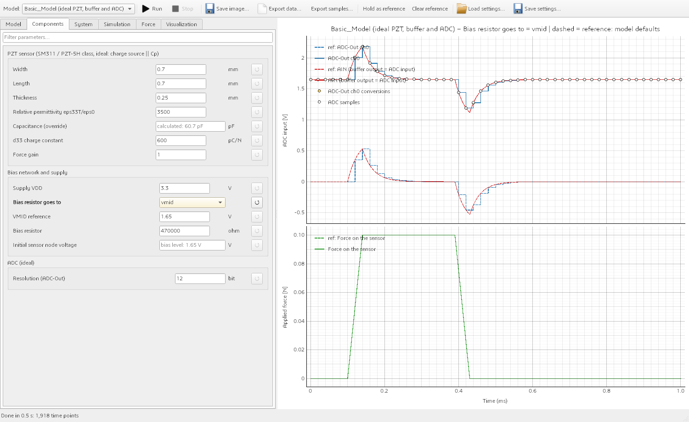

# Basic_Model

The simplest front end for the [Qspice Simulator](../Simulator/README.md): one PZT, an ideal unity buffer with a bias resistor, and an
ideal ADC. It is the reference to compare the real boards ([TestBoard_ADC124](../TestBoard_ADC124/README.md),
[TestBoard_7953](../TestBoard_7953/README.md)) against: everything they add (multiplexer, leakage, charge injection, parasitics,
op-amp limits, ADC input network) is missing here on purpose.

```text
 force --> PZT (charge source d33*dF/dt || Cp) --+--> ideal unity buffer --> ideal ADC (sampled at the sampling rate)
                                                 |
                                         bias resistor R
                                                 |
                                          ground  or  VMID
```



*The default 0.1 N pulse. Dashed: bias on ground, the output swings around 0 V. Solid: bias on VMID, the same swing around 1.65 V.
The stairs are the 12-bit ADC-Out, the circles the conversions every 20 us.*

## What is modelled

| Part | Model |
| --- | --- |
| PZT | Charge source `d33 * dF/dt` in parallel with `Cp = eps0 * eps33 * W * L / t` (SM311: 0.7 x 0.7 x 0.25 mm, 60.7 pF, 600 pC/N). No dielectric loss, no insulation leakage. `Cp` can be overridden. |
| Bias resistor | `R` (default 470 kohm) from the sensor node to **ground** (default) or to **VMID** (1.65 V). With `Cp` it makes a high-pass: time constant `R x Cp` = 28.5 us. |
| Buffer | Ideal unity-gain voltage source: no offset, no input current, no output resistance, infinite bandwidth, no rails. The ADC input *is* the buffer output. |
| ADC | Samples the buffer output instantly every `1 / sampling rate` (default 50 kHz, first sample at 0). Resolution `adc.bits` (default 12). The quantisation, noise and force calculation are done by the simulator from the saved node. |
| Parasitics, MUX | None. The only capacitance in the circuit is the PZT. |

### ADC range and the 3.3 V rail

The supply (`circuit.vdd_v`, default 3.3 V) sets the ADC range only, because an ideal buffer has no rails. The range follows the bias:

| Bias resistor to | Sensor node rests at | ADC range | LSB at 12 bit |
| --- | --- | --- | --- |
| ground (default) | 0 V | -VDD/2 .. +VDD/2 = **-1.65 .. +1.65 V** | 0.806 mV |
| VMID (1.65 V) | 1.65 V | 0 .. VDD = **0 .. 3.3 V** | 0.806 mV |

A force that drives the open-circuit swing beyond the range gives a warning above the plot, and the ADC-Out value is clipped (the model
has no input clamp). With the default sensor, +-1.65 V is reached at 0.167 N (before the bias resistor drains the sensor).

## Parameters

| Tab | Parameter | Default |
| --- | --- | --- |
| Components | sensor width / length / thickness, eps33, capacitance override, d33, force gain | 0.7 / 0.7 / 0.25 mm, 3500, calculated, 600 pC/N, 1 |
| Components | supply VDD, **bias resistor goes to** (`ground` / `vmid`), VMID level, bias resistor, initial sensor node voltage | 3.3 V, ground, 1.65 V, 470 kohm, bias level |
| Components | ADC resolution | 12 bit |
| System | **ADC sampling rate**, time of the first sample | 50 kHz, 0 us |
| Simulation | force pulses and sine waves (address 0), run duration, maximum time step (empty = automatic), solver tolerance, ADC noise and seed | 0.1 N pulse at 100 us, 1 ms, auto, 1e-6, 0 mV |

Presets (Simulation tab): `single_pulse` (default), `bias_vmid`, `sine_1khz` (3 cycles, 20 kHz sampling, 5 ms) and `slow_sampling`
(5 kHz: the sensor decays 99.9 % between two conversions, so most of the pulse is missed).

The *Derived values* box (System tab) shows the sampling period, the number of conversions, the ADC range and LSB, the bias time
constant and corner frequency, the decay of a held voltage per sample interval, and the force that reaches the ADC limits.

## Notes

- **Sampling rate and the bias resistor.** The sensor node is drained through `R` between the conversions. With the default values
  50.4 % of a held voltage is gone after one 20 us sample interval; at 5 kHz it is 99.9 %. The **Force** tab compensates this decay
  (the sensor is always connected, so the constant-connection formula applies: `dQ ~ Cp (V[k] - V[k-1]) + (V[k-1] - V_rest) / R * T`),
  and recovers the peak of the default pulse to within 0.01 % at 50 kHz (0.007 % at 12 bit, 0.0006 % at 16 bit, measured on a real
  QSPICE run) and returns to zero afterwards. On the ramps it lags by up to 4 mN, because it assumes the charge arrives uniformly
  between two conversions. When the sampling is too slow compared with `R x Cp` the information is simply gone, and no
  compensation can bring it back.
- **Solver.** The conversion instants are breakpoints of the solver (one periodic source), the force corners are breakpoints of the
  force source, and QSPICE refines the step where the circuit changes. The automatic maximum step is 1/20 of the sampling period and
  1/1000 of the run. The default tolerance `reltol = 1e-6` keeps the result within about 0.1 mV of an independent integration of the
  circuit equation (the QSPICE default 1e-3 gives 0.5 mV error on a 0.5 V signal).
- **One sensor.** The model has a single sensor, address 0; a force row with another address is rejected.
- **Not verified against hardware.** The sensor thickness (0.25 mm) is an assumption carried over from TestBoard_ADC124; use the
  capacitance override with a measured value.

## Files

| File | Purpose |
| --- | --- |
| `config.json` | Default configuration and the presets. |
| `simulator_model.json` | Manifest for the Simulator (parameter forms, tables, nodes, ADC-Out and force blocks). |
| `simulator_adapter.py` | Adapter: netlist, conversion instants, warnings, derived values, force-calculation data, `adc_range`. |
| `build_model.py` | Netlist generator; also usable alone: `python build_model.py --set circuit.bias_to=vmid --out Basic_Model.cir` writes a netlist that opens directly in QSPICE. |

The tests are in [../Simulator/tests/test_basic_model.py](../Simulator/tests/test_basic_model.py).
