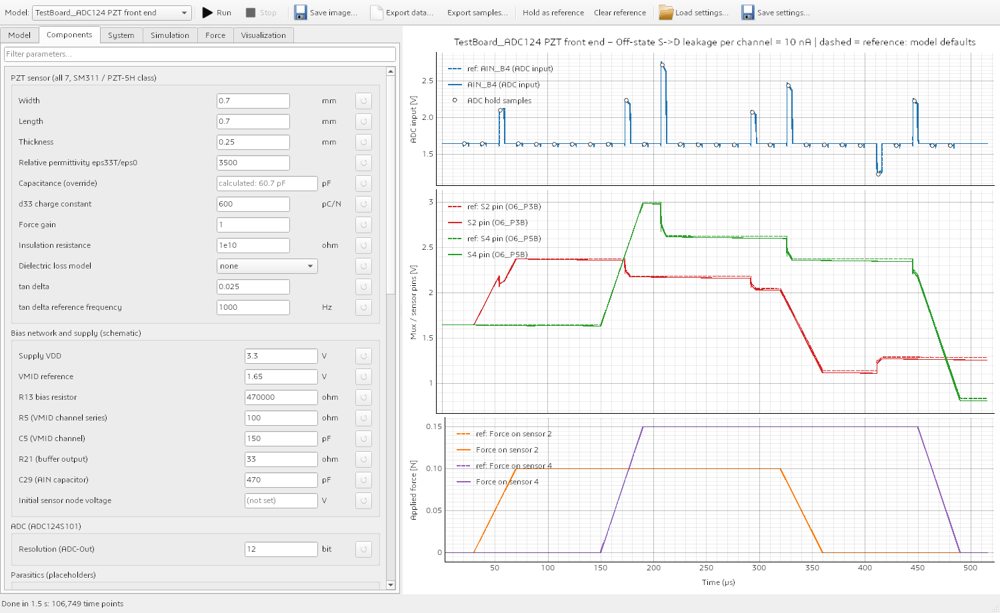
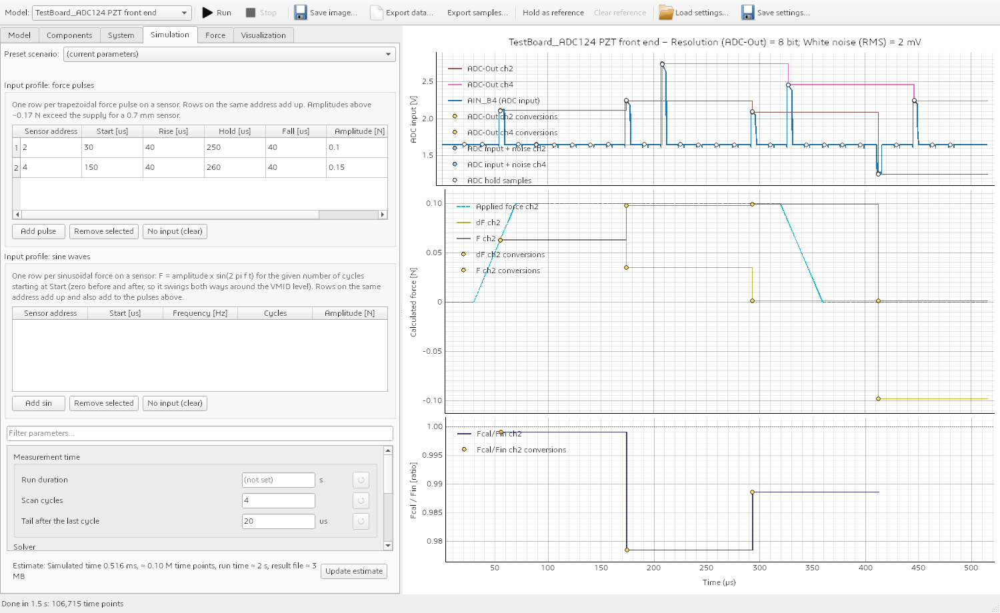
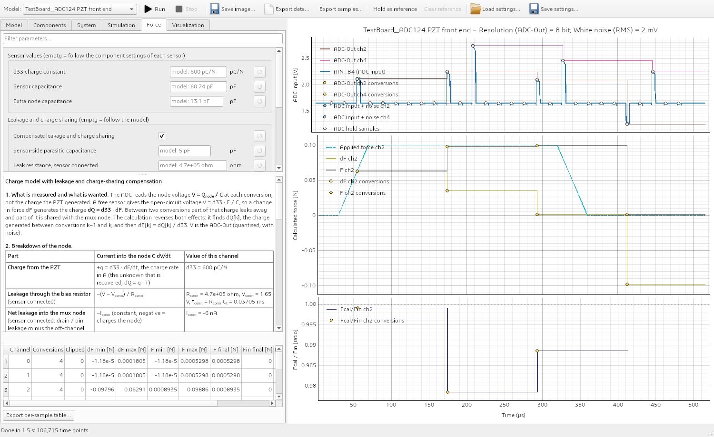
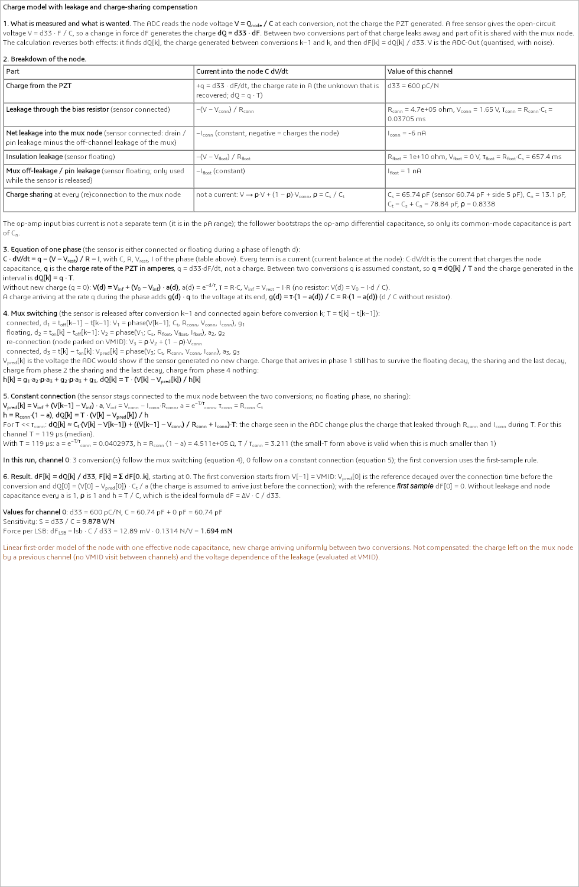

# Qspice Simulator

A GUI front end for QSPICE circuit models. Pick a model in the toolbar ([TestBoard_ADC124](../TestBoard_ADC124/README.md) and [TestBoard_7953](../TestBoard_7953/README.md) are included), change
component, system and simulation parameters, choose which nodes to display, run QSPICE, look at the node waveforms, save the image and
run again with different parameters. Any folder that follows the [model contract](#adding-a-model) shows up in the model list.



*Two-pulse scenario of TestBoard_ADC124 with the mux leakage raised from 1 nA to 10 nA. The dashed traces are the held reference run
(1 nA), the solid traces the new run; the plot title lists the parameters that were changed.*

## Start

```bash
pip install PyQt6 pyqtgraph numpy          # already dependencies of this repository
python Qspice/Simulator/run_simulator.py                     # or: python -m qspice_sim  (from Qspice/Simulator)
python Qspice/Simulator/run_simulator.py --model TestBoard_ADC124 --qspice "C:\Program Files\QSPICE\QSPICE64.exe"
python Qspice/Simulator/run_simulator.py --models D:\my_models     # extra folder of models
```

QSPICE is found via `--qspice`, the Model tab, the `QSPICE_EXE` environment variable or `C:\Program Files\QSPICE\QSPICE64.exe`.
Models are looked up in `Qspice/*/` plus the folders in `--models` and `QSPICE_MODEL_PATH`.

## Screens

| Tab | What you do there |
| --- | --- |
| **Model** | Pick the model (also in the toolbar), read its description, set the QSPICE path, add another model folder, reset every parameter to the model defaults, reload the model files after editing them. |
| **Components** | Edit component parameters (sensor material and size, bias network, mux leakage / capacitances / charge injection, op-amp, parasitics). A typed value is applied on Enter, when you leave the field, and also when you press Run (F5), Hold as reference, Save settings or Update estimate. Values accept engineering notation (`1e10`, `470k`, `1.5n`, `2meg`). Changed values are highlighted, the ↺ button resets one value, the filter box finds a parameter by name. |
| **System** | System-level parameters of the scan: scan order, settle / acquisition / conversion / VMID times and the per-sensor sampling rate (when set, the park time is derived from it). The *Derived values* box shows the resulting cycle time, sampling rate, sensor capacitance and sensitivity. |
| **Simulation** | Input profile (table of force pulses: sensor, start, rise, hold, fall, amplitude; second table of sine waves, **Add sin**: sensor, start, frequency, number of cycles, amplitude), preset scenarios, measurement time (run duration or number of scan cycles), solver step, and the *ADC output* group (white noise and its seed, see [ADC-Out](#adc-out-quantised-adc-result)). *Update estimate* predicts number of time points, run time and result size. |
| **Force** | Only for models that support it. Parameters of the [force calculation](#force-tab-force-from-the-adc-values) (d33, capacitance, gain, reference, voltage source, sensors), the formulas with live numbers and a per-sensor result table. |
| **Visualization** | Tick the nodes to display (grouped by plot panel; *Other nodes* lists every node found in the netlist; the ADC-Out, dF, F and Fcal/Fin traces are listed per channel), layout (stacked per group / one plot per node / single overlay), time window, line width, sample markers, noisy-input markers, applied-force overlay, a *Log scale (Y)* checkbox per plot panel, reference overlay, title annotation. |

Toolbar: **Run** (F5), **Stop** (Esc), **Save image…** (PNG or SVG), **Export data…** (CSV of the visible time range, including
the derived traces held between the conversions of their channel), **Export samples…** (CSV of every ADC conversion: `t, label,
address, v_in, noise_mv, code, v_out, clipped`), **Hold as reference** / **Clear reference**, **Load / Save settings…** (all
parameters, force-calculation settings and display options as JSON).

## Typical workflow

1. Choose a preset on the Simulation tab (for example `two_pulses`) or edit the input profile.
2. Change parameters, for example *Components → Off-state S→D leakage per channel*.
3. Pick the nodes on the Visualization tab and press **Run**. Only the selected nodes are saved by QSPICE, which keeps long runs small.
4. Zoom with the mouse wheel / drag; the plot re-decimates (min/max envelope), so spikes survive even with tens of millions of points.
5. **Save image…**, or **Hold as reference**, change a parameter and **Run** again to compare against the dashed reference. The reference stays until you clear it or confirm a replacement (pressing *Hold as reference* again asks first), so any number of runs with different settings can be compared against the same original reference; the plot title shows the changed parameters of the current run and of the reference.
6. Changing the node selection after a run re-plots instantly when the nodes were saved; otherwise press Run again.

Long simulations: QSPICE does about 60 000 time points per second. A 60 ms run at the model's 5 ns step is ~12 M points (~4 minutes,
~100–200 MB per saved node). The Run button warns when the estimate exceeds 90 s or 500 MB; the run can be stopped at any time.
A coarse maximum step is much faster but unreliable for models with ns-wide events (see the TestBoard_ADC124 reports).

Run files are written to `Qspice/Simulator/runs/<model>/` (git-ignored) and overwritten by the next run.

## ADC, noise and force features



*TestBoard_ADC124 with an 8-bit ADC and 2 mV of noise: ADC-Out of channels 2 and 4 (stair held until the channel's next
conversion, markers at the conversion instants, the noisy input as small markers), dF and F of channel 2 with the applied force
dashed, and the ratio Fcal/Fin with its reference line at 1.*

### Sensor capacitance override
`sensor_defaults.cp_pF` (Components tab, *Capacitance (override)*) replaces the capacitance `Cp = eps0 * eps33 * W * L / t` of the
sensor. Empty (`null`, the default) keeps the formula; the empty field shows `calculated: 60.7 pF` as a hint. A single sensor can
be overridden with `sensor_overrides["<address>"]["cp_pF"]`. Everything derived from Cp follows: the netlist, the loss resistor of
the `parallel_r` model, the open-circuit warnings, the *Derived values* (`60.7 pF (calculated)` / `(override)`) and the defaults of
the Force tab. A value of 0 or less is rejected.

### ADC range and bipolar supply (VMID)
With `circuit.vmid_v` above 0 the ADC input range is `0 .. Vref` (7953: `circuit.vref_v`; ADC124: `circuit.vdd_v`). With `vmid_v = 0`
the range is `-Vref .. +Vref`, twice the span, so one LSB is `2 * Vref / 2^bits`. The *Derived values* box shows the active range and
the LSB. In the second case the models give the buffer op-amp symmetric rails `-Vref .. +Vref` (a `Vss` source) and the banner says
*bipolar analog supply assumed (real ADS7953 / ADC124S101 inputs cannot go below 0 V)*; the sensor-swing warnings use the active
range, and the initial sensor node (empty by default) follows VMID. A model that cannot switch to a bipolar supply sets
`"bipolar_rails": false` in `adc_out`; the simulator then warns that the circuit keeps its single rails. The mux cells of both models
have no supply pin, so only the op-amp rails change.

### ADC-Out (quantised ADC result)
A derived node per sensor channel (`ADC-Out ch<k>`, group *ADC chain*): the sample node of the model (`sh` for the 7953, `ain` for
the ADC124) at the adapter's conversion instants of that channel, rounded to the ADC resolution (`adc.bits`, default 12) and converted
back to volts: `lsb = (v_high - v_low) / 2^bits; code = clip(floor((v - v_low) / lsb + 0.5), 0, 2^bits - 1); v_out = v_low + code * lsb`
(round to nearest, halves up). It needs no new simulation: changing the resolution or the noise only replots. Ticking a channel
adds the sample node to the nodes QSPICE saves. The trace is a stair held until the channel's next conversion with markers at the
conversions; the existing *ADC hold samples* markers keep showing the ideal value, so the quantisation error is visible. Inputs outside
the range are clipped and counted (*N sample(s) clipped* in the status bar and the *Clipped* column of the Force tab). A channel with
no conversion in the run shows nothing and is named in the status bar. By default the first scanned channel and every channel that has
an applied force are ticked.

### White noise
*Simulation → ADC output → White noise (RMS)* [mV] and *Noise seed*. The value is the standard deviation of independent Gaussian noise
added to the ADC input value at every conversion, before the quantisation: `v_out = quant(v_in + N(0, sigma))`. It is applied at the
conversion instants, not to the continuous waveform (sampling an ideal white source gives independent samples), so it is white by
construction. The same seed gives the same noise, so runs stay comparable against a held reference. ADC-Out includes the noise, the
ideal markers do not; *Show the ADC input + noise at the conversions* marks the noisy input. An in-circuit noise source (seen by the
buffer and the sampling network) would need millions of PWL points at the 5 ns step and is not part of this tool.

### Force tab: force from the ADC values


The formula panel of the tab, in full (breakdown of the node, equation of a phase, mux switching, constant connection):



The tab (between Simulation and Visualization, hidden for models without `force_calc`) extracts the force from the charge the sensor
generated. With *Compensate leakage and charge sharing* off (or for a model that gives no leakage data) it uses the **ideal charge
model**:

| | |
| --- | --- |
| Open-circuit sensor voltage | `V = d33 * F / C`, `C = C_sensor + C_extra` |
| Change in force between two consecutive conversions of the same sensor | `dF[k] = (V[k] - V[k-1]) * C / d33`; `V[-1]` = VMID or the first sample |
| Total force | `F[k] = sum(dF[0..k])`, starting at 0 |
| Sensitivity, force per LSB | `S = d33 / C` [V/N]; `dF_LSB = lsb * C / d33` [N] |

Parameters: d33 [pC/N], sensor capacitance [pF], extra node capacitance [pF] (default 0), reference of
the first sample (VMID / first sample), voltage source (ADC-Out quantised with noise / ideal ADC input), the sensors to extract (empty =
every channel with conversions) and the minimum |Fin| of the ratio. By default d33 (including the component's force gain) and the
capacitance (override or calculated) of each sensor come from the component settings; a value typed here replaces them for the
calculation only, is highlighted like any changed parameter, and the ↺ button returns to *follow the components* (the empty field
shows the inherited value as `model: 600 pC/N`). The settings are saved with *Save settings* and never re-run QSPICE. The table lists
per sensor the number of conversions and clipped samples, min / max of dF and F, the final F, the applied force at the end of the
run and the final error; *Export per-sample table…* writes `t, address, V, dF, F, Fin`.

The ideal model ignores the charge sharing with the multiplexer node, the leakage and the bias-resistor decay, so `F` drifts and
differs from the applied force when the real circuit deviates. (TestBoard_7953, 0.05 N pulse: a short pulse is recovered at about 73 %
because the 10 pF multiplexer node takes part of the charge; during a long pulse the bias resistor drains the sensor and F falls to
44 % of that in four sweeps.)

#### Leakage and charge-sharing compensation (default)
The voltage at a conversion is not the charge that was generated: between two conversions of one sensor the node loses charge
exponentially (R x C) through the bias resistor while the sensor is connected and through the insulation and mux / pin leakage while it
floats, and at every connection the sensor shares its charge with the mux node. The tab recovers the **generated** charge from the
system parameters and the timing:

| Phase | Capacitance | Leak resistance to rest voltage | Constant current |
| --- | --- | --- | --- |
| connected (sensor joined with the mux node) | `Ct = Cs + Cn` | `R_conn` to `V_conn` (VMID) | `I_conn` |
| floating | `Cs` = sensor + side parasitics | `R_float` to `V_float` (0 V) | `I_float` (positive discharges the node) |
| re-connection (node parked on VMID) | | | `V -> rho V + (1 - rho) V_conn`, `rho = Cs / Ct` |

What the node sees (breakdown of `C dV/dt`):

| Part | Current into the node | Where the value comes from |
| --- | --- | --- |
| Charge from the PZT | `+q = d33 * dF/dt`, charge rate in A (the unknown; `dQ = q * T`) | `d33` |
| Leakage through the bias resistor (connected) | `-(V - V_conn) / R_conn` | `R_conn` = bias resistor, `tau_conn = R_conn * Ct` |
| Net leakage into the mux node (connected: drain / pin leakage minus the leakage of the off channels) | `-I_conn` (constant, negative charges the node) | `I_conn` |
| Insulation leakage (floating) | `-(V - V_float) / R_float` | `R_float` = insulation, `tau_float = R_float * Cs` |
| Mux off-leakage / pin leakage (floating) | `-I_float` (constant) | `I_float` |
| Charge sharing at every (re)connection | not a current: `V -> rho V + (1 - rho) V_conn` | `Cs`, `Cn`, `rho = Cs / Ct` |

The op-amp input bias current is not a separate term; the follower bootstraps the op-amp differential capacitance, so only its
common-mode capacitance is part of `Cn`.

**Equation of one phase** of length `d`: `C dV/dt = q - (V - V_rest)/R - I`. Every term is a current (current balance at the node):
`C dV/dt` charges the node capacitance, and `q` is the **charge rate of the PZT in amperes**, `q = d33 * dF/dt`, not a charge. Between
two conversions `q` is assumed constant, so `q = dQ[k] / T` and the charge generated in the interval is `dQ[k] = q * T`. Without new charge (`q = 0`):
`V(d) = V_inf + (V0 - V_inf) * a(d)`, `a(d) = exp(-d / tau)`, `tau = R C`, `V_inf = V_rest - I R` (no resistor: linear drift
`V0 - I d / C`). A charge arriving at the rate `q` during the phase adds `g(d) * q` at its end, `g(d) = R (1 - a(d))` (`d / C` without
a resistor).

**With mux switching** (the sensor is released after conversion `k-1` and connected again before conversion `k`, `T = t[k] - t[k-1]`):

```text
connected,   d1 = t_off[k-1] - t[k-1]:   V1 = phase(V[k-1]; Ct, R_conn,  V_conn,  I_conn)    -> g1
floating,    d2 = t_on[k]  - t_off[k-1]: V2 = phase(V1;      Cs, R_float, V_float, I_float)   -> a2, g2
re-connect:                              V3 = rho V2 + (1 - rho) V_conn
connected,   d3 = t[k]    - t_on[k]:     V_pred[k] = phase(V3; Ct, R_conn, V_conn, I_conn)   -> a3, g3
h[k]  = g1 a2 rho a3 + g2 rho a3 + g3              (charge of phase 1 must survive phases 2..4, and so on)
dQ[k] = T * (V[k] - V_pred[k]) / h[k]
```

**With a constant connection** (the sensor stays connected to the mux node, see *Park on VMID* off: no floating phase, no sharing):

```text
V_inf = V_conn - I_conn R_conn      tau_conn = R_conn Ct      a = exp(-T / tau_conn)
V_pred[k] = V_inf + (V[k-1] - V_inf) a        h = R_conn (1 - a)
dQ[k] = T * (V[k] - V_pred[k]) / h
dQ[k] ~ Ct (V[k] - V[k-1]) + ((V[k-1] - V_conn) / R_conn + I_conn) T          (T << tau_conn)
```

The small-`T` limit is the charge seen in the ADC change plus the charge that leaked through `R_conn` and `I_conn` during `T`.

In both cases `V_pred[k]` is the voltage the ADC would show without new charge, `dF[k] = dQ[k] / d33` and `F = cumsum(dF)`. The Force
tab shows all of this with the numbers of the first extracted channel (`tau`, `rho`, `T`, `a`, `h`) and says how many conversions of
that channel follow the switching case and how many the constant-connection case. The new charge is assumed to arrive uniformly
during `T`.

Without leakage and node capacitance this is exactly `dF = dV * C / d33`. The first conversion starts from the reference (VMID);
with *Reference for the first sample = first sample* dF[0] is 0 as before. The model supplies, from the same config keys that build the
netlist, `sensor_info()[address]["leak"]` (`c_side_F`, `c_node_F`, `r_conn_ohm`, `v_conn_V`, `i_conn_A`, `r_float_ohm`, `v_float_V`,
`i_float_A`) and each conversion of `samples` carries `t_on`, `t_off` and `node_reset`. In the Force tab the checkbox, the sensor-side
capacitance, `R_conn`, `R_float`, `I_float` (leakage while the sensor floats) and `I_conn` (net leakage while it is connected) can be overridden (empty = follow the model; the hint shows the model value) and the
*Extra node capacitance* field is the mux node capacitance `Cn` in this mode. All of it replots without a run and is saved with the
settings.

Measured against real QSPICE runs of the models (0.05 N applied, 16-bit ADC):

| Case | Ideal model | Compensated |
| --- | --- | --- |
| TestBoard_7953, 15 us pulse, first conversion | 0.0364 N | 0.0484 N |
| TestBoard_7953, 200 us pulse, 4 conversions | 0.0364 -> 0.0162 N | 0.0484 -> 0.0461 N |
| TestBoard_ADC124, 2 ms pulse, conversions 1..17 | 0.0368 -> 0.0013 N | 0.0499 -> 0.0526 N (within +5 %) |

What the model does **not** compensate (it says so in the tab): the charge a previous channel left on the mux node when the mux goes
from one sensor straight to the next without a VMID visit (`node_reset` false; the note counts those conversions), the voltage
dependence of the leakage (evaluated at VMID), and any difference between the model's effective node capacitance and the real one;
the remaining error is a few percent (slow creep in the table above). The op-amp differential capacitance is not counted in `Cn`
because the follower bootstraps it.

### dF, F and Fcal/Fin traces, log scale
Per channel the node tree lists `dF ch<k>` and `F ch<k>` (group *Calculated force [N]*) and `Fcal/Fin ch<k>` (group *Fcal / Fin
[ratio]*). They are plotted at the conversion instants like ADC-Out and take part in Save image, Export data, the held reference
and the time window. `Fin[k]` is the applied force of the channel (node `f<k>`) at the conversion instant, interpolated; the ratio is
`F[k] / Fin[k]` (1 = perfect, below 1 = under-estimated, above 1 = over-estimated) and is left out (NaN, no line) where `|Fin|` is
below *Minimum |Fin| for the ratio* (default: 1 % of the largest |Fin| of the channel in the run; an exact zero is always left out).
The panel has a dotted line at 1. The applied-force nodes of the forced channels are saved whenever a derived node is ticked, so the
table and the ratio can compare with them; if a node was not saved the status bar says *press Run to include it*.
*Overlay the applied force* draws it dashed on the Calculated-force panel.

*Log scale (Y)* (one checkbox per plot panel, saved with the settings): the panel shows the magnitude `|y|` with zeros omitted and the
axis label reads `|panel| (log)`, because forces and dF are bipolar; the ratio is normally positive, so for it the log scale is a
direct view. Min/max decimation, zoom, the reference overlay and the markers work in log mode. In the *one plot per node* layout a node
follows its group's setting; the single overlay panel is logarithmic only when every plotted group is.

### Assumptions of these features
- ADC-Out / the noise / the force are derived from the *current* settings of `adc.bits`, noise and the force tab, with the reference
  voltage and VMID of the configuration the run used (they shape the circuit), so editing them replots without running.
- The Force-tab override applies to every extracted sensor (the per-sensor values come from `sensor_info` of the adapter).
- Leakage compensation is on by default; it assumes that the new charge arrives uniformly between two conversions and that the mux
  node was parked on VMID before every connection (`node_reset`); a model without `leak` data or without connection times falls back to
  the ideal formula and the tab says so.
- Rounding is to nearest with halves up; a sample counts as clipped when the input (with noise) lies outside `v_low .. v_high`.
- The default ratio threshold of 1 % of the largest |Fin| is a choice of this tool, editable in newtons on the Force tab.
- The extra node capacitance defaults to 0 (the models do not report one); the sensor and parasitic capacitances of the netlist are not added.
- TestBoard_ADC124 *Park on VMID* off: the last channel stays connected during the park time and a visit to the already connected channel has no settle
  wait (assumed, as the MG24 dual-MUX firmware `muxSelect` skips an unchanged channel); the VMID visit and VMID settle settings are ignored and the tail keeps the channel connected.
  The first connection of the run still pays the settle. TestBoard_7953 has no such toggle.

## Adding a model

A model is a folder directly below `Qspice/` (or below a folder passed with `--models`) containing:

| File | Purpose |
| --- | --- |
| `simulator_model.json` | Manifest: name, description, parameter forms, input tables, plot groups, node list. |
| `config.json` (name set in the manifest) | Default configuration: any nested JSON. Dotted paths (`mux.ileak_s_off_nA`) address values. An optional `"scenarios": {name: {"description", "overrides": {path: value}}}` entry defines the presets. |
| `simulator_adapter.py` (name set in the manifest) | Python module that turns a configuration into a SPICE netlist. |

Adapter contract (any extra files, models, libraries stay in the model folder; the adapter loads them itself):

```python
def build(cfg: dict) -> dict:
    return {"netlist": "<SPICE text with a .tran statement>",
            "t_stop": 5.7e-4,                                  # seconds
            "samples": [{"t": 1.2e-6, "label": "addr 0", "address": 0,     # conversion instants (markers); "address" = sensor channel, needed by ADC-Out / Force
                         "t_on": 0.03e-6, "t_off": 5.0e-6, "node_reset": True}],   # optional: connection window of the sensor (leakage compensation)
            "warnings": ["optional message shown above the plot"]}
    # raise ValueError("readable message") for invalid parameters

def summary(cfg: dict) -> list[tuple[str, str]]:               # optional, shown as "Derived values" on the System tab
    return [("Scan cycle", "133 us")]

def field_hints(cfg: dict) -> dict[str, str]:                  # optional: placeholder text of an empty nullable field
    return {"sensor_defaults.cp_pF": "calculated: 60.7 pF"}

def sensor_info(cfg: dict) -> dict[int, dict]:                 # optional (needs force_calc): per-sensor defaults of the Force tab
    return {0: {"d33_C_per_N": 600e-12, "cp_F": 60.7e-12, "cextra_F": 0.0,
                "leak": {"c_side_F": 5e-12, "c_node_F": 13e-12, "r_conn_ohm": 470e3, "v_conn_V": 1.65, "i_conn_A": 1e-9,
                         "r_float_ohm": 10e9, "v_float_V": 0.0, "i_float_A": 1e-9}}}   # "leak" optional: see "Leakage and charge-sharing compensation"
```

Manifest keys:

```jsonc
{
  "name": "...", "description": "...", "config": "config.json", "adapter": "simulator_adapter.py",
  "components": [ {"group": "MUX", "items": [ {"path": "mux.ron_ohm", "label": "On resistance", "unit": "ohm",
                                               "type": "float", "tip": "tooltip", "nullable": false} ]} ],
  "system": [ ... ], "simulation": [ ... ],            // same structure; types: float, int, bool, choice (+ "choices"), intlist
  "tables": [ {"path": "forces", "title": "...", "columns": [{"key": "amp_N", "label": "Amplitude [N]", "type": "float"}],
               "new_row": {"amp_N": 0.1}, "add_label": "Add pulse"} ],   // editable list-of-dicts (the input profile); add_label = text of the add button
  "plot_groups": [ {"id": "adc", "title": "ADC input [V]"} ],     // one stacked plot panel per group
  "nodes": [ {"name": "ain", "label": "AIN_B4", "group": "adc", "default": true} ],
  "sample_marker": {"node": "ain", "label": "ADC hold samples"},  // optional: marks the adapter's sample times on this node
  "adc_out": {"node": "ain", "label": "ADC-Out (quantised)", "group": "adc", "channels": 7,   // optional: derived ADC-Out nodes
              "bits_path": "adc.bits", "vref_path": "circuit.vdd_v", "vmid_path": "circuit.vmid_v",
              "noise_mv_path": "simulation.adc_noise_mV", "noise_seed_path": "simulation.noise_seed",   // optional
              "bipolar_rails": true},                         // the model switches to symmetric rails when VMID = 0
  "force_calc": {"enabled": true, "force_node": "f{k}", "force_tables": ["forces", "forces_sin"]}   // optional (needs adc_out and sensor_info)
}
```

- Every `path` must exist in the default configuration; the Model tab lists manifest problems. The validation also checks the `adc_out` /
  `force_calc` blocks (paths exist, `bits` is an integer of at least 2, the group exists, the generated derived-node names
  `adcout_ch<k>`, `df_ch<k>`, `fcal_ch<k>`, `fratio_ch<k>` do not collide with a real node).
- `adc_out` adds one derived node per channel (`channels` = number of sensor channels, addresses `0 .. channels-1`): the value of `node`
  at the adapter's conversion instants of that channel, quantised with `bits_path`, `vref_path`, `vmid_path`. `force_calc` adds the Force
  tab and the dF / F / Fcal/Fin nodes; `force_node` names the applied-force node of a channel and `force_tables` the configuration tables
  whose rows (key `address`) say which channels have an applied force. Derived nodes are listed in the node tree and plot groups like
  real nodes; ticking one adds its source nodes to the `.save` list.
- A nullable field (`"nullable": true`) stores `null` when it is emptied; `field_hints` supplies the placeholder text.
- The simulator replaces all `.save` lines of the netlist by `V(node)` for the ticked nodes, so adapters do not need to save anything.
  Nodes found in the netlist but not listed in the manifest appear under *Other nodes*.
- Only node voltages and transient analysis are supported. (QSPICE turns `.save I(R1)` into an alias instead of a saved column.)
- Models are loaded with a unique module name, so several models may each have their own helper files (use the `_load_sibling` pattern of
  [TestBoard_ADC124/simulator_adapter.py](../TestBoard_ADC124/simulator_adapter.py)).

## Code layout

```
Simulator/
  run_simulator.py          entry point
  qspice_sim/
    model_loader.py         model discovery, manifest validation, adapter loading
    runner.py               QSPICE discovery, prepare/estimate, run with progress and cancel
    netlist_tools.py        .save handling, node discovery, .tran parsing
    qraw.py                 binary .qraw reader (memory-mapped)
    decimate.py             min/max envelope for fast zoomable plots
    config_utils.py         dotted-path access, engineering-notation parser
    adc_model.py            ADC range, quantisation, white noise, conversion table, stair traces (derived ADC-Out)
    force_calc.py           ideal charge model: dF, F, Fcal/Fin, formulas text
    gui/                    main_window.py, param_form.py (schema forms + table editor), plot_panel.py (incl. log mode),
                            force_tab.py, worker.py
  tests/                    pytest: core, real QSPICE runs, headless GUI (Qt offscreen)
  tools/make_screenshots.py regenerates docs/*.png
```

## Tests

```bash
python -m pytest Qspice/Simulator/tests          # the QSPICE and GUI-run tests are skipped when QSPICE is missing
```

They cover parameter parsing, netlist handling, decimation, model discovery, a real QSPICE run, the effect of a changed leakage on the
simulated baseline, cancellation, periodic-control runs and the headless GUI (editing, presets, run, reference overlay, image export),
and the ADC / force features: a regression test that pins the netlists of both models with every new setting at its default
(`tests/baseline_netlists.json`; regenerate it only for a deliberate model change), the capacitance override, the VMID-dependent range
and rails, quantisation, noise statistics, the force formulas, the derived traces, the log scale and a real QSPICE run that drives a known
force through the TestBoard_7953 model. The GUI tests of the derived traces use a fake result set (`tests/derived_helpers.py`), so they
run without QSPICE.

## Limitations

- One transient simulation at a time; results of earlier runs are replaced (use *Hold as reference* to keep one for comparison).
- The result plot shows saved node voltages only; measurement post-processing specific to a model (for example the ADC-hold sample
  tables of the TestBoard_ADC124 reports) stays in that model's scripts. The sample markers show where those samples are taken.
- ADC-Out, the noise and the force are computed at the adapter's conversion instants from the saved sample node, not simulated: the noise
  never reaches the circuit, and a result without the sample node (not ticked in the run) shows *press Run to include them*.
- The force calculation is the ideal charge model of the Force tab; the real circuit deviates from it (charge sharing, bias decay).
- The time estimate is a rough rule (simulated time / maximum step ÷ 60 000 points per second) measured on the TestBoard_ADC124 model.
