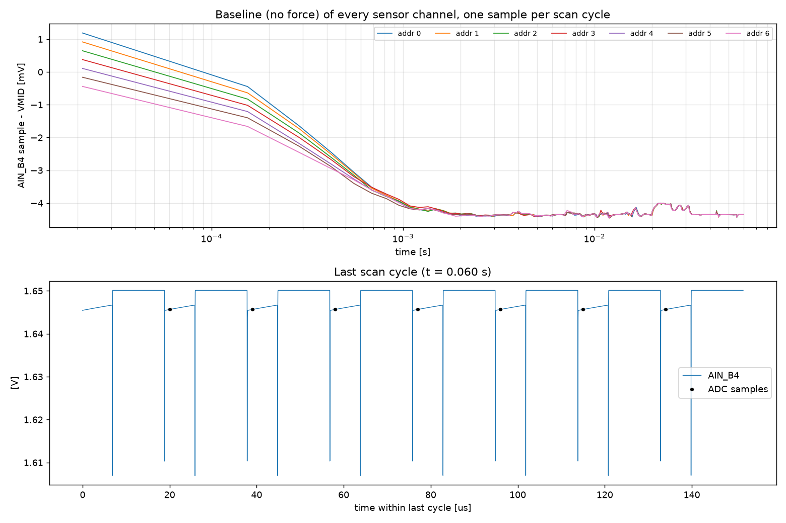
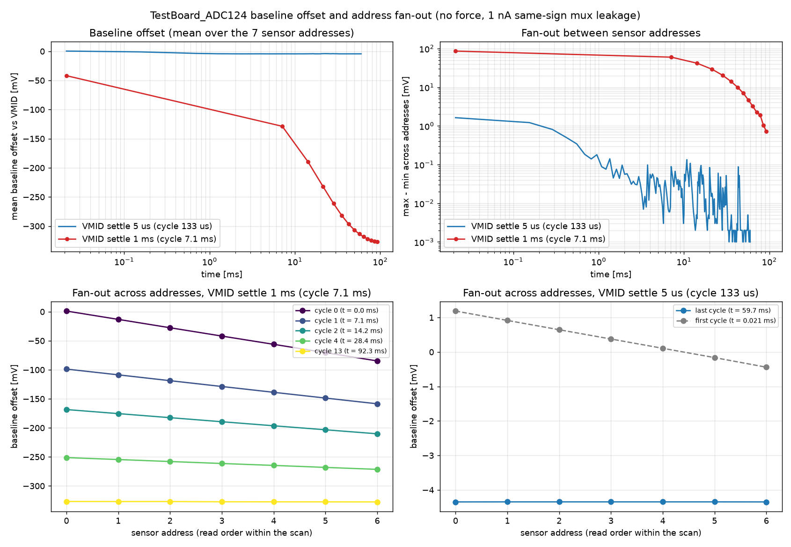

# Report: baseline with no force, VMID settle 5 µs

Scenario `baseline` of the QSPICE model in `Qspice/TestBoard_ADC124/`. Simulated, not measured.

## Question

With no force on any sensor, where does the `AIN_B4` baseline of each sensor channel sit relative to VMID (1.65 V), how long does it take to settle, and how much do the seven addresses differ from each other (fan-out)?

## Setup

| Item | Value | Basis |
| --- | --- | --- |
| Sensors | 7 × SM311 (PZT-5H), 0.7 × 0.7 × 0.25 mm | size and thickness from the user |
| Sensor model | d33 = 600 pC/N, εr = 3500, Cp = 60.7 pF, 9.88 V/N open circuit, insulation 1e+10 Ω, loss model "none" | Steminc material table (SM311) |
| MUX | TMUX1308A at 3.3 V: Ron 120 Ω, CS(off) 2.0 pF, CD(off) 7.0 pF, CON 11.0 pF, Qinj -0.8 pC, leakage 1.0 nA (S→D, same sign on all channels) and 1.0 nA (D), ton 25 ns | datasheet SCDS477A typical values |
| Buffer | OPA365 behavioral: GBW 50 MHz, slew 25 V/µs, Ro 30 Ω, Ibias 0.2 pA | datasheet SBOS365G typical values |
| Bias / output | R13 = 470 kΩ to VMID (1.65 V), R21 = 33 Ω, C29 = 470 pF, VMID channel 100 Ω + 150 pF | schematic |
| Timing per address | settle 1.0 µs, ADC word 1.0 µs (hold at +187.5 ns after settle), after-conversion 5.0 µs, VMID settle 5 µs, VMID park 7.0 µs | user; park time is a placeholder |
| Scan | 7 addresses, 19 µs each, one cycle = 133 µs | derived |
| Simulator | QSPICE, transient, 5 ns maximum step | |

No force is applied. Sensor nodes start at VMID (initial condition). One ADC-hold sample per address per scan cycle is taken from `AIN_B4`; the table below lists the offset of that sample from VMID.

## Results



| Cycle | t [ms] | addr 0 | addr 1 | addr 2 | addr 3 | addr 4 | addr 5 | addr 6 | mean | fan-out (max−min) |
| --- | --- | --- | --- | --- | --- | --- | --- | --- | --- | --- |
| 0 | 0.021 | +1.19 | +0.92 | +0.65 | +0.38 | +0.11 | -0.16 | -0.44 | +0.38 | 1.629 |
| 1 | 0.154 | -0.45 | -0.64 | -0.83 | -1.02 | -1.21 | -1.40 | -1.66 | -1.03 | 1.217 |
| 4 | 0.553 | -3.06 | -3.09 | -3.15 | -3.19 | -3.26 | -3.40 | -3.29 | -3.21 | 0.343 |
| 10 | 1.351 | -4.24 | -4.24 | -4.25 | -4.11 | -4.16 | -4.17 | -4.16 | -4.19 | 0.141 |
| 30 | 4.011 | -4.30 | -4.30 | -4.31 | -4.30 | -4.25 | -4.25 | -4.25 | -4.28 | 0.056 |
| 60 | 8.001 | -4.37 | -4.33 | -4.33 | -4.34 | -4.34 | -4.31 | -4.33 | -4.34 | 0.051 |
| 112 | 14.917 | -4.27 | -4.34 | -4.33 | -4.33 | -4.33 | -4.34 | -4.34 | -4.33 | 0.063 |
| 449 | 59.738 | -4.35 | -4.35 | -4.35 | -4.35 | -4.35 | -4.35 | -4.35 | -4.35 | 0.001 |

(offsets in mV relative to VMID; fan-out in mV)



## Findings

1. **Offset.** The baseline settles to **−4.35 mV** relative to VMID (1.64565 V). The first cycle starts at +1.2 mV only because the sensors are initialised at VMID.
2. **Settling.** The offset reaches −3.9 … −4.1 mV after 1 ms and is within about 0.3 mV of its final value from ~5 ms on. The time constant is about 0.5 ms: the sensor node recharges through R13 (470 kΩ) while connected, which happens for 7 µs out of every 133 µs, so the effective resistance is ≈ 470 kΩ × 133/7 ≈ 9 MΩ against Cp = 61 pF.
3. **Fan-out.** The addresses differ by up to 1.6 mV in the first cycle (later addresses have been connected later, so they started leaking later), 0.18 mV at 1 ms and 0.001–0.01 mV once settled: all seven addresses read the same −4.35 mV.
4. **Origin of the offset.** Off-state mux leakage (1 nA per off channel plus 1 nA at the drain) against the 470 kΩ bias: ≈ 1 nA × 9 MΩ ≈ 9 mV as an upper estimate; the simulation gives −4.4 mV. (This attribution is an estimate, not a separate simulation.)
5. **Solver wobble.** Between about 15 and 35 ms the sampled value wobbles by up to ±0.2 mV; this is numerical noise of the 5 ns-step simulation, not a physical drift (cycle-to-cycle std over the last 100 cycles is 0.01 mV).
6. **Why 60 ms and not 3 s.** All time constants are ≤ ~1 ms, so the value at 3 s equals the 5–60 ms steady state. A brute-force 3 s run at 5 ns would need ~6·10⁸ time points (~10 GB); a 3 s run with a 1 µs step cap was tried and rejected because the 2 ns charge-injection edges are not resolved and the sample jumped by ±5 mV from cycle to cycle.
7. **VMID slots** read +0.1 mV vs VMID in the last cycle (VMID source resistance and mux leakage), i.e. the VMID visit resets the D node.

## Caveats

- Placeholder inputs (not verified against hardware): `t_vmid_park_us`, the 10 GΩ sensor insulation resistance, the layout parasitics, VMID as an ideal source.
- The ADC input (sample-and-hold capacitor, kickback) is not modelled; `AIN_B4` is the node behind R21/C29.
- Mux leakage is applied with the same sign (S→D) and size (1 nA, 25 °C typical) on every channel, which is a worst case for offset. Real parts vary per channel and leak far more when hot (±25 nA max at 85 °C).
- The mux injection-current clamp (pins above VDD or below GND) is not modelled.

## Reproduce

```bash
python run_simulation.py --scenario baseline
python run_simulation.py --compare baseline,baseline_vmid1ms
python build_reports.py
```

Source data: `results/baseline/samples_decimated.csv` and `summary.csv`.
