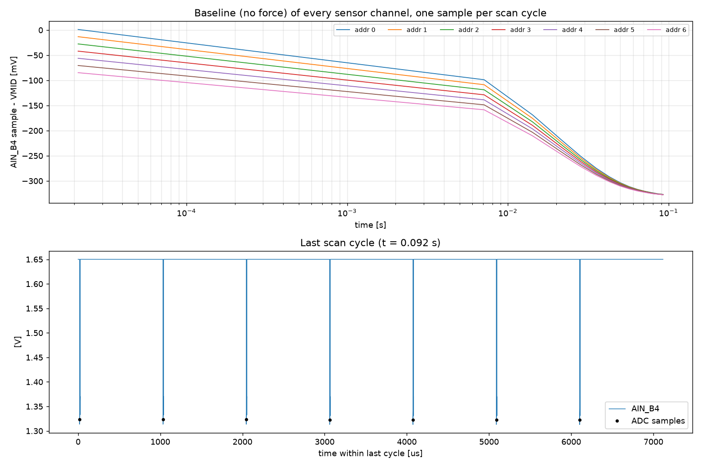

# Report: baseline with no force, VMID settle 1 ms

Scenario `baseline_vmid1ms` of the QSPICE model in `Qspice/TestBoard_ADC124/`. Simulated, not measured.

## Question

With no force on any sensor, where does the `AIN_B4` baseline of each sensor channel sit relative to VMID (1.65 V), how long does it take to settle, and how much do the seven addresses differ from each other (fan-out)?

## Setup

| Item | Value | Basis |
| --- | --- | --- |
| Sensors | 7 × SM311 (PZT-5H), 0.7 × 0.7 × 0.25 mm | size and thickness from the user |
| Sensor model | d33 = 600 pC/N, εr = 3500, Cp = 60.7 pF, 9.88 V/N open circuit, insulation 1e+10 Ω, loss model "none" | Steminc material table (SM311) |
| MUX | TMUX1308A at 3.3 V: Ron 120 Ω, CS(off) 2.0 pF, CD(off) 7.0 pF, CON 11.0 pF, Qinj -0.8 pC, leakage 1.0 nA (S→D, same sign on all channels) and 1.0 nA (D), ton 25 ns | datasheet SCDS477A typical values |
| Buffer | OPA365 behavioral: GBW 50 MHz, slew 25 V/µs, Ro 30 Ω, Ibias 0.2 pA | datasheet SBOS365G typical values |
| Bias / output | R13 = 470 kΩ to VMID (1.65 V), R21 = 33 Ω, C29 = 470 pF, VMID channel 100 Ω + 150 pF | schematic |
| Timing per address | settle 1.0 µs, ADC word 1.0 µs (hold at +187.5 ns after settle), after-conversion 5.0 µs, VMID settle 1000 µs, VMID park 7.0 µs | user; park time is a placeholder |
| Scan | 7 addresses, 1014 µs each, one cycle = 7098 µs | derived |
| Simulator | QSPICE, transient, 5 ns maximum step | |

No force is applied. Sensor nodes start at VMID (initial condition). One ADC-hold sample per address per scan cycle is taken from `AIN_B4`; the table below lists the offset of that sample from VMID.

## Results



| Cycle | t [ms] | addr 0 | addr 1 | addr 2 | addr 3 | addr 4 | addr 5 | addr 6 | mean | fan-out (max−min) |
| --- | --- | --- | --- | --- | --- | --- | --- | --- | --- | --- |
| 0 | 0.021 | +1.19 | -13.17 | -27.58 | -41.91 | -56.12 | -70.47 | -84.73 | -41.83 | 85.918 |
| 1 | 7.119 | -98.77 | -108.68 | -118.75 | -128.77 | -138.78 | -148.69 | -158.57 | -128.72 | 59.801 |
| 2 | 14.217 | -168.48 | -175.46 | -182.45 | -189.45 | -196.43 | -203.31 | -210.24 | -189.41 | 41.756 |
| 3 | 21.315 | -217.21 | -222.12 | -226.96 | -231.86 | -236.66 | -241.48 | -246.32 | -231.80 | 29.110 |
| 4 | 28.413 | -251.19 | -254.56 | -257.99 | -261.39 | -264.68 | -268.12 | -271.51 | -261.35 | 20.313 |
| 5 | 35.511 | -274.94 | -277.27 | -279.62 | -282.12 | -284.30 | -286.69 | -289.06 | -282.00 | 14.125 |
| 6 | 42.609 | -291.46 | -293.06 | -294.81 | -296.55 | -298.06 | -299.71 | -301.40 | -296.44 | 9.935 |
| 7 | 49.707 | -303.08 | -304.16 | -305.30 | -306.54 | -307.62 | -308.78 | -310.06 | -306.51 | 6.981 |
| 8 | 56.805 | -311.22 | -311.94 | -312.71 | -313.55 | -314.28 | -315.12 | -315.90 | -313.53 | 4.673 |
| 9 | 63.903 | -316.72 | -317.20 | -317.75 | -318.34 | -318.85 | -319.45 | -319.96 | -318.32 | 3.235 |
| 10 | 71.001 | -320.54 | -320.79 | -321.23 | -321.64 | -322.00 | -322.42 | -322.80 | -321.63 | 2.263 |
| 11 | 78.099 | -323.22 | -323.73 | -324.04 | -324.32 | -324.57 | -324.86 | -325.14 | -324.27 | 1.915 |
| 12 | 85.197 | -325.43 | -325.75 | -325.95 | -326.14 | -326.25 | -326.38 | -326.48 | -326.06 | 1.049 |
| 13 | 92.295 | -326.82 | -326.94 | -326.92 | -327.33 | -327.39 | -327.47 | -327.53 | -327.20 | 0.719 |

(offsets in mV relative to VMID; fan-out in mV)


## Findings

1. **Offset.** The baseline is **−327 mV** at 92 ms (−326.8 … −327.5 mV across the addresses) and still falling slowly: the step shrinks by about ×0.65 per cycle (−325.4 → −326.8 mV over the last two cycles), so the asymptote is about **−330 mV**, with τ ≈ 2–3 cycles ≈ 16 ms. This is ~75× the −4.35 mV of the 5 µs case.
2. **Mechanism (back-of-envelope estimate, same order as the simulation).** A floating sensor leaks 1 nA into a 61 pF node, i.e. 16 mV/ms, so about 115 mV per 7.1 ms cycle. The 7 µs connection recovers only about a third of the deficit: charge sharing with the ≈ 12 pF D node restores ≈ 15 %, and 7 µs of the 470 kΩ bias (τ = 470 kΩ × (61 + 12) pF ≈ 34 µs) another ≈ 19 % of the remainder. Equilibrium: 115 mV / 0.31 ≈ 370 mV, the same order as the simulated ≈ 330 mV. With a 133 µs cycle the same leakage costs only ~2 mV per cycle.
3. **Fan-out.** In the first cycle the addresses spread by 85.9 mV (address 0 +1.2 mV, address 6 −84.7 mV): address k is read k × 1.014 ms after address 0, and the first cycle starts from VMID. The spread decays by about ×0.7 per cycle (59.8, 41.7, 29.1, 20.3 … mV) and is **0.7 mV** in the last cycle. With the 5 µs VMID settle there is no visible fan-out after 1 ms (≤ 0.01 mV).
4. **Not converged.** After 14 cycles the baseline and the fan-out are still moving (0.7 mV fan-out, ~1 mV per cycle of baseline drift decreasing). The listed "steady state" row of `summary.csv` for this scenario averages all 14 cycles and should be ignored; use the last-cycle row.
5. **VMID slots** still read +0.1 mV, so the VMID visit resets the D node regardless of its length. The whole difference to the 5 µs case is the leakage of the sensors between their visits.
6. **Sensitivity.** The result scales with the assumed leakage (1 nA, same sign on all channels) and inversely with Cp. Real leakage differs per channel and rises steeply with temperature, so treat −330 mV as this model's equal-sign worst case rather than a hardware prediction.

### Comparison with the 5 µs VMID settle

| | VMID settle 5 µs | VMID settle 1 ms |
| --- | --- | --- |
| Scan cycle | 133 µs | 7.1 ms |
| Baseline offset (last cycle) | −4.35 mV | −327 mV (asymptote ≈ −330 mV) |
| Settling time constant | ~0.5 ms | ~16 ms |
| Fan-out between addresses (last cycle) | 0.001 mV | 0.7 mV (first cycle 85.9 mV vs 1.6 mV) |
| VMID-slot residue | +0.1 mV | +0.1 mV |

## Caveats

- Placeholder inputs (not verified against hardware): `t_vmid_park_us`, the 10 GΩ sensor insulation resistance, the layout parasitics, VMID as an ideal source.
- The ADC input (sample-and-hold capacitor, kickback) is not modelled; `AIN_B4` is the node behind R21/C29.
- Mux leakage is applied with the same sign (S→D) and size (1 nA, 25 °C typical) on every channel, which is a worst case for offset. Real parts vary per channel and leak far more when hot (±25 nA max at 85 °C).
- The mux injection-current clamp (pins above VDD or below GND) is not modelled.

## Reproduce

```bash
python run_simulation.py --scenario baseline_vmid1ms
python run_simulation.py --compare baseline,baseline_vmid1ms
python build_reports.py
```

Source data: `results/baseline_vmid1ms/samples_decimated.csv` and `summary.csv`.
