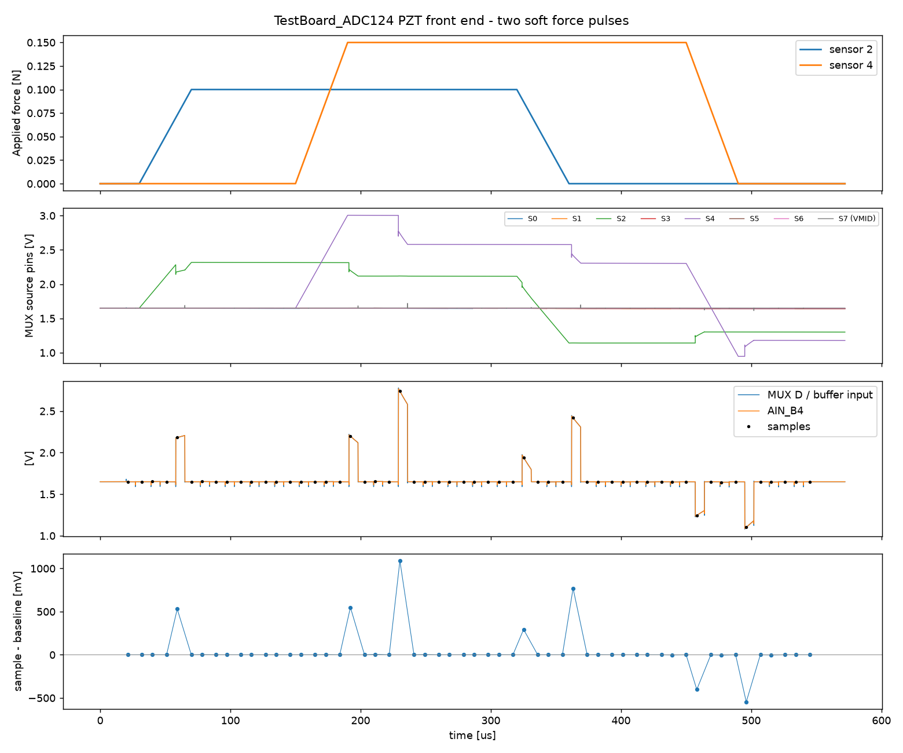
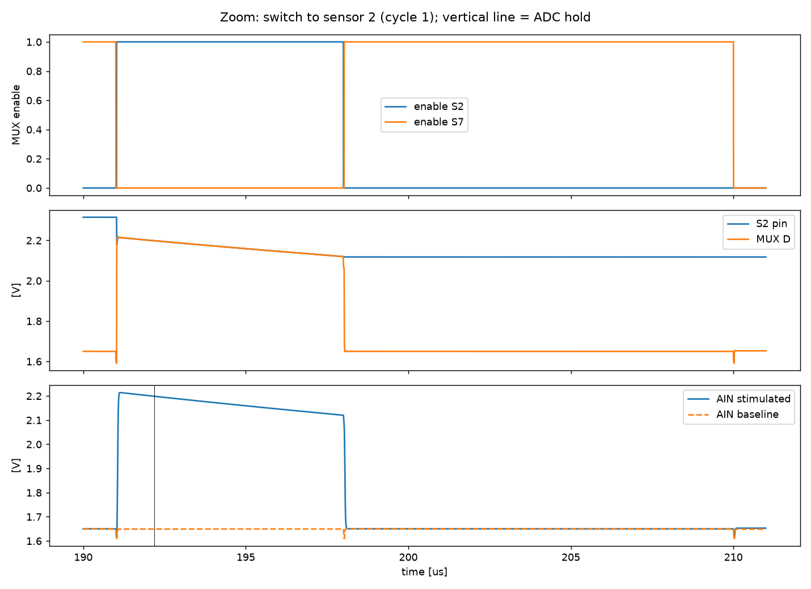

# Report: two soft force pulses (TestBoard_ADC124 PZT front end)

Scenario `two_pulses` of the QSPICE model in `Qspice/TestBoard_ADC124/`. Simulated, not measured.

## Question

How does a force applied to two of the seven PZT sensors appear in the `AIN_B4` samples, how much of it leaks into the other channels, and what happens when the force is released?

## Setup

| Item | Value | Basis |
| --- | --- | --- |
| Sensors | 7 × SM311 (PZT-5H), 0.7 × 0.7 × 0.25 mm | size and thickness from the user |
| Sensor model | d33 = 600 pC/N, εr = 3500, Cp = 60.7 pF, 9.88 V/N open circuit, insulation 1e+10 Ω, loss model "none" | Steminc material table (SM311) |
| MUX | TMUX1308A at 3.3 V: Ron 120 Ω, CS(off) 2.0 pF, CD(off) 7.0 pF, CON 11.0 pF, Qinj -0.8 pC, leakage 1.0 nA (S→D, same sign on all channels) and 1.0 nA (D), ton 25 ns | datasheet SCDS477A typical values |
| Buffer | OPA365 behavioral: GBW 50 MHz, slew 25 V/µs, Ro 30 Ω, Ibias 0.2 pA | datasheet SBOS365G typical values |
| Bias / output | R13 = 470 kΩ to VMID (1.65 V), R21 = 33 Ω, C29 = 470 pF, VMID channel 100 Ω + 150 pF | schematic |
| Timing per address | settle 1 µs, ADC word 1 µs (hold 187.5 ns after settle), after-conversion 5 µs (other muxes read; sensor stays connected): **7 µs connected**, then VMID settle 5 µs + park 7 µs | user; park time is a placeholder; saved results predate the 4-mux timing model (see README) |
| Scan | 7 addresses, one cycle = 133 µs | derived |
| Simulator | QSPICE, transient, 5 ns maximum step | |

Force pulses: address 2: 0.1 N, ramp 40 µs up / 40 µs down, hold 250 µs, start 30 µs; address 4: 0.15 N, ramp 40 µs up / 40 µs down, hold 260 µs, start 150 µs. Pulse amplitudes are limited by the 9.9 V/N sensitivity of the small sensor: 0.15 N already puts the sensor pin at about 3.0 V.

Method: every ADC hold instant is sampled from the simulated `AIN_B4`. A second run with all forces set to zero is subtracted (`delta`), which removes the baseline offset, charge-injection and leakage terms and leaves the sensor signal.

## Results



Sensors with a force pulse, one row per scan cycle:

| Cycle | Address | Hold time [µs] | Force at hold [N] | Open-circuit [mV] | AIN [V] | AIN, zero-force run [V] | delta [mV] |
| --- | --- | --- | --- | --- | --- | --- | --- |
| 0 | 2 | 59.2 | 0.073 | 721 | 2.1810 | 1.6506 | +530.4 |
| 0 | 4 | 97.2 | 0.000 | 0 | 1.6501 | 1.6501 | +0.0 |
| 1 | 2 | 192.2 | 0.100 | 988 | 2.1986 | 1.6492 | +549.4 |
| 1 | 4 | 230.2 | 0.150 | 1482 | 2.7391 | 1.6488 | +1090.3 |
| 2 | 2 | 325.2 | 0.087 | 860 | 1.9423 | 1.6481 | +294.1 |
| 2 | 4 | 363.2 | 0.150 | 1482 | 2.4186 | 1.6479 | +770.7 |
| 3 | 2 | 458.2 | 0.000 | 0 | 1.2447 | 1.6474 | -402.7 |
| 3 | 4 | 496.2 | 0.000 | 0 | 1.1017 | 1.6472 | -545.6 |



Largest |delta| on channels without a force pulse: VMID slots: 0.00 mV, address 0: 0.23 mV, address 1: 1.77 mV, address 3: 3.95 mV, address 5: 2.26 mV, address 6: 0.01 mV.

## Findings

1. **Signal level.** At the flat top the reading is 549 mV for 0.10 N (open-circuit 988 mV) and 1090 mV for 0.15 N (open-circuit 1482 mV), i.e. 55–74 % of the open-circuit value. Two capacitive dividers act on the 61 pF sensor: the sensor node also carries ≈ 7 pF of trace and mux capacitance (61/68 ≈ 0.89), and on connection it shares its charge with the ≈ 12 pF of the mux D node (mux drain, trace, op-amp input; 68/80 ≈ 0.85), so a first visit keeps ≈ 0.76 of the open-circuit value (sensor 4: 74 %). Visits after the first find less charge, because every connection removes part of it (finding 3).
2. **Ramp sampling.** Sensor 2's first visit (cycle 0) falls on the force ramp (0.073 N) and reads 530 mV: the readings follow the instantaneous force, not the pulse amplitude.
3. **Droop with every visit.** Both flat-top readings fall from one visit to the next (sensor 2: 549 → 294 mV is partly the release ramp, but sensor 4: 1090 → 771 mV is on the flat top). The piezo only generates charge while the force changes, so each connection to the bias network (charge sharing plus 7 µs of R13 pulling the node toward VMID) removes charge that is not replaced; a static force is therefore not read back at a constant level.
4. **Release.** After the force is removed the readings go negative (−403 mV on sensor 2, −546 mV on sensor 4) and recover slowly through R13, because each visit only restores part of the deficit.
5. **Crosstalk.** Unforced channels move by at most a few mV (address 3, between the two driven sensors: 3.95 mV, address 5: 2.26 mV, address 1: 1.77 mV); VMID slots show about 0.001 mV, so the VMID visit resets the D node completely.

## Caveats

- Placeholder inputs (not verified against hardware): `t_vmid_park_us`, the 10 GΩ sensor insulation resistance, the layout parasitics, VMID as an ideal source.
- The ADC input (sample-and-hold capacitor, kickback) is not modelled; `AIN_B4` is the node behind R21/C29.
- Mux leakage is applied with the same sign (S→D) and size (1 nA, 25 °C typical) on every channel, which is a worst case for offset. Real parts vary per channel and leak far more when hot (±25 nA max at 85 °C).
- The mux injection-current clamp (pins above VDD or below GND) is not modelled.

## Reproduce

```bash
python run_simulation.py --scenario two_pulses
python build_reports.py
```

Source data: `results/two_pulses/samples.csv`; netlist: `TestBoard_ADC124_PZT.cir`.
