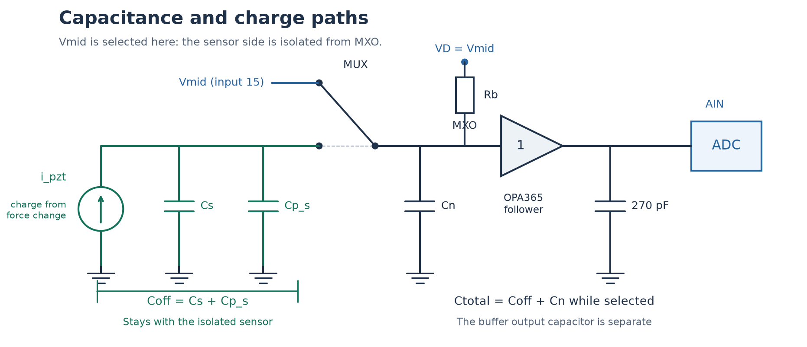
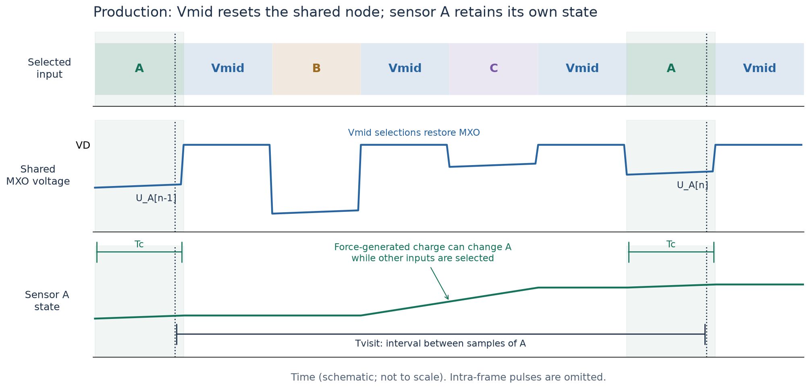
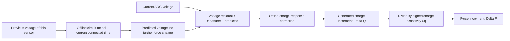

# TestBoard_7953: offline capacitance measurement, production sampling, and force increments

This guide connects the CapTest measurement to production sampling with Vmid between sensor visits. It uses offline calibration values, realtime ADC voltages, and known acquisition parameters. The circuit-induced voltage change must be accounted for before a voltage change is interpreted as newly generated piezoelectric charge.

`Delta F[n] = F(t[n]) - F(t[n-1])` refers to consecutive samples of the **same sensor**. It is a force increment in newtons, not a force derivative in N/s.

In an earlier discussion, “innovation” meant measured voltage minus predicted voltage. This guide calls that quantity the **voltage residual**, `e[n]`. It is an intermediate calculation, not a new measurement.

The capacitance results below were measured on 3 November 2026. The force reconstruction described here is a proposed calculation and validation procedure; the existing production force calculator does not yet implement the full CapTest switching model.

## 1. How we measure and calculate the sensor offline

### 1.1 Circuit and capacitances



The drawing shows Vmid selected. The piezoelectric sensor generates charge when force changes. Its capacitance `Cs` is in parallel with the sensor-side parasitic capacitance `Cp_s`. Both remain attached to the sensor when the mux selects another input. The shared mux-output capacitance `Cn` is connected to them only when that sensor is selected.

```text
Coff   = Cs + Cp_s                  sensor-side capacitance while disconnected
Ctotal = Coff + Cn                 capacitance while connected
Cs     = Ctotal - Cn - Cp_s
```

`Rb` connects MXO to the physical Vmid source. It therefore charges the selected sensor, not every disconnected sensor continuously. The 270 pF capacitor after the buffer is not directly added to `Ctotal`.

For voltage-mode charge conversion, cable and input capacitances participate in storing the generated charge. Consequently, `Cs` alone is not always the appropriate voltage-to-charge conversion capacitance. See [PCB Piezotronics: voltage-mode signal conditioning](https://www.pcb.com/resources/technical-information/signal-conditioning-basics).

### 1.2 Offline inputs and outputs

Store a calibration record for each ADC/channel and acquisition configuration:

| Quantity | Units | How obtained |
| --- | --- | --- |
| `Rb` | ohm | Board resistor value; preferably measured rather than nominal |
| `Ctotal` | F | CapTest two-connected-time fit |
| `c0` | dimensionless | Effective connection fraction at Vmid, from the same fit |
| `c1` | 1/V | Voltage dependence of the connection fraction |
| `qv` | V | Constant offset in the fitted voltage recurrence |
| `Coff` | F | Independent sensor-side capacitance characterization, if using the analytical charge calculation in section 3.3 |
| `KQ` | C/V | Offline electrical charge-response calibration, if using section 3.2; may be a table versus voltage and timing |
| `Sq` or `d33_eff` | C/N | Effective signed charge sensitivity of the mounted sensor |
| Off-state leakage law | e.g. ohm and reference voltage | Offline discharge measurement, if appreciable over a production revisit interval |
| Acquisition conditions | — | SPI engine/clock, connected time, sensor repeats, Vmid frames, scan order/rate, voltage range, wiring, and ADC range |

`KQ` is an effective conversion coefficient, not a physical capacitor. Although C/V has the units of capacitance, it includes the attenuation of the read operation. It is measured offline; it does not require a realtime charge or force measurement.

The material coefficient `d33` can be used as `Sq` only when the sensor orientation and mechanical load transfer justify it. Otherwise measure the effective sensitivity in the assembled sensor. Charge sensitivity and its calibration are discussed in [PCB Piezotronics: force sensors](https://www.pcb.com/resources/technical-information/introduction-to-force-sensors). Choose the sign so that the desired positive force direction is consistent with the voltage/charge polarity.

### 1.3 CapTest sequence and calculation

Use CapTest firmware 1.3.0 or newer and its `alternate` method. The default repeats one sensor frame followed by one Vmid frame. Every second cycle stretches the sensor-connected frame, giving two connected times in one burst.


Before measurement, allow the sensor to discharge enough to provide useful voltage range. Three seconds was sufficient for the tested 2:7 sensor. A fixed wait is not proof of discharge: the first reading must be at least 0.3 V below `VD`, or CapTest marks `ALT_SMALL_RANGE` and excludes the burst. Check the Vmid resets and fit flags, retain the raw packets, and repeat the measurement.

For an unloaded sensor, define:

```text
U[k]    = ADC sensor voltage at the end of visit k
VD      = measured physical Vmid reference
d[k]    = VD - U[k]
Tc[k+1] = connected-time interval assigned to the next visit, from timestamps
```

The fitted recurrence is:

```text
d[k+1] = exp(-Tc[k+1]/tau) * ((1 - c(d[k]))*d[k] + qv)
c(d)   = c0 + c1*d
tau    = Rb*Ctotal
```

For each trial `tau`, the model is linear in `(1-c0)`, `-c1`, and `qv`. CapTest solves those coefficients by least squares, then chooses the `tau` with the smallest residual error. The two connected times separate resistor charging from the common connection effect:

```text
Ctotal       = tau/Rb
Cshare(d)    = Ctotal*(c0 + c1*d)
Cshare(VD)   = Ctotal*c0
```

`qv` is in volts in this equation. Its equivalent fitted charge parameter is `Ctotal*qv` in coulombs. It is not an additional realtime input or a proven microscopic switch-injection charge.

The recorded three-burst results are:

| Channel | `Ctotal`, mean +/- SD | `Cshare` at `VD` | `Cshare` 1 V below `VD` |
| --- | --- | --- | --- |
| 1:0 | 73.3 +/- 0.1 pF | 6.7 pF | 11.4 pF |
| 2:5 | 73.4 +/- 0.1 pF | 6.8 pF | 11.4 pF |
| 2:10 | 135.2 +/- 0.4 pF | 6.5 pF | 11.3 pF |
| 2:7 | 257.5 +/- 0.3 pF | 6.8 pF | 12.0 pF |

These standard deviations describe repeatability. They do not include resistor, timing, model, or calibration errors. The 2:7 result comes from its own short/long-time measurements, not an assumed small-sensor calibration.

Retain all fitted coefficients, not just `Ctotal`. If only the derived share values are available:

```text
c0 = Cshare_at_VD / Ctotal
c1 = (Cshare_1V_below_VD - Cshare_at_VD) / (Ctotal * 1 V)
qv = q_cycle_pc * 1e-12 / Ctotal
```

The current analyzer stores the last two diagnostics in `Measurement.connect_info`; the standard result row is not a complete force-calibration record. Save the raw packets and explicitly retain/export the required per-channel parameters.

### 1.4 Measuring parasitics and validating the scale

`Cshare` describes charge transfer during a connection. **It is not a measurement of `Cn`, and must not be subtracted as though it were a parasitic capacitor.**

To estimate the sensor capacitance, remove the sensor while preserving the wiring to be included in the baseline, and measure a matching blank:

```text
Cs = Ctotal_loaded - Ctotal_blank
```

If unplugging a strip also removes its flex/traces, that subtraction includes the removed wiring capacitance. Record precisely where the disconnection occurred.

A bare input may settle too quickly to leave the required voltage range. In that case replace the sensor with a known capacitor, such as a measured approximately 100 pF capacitor:

```text
Cpar_total = Ctotal_with_calibration_capacitor - Ccal
Cs         = Ctotal_loaded - Cpar_total
```

Two known capacitor values should produce their known capacitance difference and a consistent blank estimate. This checks the measurement scale. A total blank measurement identifies `Cn + Cp_s`; it does not separate those two contributions, so it does not by itself identify `Coff`.

### 1.5 Offline calibration for charge and force

The force calculation needs the voltage response to newly generated charge as well as the no-additional-charge recurrence. CapTest alone establishes the latter.

For the electrical calibration route, use a known small charge input at the sensor side, with the final wiring and production sampling sequence. For example, a calibrated current pulse gives `Qcal = integral(Ical dt)`. Compare the ADC reading with its predicted reading for the same preceding state:

```text
e_cal = U_with_known_charge - U_predicted_without_that_charge
KQ    = Qcal/e_cal
```

Repeat for both polarities and the operating voltage/timing range. The injection timing must represent the intended force-change model: for charge accumulated mostly while disconnected, inject during that interval; for an assumed nearly constant charge-generation rate over a revisit interval, use that profile. Keep any calibration-fixture loading in the final configuration or account for its removal.

Alternatively, calibrate the full voltage-residual-to-force coefficient using a known force increment: `KF = DeltaF_cal/e_cal` in N/V. Then section 3 uses `DeltaF = KF*e` directly. This includes mounting effects and avoids separately identifying electrical charge gain and `Sq`.

Neither `KQ` nor `KF` has been established by the capacitance results in the table. If the analytical assumptions in section 3.3 are independently verified, that route can instead calculate the charge scale from capacitances and the switching model.

## 2. How we sample in realtime production

### 2.1 Match the calibration sequence

For the one-sensor-frame calibration above, use manual sequencing, one retained sensor frame per visit, and Vmid between sensor channels:

```text
Sensor A -> Vmid -> Sensor B -> Vmid -> Sensor C -> Vmid -> ... -> Sensor A
```

These are selections on one ADC. Scanning another ADC does not reset this ADC's MXO.

The updated production firmware inserts one Vmid command between sensor routes on each ADC. It keeps two final pipeline-flush commands per ADC scan to retrieve the last sensor result and park the ADC. For repeat 1 and channels A, B, C, the command sequence is `A, Vmid, B, Vmid, C, Vmid, Vmid`; the final pair is distinct from the single reset between sensor routes.

In production firmware, configure the corresponding settings explicitly while stopped, for example `channelrepeat 1*` and `vmid true*` after selecting manual ADC sequencing. The checked firmware defaults are three repeats and Vmid-between-channels disabled; do not assume startup matches this guide. Confirm the effective settings in status. Production retains the last sensor result when repeats are enabled, rather than averaging those results.

Using three sensor frames requires calibration or a validated model for three frames. The same Vmid count alone does not make that sequence equivalent to one sensor frame. Keep SPI engine, clock, connected-time convention, and wiring consistent; verify a timing change before reusing the connection coefficients.



The Vmid visit restores the **shared node**. Sensor A remains isolated while B, C, and Vmid are selected. Force-generated charge can accumulate on A during that interval; `Rb` does not continuously discharge A through MXO.

### 2.2 Respect the command pipeline and sampling instant

The ADS7953 samples at CS falling and selects the next mux channel later in the frame, on the second SCLK falling edge. A command's sensor result therefore appears two command frames later in this firmware. See the [ADS7953 datasheet](https://www.ti.com/lit/gpn/ads7953), section 8.1 and Figure 1.

For an ADC initially parked on Vmid, the logical sequence is:

| Frame | Command sent | Channel selected later in this frame | Conversion returned at this frame |
| --- | --- | --- | --- |
| 0 | A | Vmid | Vmid |
| 1 | Vmid | A | Vmid |
| 2 | B | Vmid | A |
| 3 | Vmid | B | Vmid |
| 4 | C | Vmid | B |

Use the channel tags and firmware pipeline bookkeeping to associate each voltage with the sensor and its acquisition time. USB arrival time is not the ADC sampling time.

The scope also shows a disturbance starting at CS falling. The timing alone does not prove the ADC reads its settled top or the sensor's undisturbed voltage. The empirical transition model and electrical gain calibration must use the same sampling phase. The analytical route in section 3.3 additionally requires the sensor-state/readout relationship to be verified.

### 2.3 Realtime values and timing parameters

| Input | Source and use |
| --- | --- |
| `U[n-1]`, `U[n]` | Consecutive valid ADC voltages for the same channel |
| `VD` | Actual Vmid-reference voltage for that ADC; obtain offline before capture if stable, or monitor in realtime when available |
| `Tc[n]` | Effective connected time for the current visit, using the same convention as the CapTest fit |
| `Tvisit[n]` | Interval between successive retained samples of that sensor |
| Calibration record | Per-channel offline quantities from section 1 |

For a fixed schedule, `Tvisit = 1/fs_channel`. SPI clock frequency, total conversion rate, and per-sensor sample rate are different quantities. `Tc` is not `Tvisit`; do not use an entire scan interval as the exposure to `Rb`.

The [November 4 production speed test](../testing/benchmarks/testboard-7953/TESTBOARD_7953_SINGLE_VMID_RESULTS.md) measured median per-channel periods of 104 us at a requested 20 MHz SPI clock and 90 us at 30 MHz. Those results use all 50 channels across both arrays, LPSPI, manual sequencing, repeat 1 and one Vmid reset between sensor routes. They characterize the revisit interval for that configuration, not `Tc` or analog calibration accuracy.

The CapTest fit obtains its connected-time interval from frame timestamps. For production use, measure/derive the equivalent per-channel interval for the actual acquisition engine and schedule. In particular, do not substitute `16/f_SPI` without its software and inter-frame overhead. If production does not export frame timestamps, use offline timing characterization for a fixed configuration; arbitrary changing timing requires additional metadata.

The current production code performs Vmid conversions but normally stores only the sensor results in the outgoing sample array. It does not automatically provide each Vmid conversion to host processing. Use a verified stable `VD` calibration, or add explicit reference telemetry before depending on realtime Vmid values. A quiet sensor baseline may sit below `VD`; it is not interchangeable with the reference used to fit `c0`, `c1`, and `qv`.

Convert ADC codes with the actual ADC range. With 12-bit conversion and range 0..VREF:

```text
U = code * VREF/4096
```

For the 0..2*VREF range, use `2*VREF/4096`. If the input data is already in volts, do not convert it again.

## 3. How we calculate Delta F between samples

### 3.1 Predict the circuit-induced change

Assume `VD` and the acquisition configuration are stable over the interval, and that sensor-side leakage while disconnected is negligible. The voltage predicted with **no further change in force** is:

Use three distinct names:

- `V_previous`: the actual ADC voltage from the preceding visit to this sensor.
- `V_measured`: the actual ADC voltage from the current visit, including any response to a force change.
- `V_expected_no_force_change`: the calculated current voltage assuming the force has not changed since the preceding visit.

```text
d_prev = VD - V_previous
E      = exp(-Tc / (Rb*Ctotal))
d_pred = E * ((1 - c0 - c1*d_prev)*d_prev + qv)
V_expected_no_force_change = VD - d_pred
e = V_measured - V_expected_no_force_change
```

`V_measured` always means the actual measurement. Only `V_expected_no_force_change` assumes no further force change. The residual `e` is always measured voltage minus that calculated expectation.

For example, if the preceding reading was 1.200 V, the circuit model predicts 1.210 V with unchanged force, and the actual current reading is 1.215 V, then `e = 1.215 - 1.210 = 0.005 V`. The model explains 10 mV of the measured 15 mV rise; 5 mV remains for charge reconstruction, subject to noise and model error.



A held force can leave a voltage that continues to relax. That relaxation should follow `V_expected_no_force_change` and yield approximately zero `Delta F`. The calculation estimates a change of force, rather than declaring every electrical voltage change a force change.

### 3.2 Calculate charge using the offline electrical calibration

For small increments and an offline `KQ` calibrated for the relevant voltage, visit timing, and charge-generation profile:

```text
DeltaQ_C  = KQ_C_per_V * e_V
DeltaF_N  = DeltaQ_C / Sq_C_per_N

Sq_C_per_N = d33_eff_pC_per_N * 1e-12
```

Equivalently, use `DeltaF_N = KF_N_per_V*e_V` if the complete force response was calibrated directly. Do not also divide that result by `d33`.

An illustrative calculation, not a measured force calibration of this board:

```text
Offline charge-response coefficient KQ = 270e-12 C/V
Effective sensitivity Sq              = 600e-12 C/N
Predicted sensor voltage             = 1.240 V
Measured sensor voltage              = 1.250 V

e      = 0.010 V
DeltaQ = 270e-12 * 0.010 = 2.70e-12 C = 2.70 pC
DeltaF = 2.70/600 = 0.00450 N
```

The 270 pF-equivalent coefficient in this example is hypothetical; it is not the buffer's 270 pF capacitor. A voltage residual of zero must produce a charge increment and force increment of zero.

### 3.3 Analytical calculation from measured capacitances and model parameters

This route avoids an independently measured `KQ`, but adds physical assumptions that CapTest alone has not established:

- The sample represents the voltage state left on the sensor at the end of its visit, or a verified readout correction has been applied and the transition model expressed in that corrected voltage.
- The generated charge accumulates predominantly while the sensor is disconnected; force change during the short read window is negligible.
- `Coff = Cs + Cp_s` is independently known, and off-state leakage is negligible over `Tvisit`.
- The switching law remains valid under the force signal, including its polarity and amplitude.

Under these assumptions, generated charge raises the pre-read voltage by `DeltaQ/Coff`. Linearizing the calibrated transition around `V_previous` gives:

```text
a_read = E * (1 - c0 - 2*c1*d_prev)
DeltaQ = Coff * e/a_read
DeltaF = Coff * e/(a_read*Sq)
```

`a_read` accounts for attenuation of the new charge by the connection operation and resistor charging. It must be positive and well away from zero in the calibrated range. Multiplying `e` by `Cs` or `Ctotal` alone omits this correction. In the special case of pure instantaneous sharing, `a_read = E*Coff/Ctotal`, reducing the charge formula to `DeltaQ = Ctotal*e/E`. The observed switching effects mean that special case is not automatically valid here.

For larger increments within a monotonic calibrated voltage range, invert the same lumped model instead of linearizing it:

```text
d_now = VD - V_measured
A     = 1 - c0
B     = d_now/E - qv

If c1 is approximately zero:
    d_before_read = B/A
Otherwise:
    discriminant  = A*A - 4*c1*B
    d_before_read = 2*B / (A + sqrt(discriminant))

DeltaQ = Coff * (d_prev - d_before_read)
DeltaF = DeltaQ/Sq
```

The displayed root is the branch continuous with the linear limit for `A > 0`. Require a nonnegative discriminant and a pre-read voltage inside the calibrated monotonic range; do not silently clamp an invalid solution. This inversion is exact for the stated lumped-input model, not for an arbitrary unknown force waveform during the visit.

### 3.4 Leakage, bandwidth, and validity

If disconnected-state leakage matters, characterize it offline. For a verified linear leakage path from the sensor side to `Vleak`:

```text
tau_off             = Roff*Coff
V_before_no_change  = Vleak + (V_after_previous_visit - Vleak)*exp(-Toff/tau_off)
```

Use that no-additional-force state in the read model rather than the uncorrected previous state. `Rb` is not `Roff`. Use the actual disconnected duration and account for any delay between sampling and release. If the ADC reading is not the stored sensor voltage, use the verified observation/state conversion as well. A production gain calibration must include the same leakage behavior.

The measured residual is a time-weighted response to generated charge. If substantial force changes occur during the connected window or charge leaks significantly between visits, two endpoint voltages do not uniquely determine the unweighted charge generated at unknown times. Use an offline calibrated input response for an explicit waveform assumption, such as approximately constant charge-generation rate over one interval, and validate at the intended force bandwidth. Sampling faster than the force dynamics and keeping the connected window short helps make the disconnected-charge approximation useful.

Apply the calculation only when:

1. The channel, reference, voltage range, and sampling phase match the calibration.
2. Vmid resets succeed and the ADC is not clipped.
3. The sensor-frame count and connected timing match the model; a repeat-three production visit is not a repeat-one visit.
4. Reference drift, off-state leakage, temperature, and cross-channel coupling are within the calibrated limits.
5. The force signal lies in the calibrated voltage range. Charging from below Vmid does not validate extrapolation above Vmid.

Maintain `V_previous` and timing state separately for each sensor. The first valid sample initializes that state and has no preceding force increment. On a missing sample, timing change, or failed reset, flag/reinitialize or use a validated multi-visit model; do not treat the next sample as though only one normal visit occurred.

Calculate the voltage residual before applying display thresholds. If a noise threshold is needed, characterize the residual noise offline; thresholding or zeroing the raw voltage before this correction can discard part of a real loading or unloading signal.

An implementation outline for the electrical-calibration route is:

```python
# All capacitances in F, resistances in ohm, times in s, voltages in V.
# The offline record supplies Ctotal, c0, c1, qv, KQ, and signed Sq.
# This outline assumes negligible off-state leakage and fixed VD.
Tc = connected_time[channel]
Tvisit = sample_time - previous_sample_time[channel]
d_prev = VD - previous_voltage[channel]
E = exp(-Tc / (Rb[channel] * Ctotal[channel]))
predicted_voltage = VD - E * (
    (1.0 - c0[channel] - c1[channel] * d_prev) * d_prev + qv[channel]
)
voltage_residual = measured_voltage - predicted_voltage
delta_charge = charge_response_coefficient(channel, d_prev, Tc, Tvisit) * voltage_residual
delta_force = delta_charge / charge_sensitivity[channel]
previous_voltage[channel] = measured_voltage
previous_sample_time[channel] = sample_time
```

This is a proposed reconstruction step. The current [force calculator](../../data_processing/pzt_force_calculation.py) corrects an RC decay and optional mux exposure, but does not yet apply this nonlinear switching model. Its event resets and display behavior are separate from the physical charge calculation.

To obtain relative force, accumulate `F[n] = F[n-1] + DeltaF[n]` from a known initial force. This does not recover an unknown initial static force. Keep any zeroing or display reset explicit; a quiet piezoelectric voltage alone does not establish that a held force was released.

Validate with a known charge input and/or reference force waveform using the final production scan. Check constant-force intervals, loading, unloading, both signal polarities, and more than one scan rate. Average repeat calibrations from the same method and compatible conditions; compare different methods separately.

Detailed measurement evidence: [capacitance report, step 5](../reports/TestBoard_7953_capacitance_report.md#step-5-c_total-and-c_s-with-vmid-between-samples-one-vmid-frame). Acquisition implementation: [production sensor/Vmid sequence](../../Arduino_Sketches/TestBoard_7953/src/PztController.cpp) and [CapTest alternate fit](../../CapTest/captest/capfit.py). Workflow and protocol: [CapTest user guide](TESTBOARD_7953_CAPTEST_USER_GUIDE.md) and [CapTest firmware architecture](../architecture/firmware/TESTBOARD_7953_CAPTEST.md).
