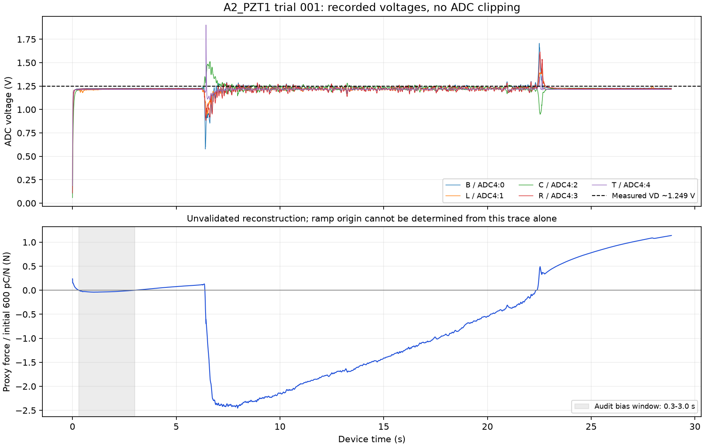

# CapTest force calibration audit — 6 November 2026

Scope: current working-tree CapTest implementation, the saved A2_PZT1 electrical
record and `trial_A2_PZT1_001.cap`. This review did not change application or
firmware code, run hardware, or alter the original measurements/recordings.

## Conclusion

The old upper-range rejection is reproducible from the recorded voltages, but
"the workflow is fine; press more lightly" is not a sufficient diagnosis.
The current source has already removed the default VD+0.25 V rejection. It now
allows above-VD extrapolation. That change removes the particular error without
establishing the model's accuracy there.

More immediate problems are a poor L-channel electrical fit admitted as usable,
an incomplete leakage-application/reanalysis workflow, contradictory retry
behavior and recording-name collisions after reset. Current acceptance/save
status also permits unvalidated, drifting results to be called calibrated.

## 1. What the recording confirms

Replayed the raw file through `capture.replay_file`, using the current
`force_inputs_board.json` route models for A2_PZT1:

- 17,440 sweeps, 28.86454 s over the selected routes.
- Median rate 603.505 Hz per channel, with 1,500 us added lag per full-board sweep.
- Measured connected times approximately 1.377-1.383 us, distinct from the
  approximately 1.657 ms revisit period.
- No reported decoding/CRC/sequence, channel-tag or Vmid-reset problems.
- No ADC clipping against the current headroom checks in a 2.5 V span.
- ADC4 Vmid mean during capture: 1.249316 V; route electrical VD values are
  approximately 1.2494 V.

| Position / physical route | Maximum ADC voltage | Maximum above its VD | Would exceed old VD+0.25 V rule? |
| --- | ---: | ---: | --- |
| B / ADC4:0 | 1.707153 V | 0.457723 V | Yes |
| L / ADC4:1 | 1.436157 V | 0.186707 V | No |
| C / ADC4:2 | 1.512451 V | 0.263082 V | Yes |
| R / ADC4:3 | 1.613770 V | 0.364319 V | Yes |
| T / ADC4:4 | 1.901855 V | 0.652425 V | Yes |

These numbers corroborate the reported excursions and digital capture health.
They do not measure the finger force, prove all analog hardware is correct, or
establish that a real 20 g mass will fit the same voltage bounds.

The lower plot uses an explicitly chosen audit baseline of 0.3-3.0 s, the
current electrical record, initial sensitivity 600 pC/N and origin at 3.0 s.
It is an unvalidated proxy-force replay, not a calibrated measurement of the
finger or an exact reconstruction of the original wizard's analysis windows.
The raw capture/NPZ files found here contain no wizard marks, and no saved
calibration-record JSON was present to recover them. Exact original event
classification/window fitting therefore cannot be reproduced from these files.

Machine-readable [replay diagnostics](images/captest_force_review_2026-11-06/replay_diagnostics.json)
include source hashes and audit assumptions.

## 2. Findings, in priority order

### P1 — Reset/new sessions can overwrite prior raw evidence

[`ForceCalibrationController._raw_path`](../../CapTest/captest/force_session.py#L124)
uses a counter beginning at zero for each new controller and creates names such
as `trial_A2_PZT1_001.cap`. Reset discards the controller.
[`ChunkRecorder`](../../CapTest/captest/capture.py#L515) opens that path with
`wb`, truncating an existing file. The NPZ companion is likewise replaced.

Without opening or changing any existing capture, two fresh controller objects
both selected the already-existing trial 001 path. This contradicts the Reset
button's promise that capture files stay on disk and can invalidate older
records' hashes/evidence.

Required: collision-proof session/trial IDs and exclusive creation, with
separate atomic trial metadata. Preserve original evidence across Reset, retry,
app restart, group switching and aborted trials.

### P1 — An electrically poor channel is marked usable for force

In the saved record, **ADC4:1 / L** has `HIGH_RESIDUAL` on all three bursts.
Mean fit RMS is **8.19194 LSB** (about 5.00 mV), versus 0.82-1.27 LSB on the
other four channels. Its averaged coefficients include `c0=-0.0772847`,
`c1=0.305479 / V`, and `qv=-0.00276375 V`; its fitted Vinf diagnostics are null.

Nevertheless, the route is `usable` and A2_PZT1 is `complete`.
[`route_record`](../../CapTest/captest/force_export.py#L118) excludes tag/reset
errors explicitly but lets these high-residual fits become force inputs.
Negative c0 alone is not proof of a hardware defect; combined with the large
residual it is a reason to inspect/re-measure this channel and its model,
especially before extrapolating it above VD.

Required: distinguish "measured/exportable" from "valid for force". Apply
explicit model-quality criteria before enabling package calibration. Re-measure
ADC4:1 and investigate its raw fit rather than treating a complete dataset as
automatically trustworthy.

### P1 — Above-VD acceptance is now unvalidated extrapolation

The checked [`range_report`](../../CapTest/captest/force_model.py#L589) has
`neg_margin_v=None`. Default rejection now applies to clipping or voltage too
far below the fitted range; above VD is only `extrapolated_low`. All five
recorded routes pass the current clipping/outside checks, with extrapolation
flags. The UI's live headroom message considers clipping, not model validity.

The fit's above-VD behavior has not been established simply because its
polynomial is smooth. For example, the L-channel transition derivative reaches
approximately 1.154 over this recording's voltage range. This is not an
independently measured new-charge gain and should not be silently treated as one.

Required: separate capture permission, ADC headroom and calibrated-model
validity. An exploratory capture can be retained above VD, but must remain
provisional until the response is validated over that voltage/timing range.
The old 0.25 V limit has no demonstrated physical significance; making it
configurable, removing it, or deriving a bound from the same unvalidated trial
does not establish accuracy. Validate both polarities with known force/charge
and the final scan before marking the extended domain calibrated.

### P1 — Leakage evaluation is not a complete calibration path

The tab exposes **Evaluate leakage**, but no action calls
[`apply_leakage`](../../CapTest/captest/force_session.py#L370). That method,
if called programmatically, changes the model for subsequent accumulation but
does not reanalyse stored trials or invalidate existing sensitivity/validation.
Its own log says trials need reanalysis; no such workflow is wired here.

`build_record` serializes `self.leakage` even if it was merely evaluated and
never applied. A saved identified correction can therefore coexist with a
d33_eff fitted using the uncorrected model. The live residual/bias display
also omits leakage arguments even when accumulation uses a correction.

Required: distinct proposed/applied correction states; explicit application;
replay of original trials with fresh frozen bias estimates and the same
correction; invalidation/refitting of gain and validation; consistent live,
offline and saved model versions. Evaluation also currently requires an
accepted trial, which prevents using a rejected-but-clean capture to diagnose
some hold/model failures.

### P2 — Drift fitting does not identify the cause; calibration status overstates quality

[`event_step`](../../CapTest/captest/force_model.py#L280) fits
`Q = a + rate*t + step*indicator` across pre/post windows. It can estimate a
step in the presence of an assumed common linear ramp. It cannot distinguish
electrical bias from an actual slowly changing force, mechanical creep or
an incorrect voltage-dependent model.

Demonstration: passing a genuinely linear charge trace `Q=t*1e-12` returns
approximately zero fitted step, despite a 2 pC difference between window means.
That is expected algebra, not evidence that the ramp is "not force".

`HOLD_DRIFT` and `LOAD_REMOVAL_INCONSISTENT` are flags, not rejection reasons.
[`analyze_trial`](../../CapTest/captest/force_calibration.py#L348) can accept them.
A synthetic drifting trial was accepted with `HOLD_DRIFT`, and
[`build_record`](../../CapTest/captest/force_calibration.py#L605) labelled its
fitted record `calibrated` with `validation=None`.

Required: preserve raw and drift-adjusted results, define explicit force/drift
acceptance limits, and distinguish fitted/provisional/validated status. A finger
press does not establish a constant known load. Use known mass plateaus and
independent validation to test a drift hypothesis; do not tune it away solely
to make force appear flat.

### P2 — Retry contradicts the instruction shown after a range failure

The current failure prompt recommends Retry failed for the first mass. However,
[`Wizard.retry`](../../CapTest/captest/force_calibration.py#L520) refuses it when
`last.mass_g >= stopped_at_g`. A reproduced 20 g range failure skipped escalation,
then Retry raised: "escalation stopped at 20 g".

Required: allow another attempt at the failed mass while keeping heavier masses
blocked until that attempt passes, or present an accurate recovery operation.
Do not advise Reset as the workaround until recording collisions are fixed.

### P2 — Fit/validation metrics and edge cases need attention

- Force-error metrics subtract the fitted event intercept, whereas the
  accumulator's force conversion only divides Q by d33_eff. These are different
  estimators when the intercept is material. Report actual deployed force-step
  error as well as intercept-adjusted regression residuals, or implement and
  justify a consistent estimator. An event intercept is not automatically a
  continuously applicable force offset.
- With two complete repeats of one mass, held-out training leaves two events,
  but `fit_d33` requires at least three. A direct reproduction raises ModelError.
  The GUI's validation exception handler catches CalibrationError but not this
  ModelError. Check training-set sufficiency and report a useful state instead.
- Save is enabled by the existence of a fit; no successful hold-out/error limit
  is required. A later fit/trial change must invalidate stale validation.
- Save event marks, evidence hashes and rejection results after each trial,
  including rejected/cancelled captures, rather than only when a fitted
  calibration can be saved. This is needed to reproduce the original rejection.

## 3. What is correctly implemented

The reconstruction uses loaded Ctotal, measured VD and per-route connected time
in the nonlinear no-force predictor. It computes `e=V_measured-V_predicted`,
sums `Ctotal*e` directly as a labelled **charge proxy**, and applies the package
sensitivity once. It does not insert a second dt factor or automatically decay
the physical accumulator. Initial-sample handling and array-qualified routing
are present. The capture retains raw words/timing and reports integrity problems.

These are useful foundations. They do not establish physical charge gain,
accurate force on a finger trial, or validity of arbitrary above-VD extension.

## 4. Tests and recommended order

Ran six focused files: force model, trial calibration, force session, force GUI,
capture and force export. Initial combined run: **112 passed, 1 failed** in
32.33 s. The failure was
`test_rejected_trial_says_why_and_what_to_change`, which left the generic Prepare
prompt instead of the rejection. Its isolated rerun passed in 0.98 s, indicating
an order/timing-sensitive GUI issue requiring investigation; the combined run
was not consistently green.

Additional direct reproductions confirmed range-retry refusal, collision paths,
acceptance/save of HOLD_DRIFT without validation, removal of a linear ramp by
the step fit, and the two-repeat hold-out error. No real captures were opened
for writing during these checks.

Recommended order:

1. Protect recordings/metadata against overwrite and preserve rejected-trial evidence.
2. Fix electrical-model readiness and resolve the ADC4:1 high-residual fit.
3. Make range/extrapolation and calibration-quality states explicit.
4. Finish leakage apply/replay/refit/validation, then fix retry and validation edge cases.
5. Run known 20 g placement/hold/removal trials in the final scan, both directions
   and repeated contact positions. Escalate to heavier masses only within observed
   headroom and a validated model/force range. A lighter press alone is not a fix.
