# TestBoard_7953 capacitance measurement

Scope and ADC investigation, 2026-10-30 and 2026-11-02. Firmware CapTest 1.1.0. Conclusions use ADC1 and ADC2 only.

## Summary

- **The charge-up has two parts.** `R_b` charges the node continuously, and a charge of about 6-7 pC arrives once per frame at low voltage. At the normal 1.37 µs frame, the per-frame part does 52-75 % of the charging, so `tau / R_b` reads `C_total` 2-4 times too low.
- **`C_total` and `C_f` can be calculated from ADC bursts.** Two frame periods, or one long burst, match the full 8-gap sweep within 2 %.
- **`C_s` is only bracketed so far.** `C_s = C_total - C_par`, and `C_par` has not been measured. The strip-unplugged sweep that would measure it has not been run.
- **The per-frame term is not set by `R_b` or the SPI command.** `C_f` stays about 4.0 pF at 1 MΩ and 470 kΩ. Changing the SPI clock at a fixed frame period, or using the ADC's continue command, does not change it.
- **The jump starts upstream of the buffer.** The pulse and jump are visible at MXO. Their cause is not identified.
- **Open:** the scope shows impossible negative levels at the op-amp output, and reads up to 113 mV below the ADC on large sensor 2:7. The test that could explain this was not run. Treat absolute scope levels in the first frames as unconfirmed. The ADC data does not depend on them.
- **No independent capacitance check exists.** All values come from fits with nominal `R_b`. No LCR measurement has been made.

## How the board measures a sensor

```text
Sensor C_s -- mux input --[ADS7953 mux]-- MXO --+-- OPA365 follower -- 270 pF to GND -- AIN (ADC)
                                                |
                                                +-- R_b -- Vmid (1.25 V)
```

The mux output (MXO) is shared by all channels of one ADC. The firmware first holds it at Vmid by selecting input 15, then switches to a rested sensor at about 0 V. The node falls, then charges back toward Vmid while the ADC samples it through the buffer. The OPA365 runs from a single supply, with V- at ground and no negative rail.

### What each factor does

| Factor | Values here | Effect on the curve |
| --- | --- | --- |
| Sensor capacitance, `C_s` | 0.7 x 0.7 mm on most channels; 1.2 x 1.2 mm on channels 2, 7, 12 | Most of `C_total`. Sets the RC time and how far each per-frame charge moves the node. |
| Bias resistor, `R_b` | ADC1 1 MΩ, ADC2 470 kΩ (nominal; in-circuit readings 0.999 MΩ and 469.4 kΩ) | Sets only the RC part. Halving it does not change `C_f`. |
| Frame period, `T` | 1373 ns (20 MHz, gap 200 ns) to 36.2 µs | Sets how many per-frame charges arrive per microsecond. The main control on `tau`. |
| SPI clock | 20 and 10 MHz | Lengthens `T` and the pulse. At equal `T`, the `C_f` ratio is 0.999 (range 0.982-1.007). |
| CS gap setting | 200 ns to 35 µs | Lengthens `T`. The real CS-high time is 345 ns at the 200 ns setting. The net jump stays about the same. |
| Per-frame capacitance, `C_f` | About 3.2-4.1 pF fitted; about 6.3 pF at 0-0.2 V falling to 2.6 pF near 1.15 V in rested bursts | An equivalent fit value, not a capacitor found on the board. Depends on node voltage. |
| Rest time | 2:7 needs 3 s (measured) | Sets the starting voltage. Too short a rest starts the curve high. |
| 270 pF at the buffer output | Fixed | Absorbs ADC kick. The acquisition-start kick is barely visible. |
| Probe on MXO | About 14 pF (estimate; other methods gave 7 and 30 pF) | Adds to `C_total` and raises the first level by about 235 mV. Do not probe MXO for capacitance work. |

### The model

```text
1/tau = 1/(R_b * C_total) + (C_f / C_total) / T

Step per frame = (V_target - V) * (1 - exp(-T / (R_b * C_total)))     R_b part
               + (V_target - V) * C_f / C_total                       per-frame jump
```

A long frame leaves `R_b` in charge, and a short frame leaves the jump in charge.

Measured `tau`, the uncorrected `tau / R_b`, and the `R_b` share of the charging from the fitted line (sweep of 2026-11-02):

| Channel | `R_b` | Fitted `C_total` | `C_f` | T = 1373 ns | T = 6173 ns | T = 36173 ns |
| --- | --- | --- | --- | --- | --- | --- |
| 1:0, small | 1 MΩ | 71.4 pF | 4.03 pF | 18.1 µs, 18 pF, 25 % | 43.1 µs, 43 pF, 61 % | 64.8 µs, 65 pF, 90 % |
| 2:5, small | 470 kΩ | 73.0 pF | 4.04 pF | 14.4 µs, 31 pF, 42 % | 26.0 µs, 55 pF, 76 % | 33.4 µs, 71 pF, 95 % |
| 2:10, small | 470 kΩ | 134.4 pF | 3.37 pF | 29.3 µs, 62 pF, 46 % | 50.1 µs, 107 pF, 80 % | 60.9 µs, 130 pF, 96 % |
| 2:7, large | 470 kΩ | 252.2 pF | 3.16 pF | 56.8 µs, 121 pF, 48 % | 95.3 µs, 203 pF, 81 % | 114.1 µs, 243 pF, 96 % |

## Calculating `C_total`, `C_f` and `C_s` from the ADC samples

The burst gives `tau`, from a single-exponential fit to the samples using the firmware timestamps. `T` is the median sample spacing. Everything below starts from those.

### Step 1: `C_f` and `C_total` from two or more frame periods

Fire the same channel at two gaps, with the same rest time.

```text
k       = (1/tau1 - 1/tau2) / (1/T1 - 1/T2)
C_total = 1 / (R_b * (1/tau1 - k/T1))
C_f     = k * C_total
```

With more gaps, fit a straight line of `1/tau` against `1/T`: `k` is the slope, and `C_total = 1 / (R_b * intercept)`. The sweep uses 8 gaps.

Worked example, 2:7 at 470 kΩ:

| Quantity | Value |
| --- | --- |
| T1 = 1.373 µs, tau1 = 56.8 µs | 1/T1 = 0.7283 /µs, 1/tau1 = 0.01761 /µs |
| T2 = 6.173 µs, tau2 = 95.3 µs | 1/T2 = 0.1620 /µs, 1/tau2 = 0.01049 /µs |
| k = 0.00711 / 0.5663 | 0.01256 |
| Intercept = 0.01761 - 0.01256 x 0.7283 | 0.00846 /µs (RC part 118 µs) |
| `C_total` = 118 µs / 470 kΩ | **251.5 pF** (8-gap fit 252.2 pF) |
| `C_f` = 0.01256 x 251.5 pF | **3.16 pF** (8-gap fit 3.16 pF) |

### Step 2 (optional): `C_total` from one burst when `C_f` is known

```text
C_total = tau * (1/R_b + C_f/T)
```

2:7 with its own `C_f`: 56.8 µs x (1/470 kΩ + 3.16 pF/1.373 µs) = 252 pF.

### Accuracy of the methods

Checked against the 8-gap fit on 22 channels (1:2, 2:1 and 1:3 left out). One-burst methods use the mean `C_f` of 3.64 pF.

| Method | Bursts | Mean error | Worst error | 1:0 (71.4 pF) | 2:7 (252.2 pF) |
| --- | --- | --- | --- | --- | --- |
| Long frame, T = 36173 ns | 1 | +0.5 % | 1.7 % | 71.3 pF | 254.3 pF |
| Two periods, T = 1373 and 6173 ns | 2 | -0.5 % | -1.9 % | 71.0 pF | 251.5 pF |
| Short frame, T = 1373 ns | 1 | -0.4 % | 8.2 % | 66.3 pF | 271.7 pF |
| Uncorrected `tau / R_b`, T = 1373 ns | 1 | 2-4 times low | | 18.1 pF | 121 pF |

These checks reuse the same bursts as the reference, so they show that the methods agree, not that the capacitance is correct.

### Step 3: `C_f` at a given voltage, from one burst's steps

The value in step 1 is an average over the burst. `C_f` falls as the node rises, and each frame gives its own value once `C_total` is known:

```text
J_k      = (V_(k+1) - V_k) - (V_target - V_k) * (1 - exp(-T / (R_b * C_total)))
C_f(V_k) = C_total * J_k / (V_target - V_k)
```

`V_target` is the mean of the last samples of a burst long enough to settle.

| Burst, first frame | `V_k` | Step | `R_b` part | `J_k` | `V_target - V_k` | `C_f` |
| --- | --- | --- | --- | --- | --- | --- |
| 2:7, gap 5000 ns, rested | 0.093 V | 87 mV | 57 mV | 30 mV | 1.12 V | About 6.8 pF |
| 2:5, gap 5000 ns | 0.292 V | 220 mV | 157 mV | 63 mV | 0.95 V | About 4.9 pF |

The ADC samples during the pulse, so `V_k` is probably `V + D`, not the settled node voltage. This shifts the voltage assigned to each `C_f` value. It has not been corrected.

### Step 4: `C_s`

```text
C_s = C_total - C_par
```

`C_par` is everything on the node other than the sensor: mux, off channels, trace, flex and buffer input. To measure it, unplug the strip and repeat step 1 on the same channel. This has not been done, so only a bracket is possible. The lower bound assumes `C_par` equals the roughly 13 pF estimated for the node during the pulse, which is rough and may not be the same capacitance.

| Channel | `C_total` | `C_s` if `C_par` = 0 | `C_s` if `C_par` = 13 pF |
| --- | --- | --- | --- |
| 1:0, small | 71.4 pF | 71 pF | 58 pF |
| 2:5, small | 73.0 pF | 73 pF | 60 pF |
| 2:10, small | 134.4 pF | 134 pF | 121 pF |
| 2:7, large | 252.2 pF | 252 pF | 239 pF |

The sensor sizes cannot supply `C_par`. With a capacitance ratio of 2.94, 2:7 and 2:5 give a negative `C_par` (about -19 pF), so either the sensors do not scale exactly with nominal area or the fit values carry an error of that order.

Sources of error:

- **`R_b`:** 1 % error gives about 1 % in `C_total`.
- **Rest:** rest changes `tau`. 2:7 at gap 5000 ns gave 85.7 µs after a rest of 10 s or more, and 95.3 µs in the 500 ms sweep. The rested fit also used only 64 samples. All values above use the 500 ms sweep, so use the same rest for every burst.
- **First-sample height:** do not use it. It includes the jump and the pulse offset, and depends on rest.

### Step 5: `C_total` and `C_s` with Vmid between samples (one Vmid frame)

This is the CapTest default for TestBoard_7953 from firmware 1.3.0 (`capalt`). It works the way production does with Vmid between channels: one frame on the sensor, then one frame on Vmid (input 15), repeated. One Vmid frame is enough, because the node is back within 0.6 mV of `V_D` after it (measured, see "Switching to Vmid between samples" below).

**Burst.** Short cycles use the normal gap (200 ns, T about 1.44 µs). In every second cycle the frame with the sensor connected uses a long gap, so one burst holds two connected times. The automatic long gap is 0.3 × `R_b` × 100 pF, limited to 4-40 µs: 14.1 µs on ADC2, giving a connected time of 15.3 µs.

**Model.** U_k is the sensor sample of cycle k, taken just before the mux returns to Vmid. `d_k = V_D − U_k` is its distance below Vmid, and `Tc` is the connected time of the next cycle, from the time stamps. Each Vmid frame resets the node to `V_D`, so:

```text
d_(k+1) = exp(-Tc / tau) * ((1 - c(d_k)) * d_k + q)
c(d)    = c0 + c1 * d            (C_share = c * C_total, charge taken per connection)
C_total = tau / R_b
```

- `exp(−Tc/tau)` is the charging through `R_b` while connected.
- `c` is the charge each connection takes, written as a capacitance reset to `V_D`.
- `q` is a small fixed charge per connection.
- `c` grows with `d` because the once-per-frame charge does (step 3). With a constant `c`, `C_total` came out 3-6 % low and the residuals were 3-5 LSB.
- For a given `tau` the model is linear in `c0`, `c1` and `q`. The fit takes the `tau` with the smallest squared error.
- Short and long cycles give two decay rates. Their difference fixes `tau`, and their common part fixes `c`.

**What it does not need:**

- The sensor start voltage: only the cycle-to-cycle ratio enters.
- `C_f` and a second burst: the per-frame charge is part of `c`, not of `tau`.

It does need the sensor to start at least 0.3 V below Vmid. Bursts fired without a rest started 60-200 mV below Vmid and were off by up to 21 %, so CapTest flags them `ALT_SMALL_RANGE` and leaves them out of the mean.

**`C_s`.** `tau` covers everything connected to MXO, so `C_total = C_n + C_sensor_side`, where `C_n` is the node part.

- `C_n` is not measured directly.
- The fit gives `C_share` at `V_D`, which is `C_n` plus the per-frame charge of the connected frame. So `C_n` ≤ `C_share(V_D)`.
- With `C_f` near Vmid about 2.6 pF (step 3), `C_n` is about 4 pF. That figure is rough.

```text
C_s = C_total - C_n - C_par,s        with 0 <= C_n <= C_share(V_D)
```

`C_par,s` is the sensor-side part of `C_par`: mux input pin, trace and flex. It is still unmeasured and needs the strip-unplugged sweep.

**Worked example on the board, 3 November.** Three rested bursts per channel, 3 s rest, 1 Vmid frame, ADC2 long gap 14.1 µs (ADC1 30 µs). Data in `CapTest/Results/TestBoard_7953/2026-11-03_alternate_method_check2_raw.json`.

| Channel | `C_total`, 3 bursts | 8-gap sweep | `C_share` at `V_D` | `C_share` 1 V below `V_D` | `C_s + C_par,s` (`C_n` = 0 to `C_share`) |
| --- | --- | --- | --- | --- | --- |
| 1:0 | 73.3 ± 0.1 pF | 71.4 pF (+2.7 %) | 6.7 pF | 11.4 pF | 66.6-73.3 pF |
| 2:5 | 73.4 ± 0.1 pF | 73.0 pF (+0.5 %) | 6.8 pF | 11.4 pF | 66.6-73.4 pF |
| 2:10 | 135.2 ± 0.4 pF | 134.4 pF (+0.6 %) | 6.5 pF | 11.3 pF | 128.7-135.2 pF |
| 2:7 | 257.5 ± 0.3 pF | 252.2 pF (+2.1 %) | 6.8 pF | 12.0 pF | 250.7-257.5 pF |

- **Repeatability:** 0.1-0.2 % between bursts.
- **Against the sweep:** +0.5 % to +2.7 %. Both are model-based, so this is agreement, not accuracy.
- **`C_share` at `V_D` is 6.5-6.8 pF on all four channels**, for sensors from 73 to 258 pF. It belongs to the node, as expected.
- **Residuals:** 1.0-1.6 LSB, with no flags.

## What causes the step up and step down

Each frame the buffer node steps up, stays flat for the pulse, then steps down part of the way. The step down is about the same on every sensor, and the net jump depends on `C_total`, so the frame contains two separate effects.

Levels around one pulse, gap 5000 ns (c = cursor, p = photo reading):

| Shot | Before pulse | Pulse top | Settled after | Step up | Step down, D | Net jump, J |
| --- | --- | --- | --- | --- | --- | --- |
| 2:5, 470 kΩ, nothing off screen | 134 mV c | 297 mV c | About 215 mV p | 163 mV | About 82 mV | About 81 mV |
| 2:7, 470 kΩ, frame 1 | -108 mV c | -6 mV c | -86 mV c | 102 mV | 80 mV | 22 mV |
| 2:7, 470 kΩ, frame 2 | 15 mV c | 112 mV c | 49 mV c | 97 mV | 63 mV | 34 mV |
| 1:0, 1 MΩ, probe on MXO | 179 mV c | 287 mV c | 248 mV c | 108 mV | 39 mV | 69 mV |

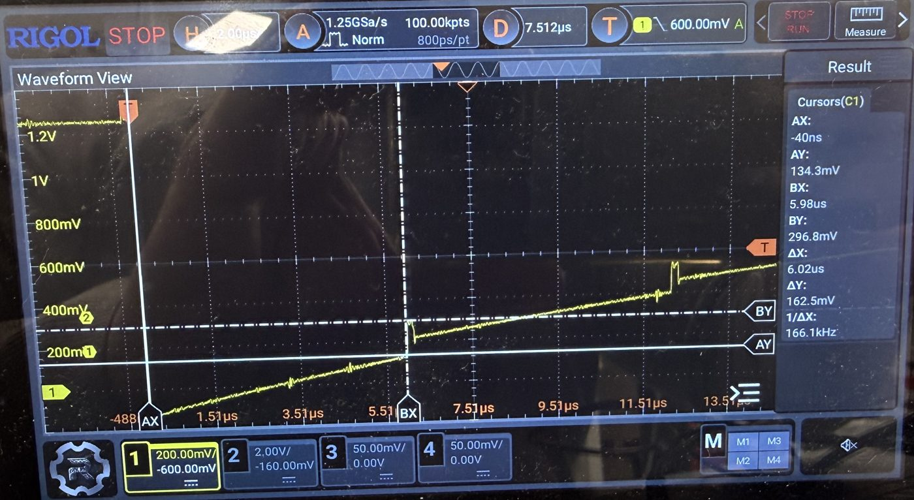

*2:5, 20 MHz, gap 5000 ns, parked level on screen. Cursors: 134 mV before the pulse, 297 mV at the pulse top.*

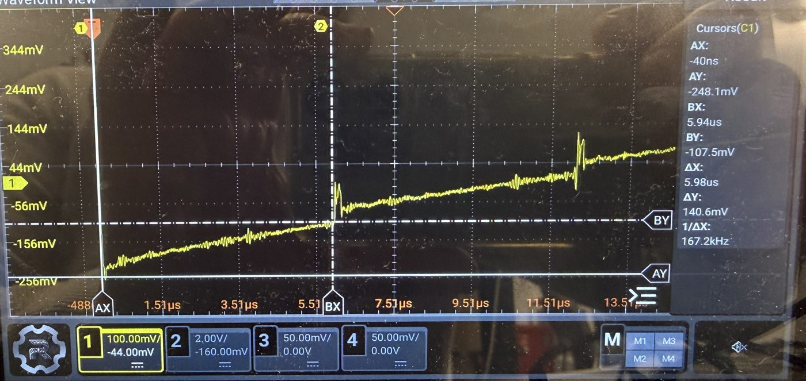

*2:7, 20 MHz, gap 5000 ns. Cursors: -248 mV after the fall, -108 mV before the first pulse.*

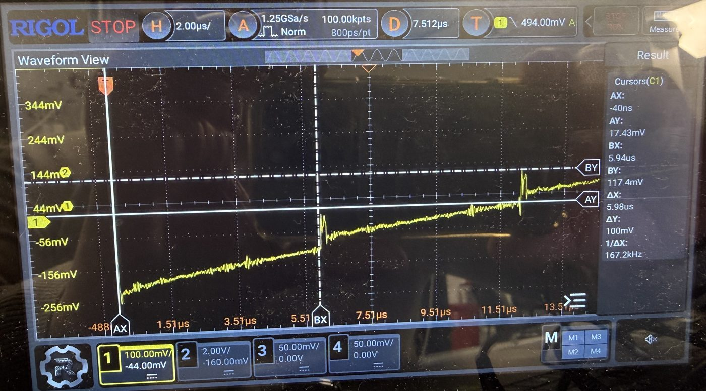

*2:7, same settings, repeat shot. Cursors: 17 mV before the second pulse, 117 mV at its top.*

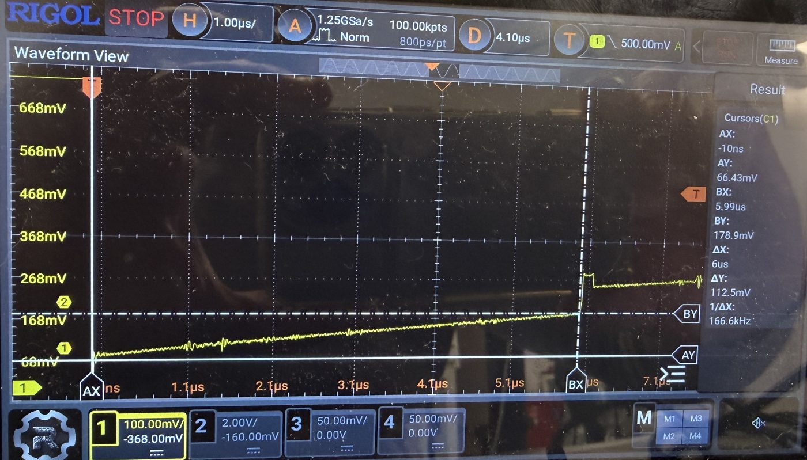

*1:0 with the probe on MXO, 20 MHz, gap 5000 ns. The pulse and jump are at MXO too. Cursors: 66 mV after the fall, 179 mV before the pulse.*

### The net jump J can be calculated

```text
J = (V_r - V) * C_f(V) / C_total          V_r = just below Vmid
Q = J * C_total = (V_r - V) * C_f(V)
```

With `C_f` about 6.3 pF at low voltage, Q is about 7 pC near 0 V. The model gives about 28 mV on 2:7 (measured 22-34 mV) and 72 mV on 2:5 (measured about 81 mV). The charge falls to zero near Vmid, so it behaves like a capacitor reset to about Vmid each frame. The fit target of 13-57 mV below `V_D` fits this. No such capacitor or reset path has been identified. Input 15 (Vmid) on the same mux is only a candidate. `C_f` has to be measured, because the datasheet does not give it.

### The step D fits a small isolated node, but its size has to be measured

```text
D = Q_D / C_x          step up = J + D          step down = D
```

Three rough estimates of the capacitance seen during the pulse, `C_x`:

| Evidence | Reading | `C_x` |
| --- | --- | --- |
| Top of the pulse rises at the `R_b` current, 2:5, 470 kΩ | About 0.2 V/µs at about 2.4 µA, photo | About 12 pF |
| Same, 1:2, 1 MΩ | About 0.12 V/µs at about 1.25 µA, photo | About 10 pF |
| D falls with the MXO probe (about 14 pF), from about 80 to 39 mV | 80 x C_x = 39 x (C_x + 14 pF) | About 13 pF |

A node of 10-13 pF instead of 73-252 pF suggests the sensor is disconnected during the pulse. With D about 80 mV, `Q_D` is about 1 pC. What moves the node up by this amount is not known. Ordinary switch charge injection is doubtful, because a CMOS switch near 0 V would be expected to push the node down when it opens, not up. ADC power-down is ruled out: every command word has the power-down bit (DI05) at 0, continue mode keeps that setting, and the step also appears at MXO, which is before the buffer, while the converter sits after it. The ADC samples during the pulse, so it reads about `V + D`.

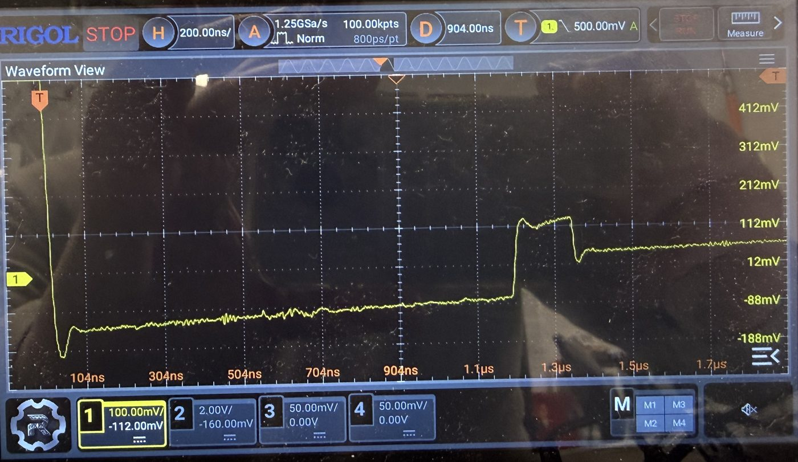

*2:5, 200 ns/div. Flat top with a slow rise, used for the 12 pF estimate. The parked level is off screen.*

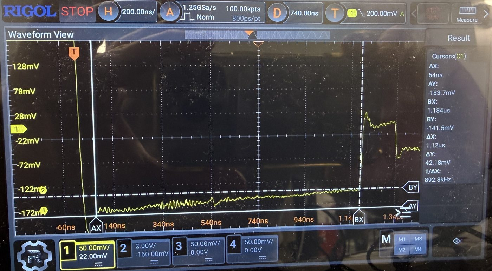

*1:2, 20 MHz, gap 200 ns, 200 ns/div. Top of the pulse, used for the 10 pF estimate.*

**Direction of the steps.** Reconnecting a node above the sensor should pull it down, which matches the step down. Sharing alone gives a net gain of only about `D x C_x / C_total`, about 13 mV on 2:5 against about 81 mV measured, so reconnection cannot supply J. J needs a charge source near Vmid joining the node, which would push it up, and that connection event has not been located. It may be part of the step up.

**Limits of this explanation.** It rests on few readings, several from photos. It does not explain the 7 pC, or why J appears before the sensor is reconnected if the sensor is open throughout the pulse. It also predicts a pulse while parked on Vmid, and the parked traces show only small spikes at this zoom.

## Timeline

### One burst

| Step | Duration | What happens |
| --- | --- | --- |
| Rest | At least 3 s for 2:7 | Sensor disconnected, falling toward its start voltage. The app's default is 300 ms and the sweeps use 500 ms, both too short for a full rest on 2:7. |
| Park | 200 µs, 147 frames | Input 15 selected, node at Vmid. The recorded Vmid words give `V_D`. |
| Frame 0 | 1 frame | Sensor channel commanded. Mux still on Vmid. Returned word has tag 15. |
| Frame 1 | 1 frame | Mux switches to the sensor on the 2nd SCLK falling edge, and the node falls. Returned word has tag 15. |
| Frame 2 | About 1.19 µs after the switch at 20 MHz, gap 200 ns | First sensor sample, the first word with the sensor's tag. |
| Later frames | N samples, one per `T` | The channel is re-commanded each frame unless in continue mode. The pulse and jump repeat each frame. |
| End | | Board parks on Vmid again. |

### One frame at 20 MHz, gap 200 ns (T = 1373 ns)

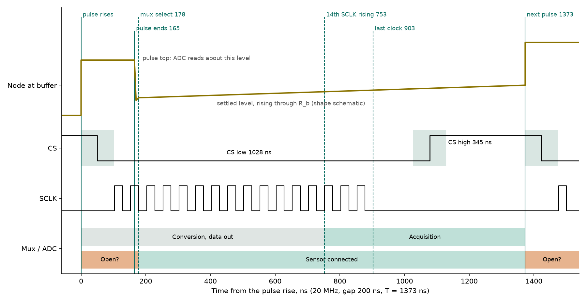

Solid lines were measured on the op-amp output. Dashed lines are derived from the datasheet edges by placing mux select at 178 ns. Shaded CS bands show where the CS edges could be before CS and the node were captured together. The 3 November capture (below) puts CS falling at the pulse rise, so the CS fall belongs at 0 ns, not 50 ns. The trace shape is schematic.

The same frame as text:

Drawn to scale, one character is 25 ns. Time is measured from the pulse rise. `?` marks where an edge or state was uncertain when this diagram was drawn. The 3 November capture has since placed CS falling at 0 ns.

```text
ns       0       200     400     600     800     1000    1200    1400
Marks    A     BC                      D     E                  F
Node top =======                                                =======
Node low        __ settled, rising through R_b _________________
CS       ????_____________________________________????----------????___
SCLK         ################################
ADC      ... conversion ...............~~~ acquisition ~~~~~~~~~????
Mux      ???????+++ sensor connected +++++++++++++++++++++++++++???????
```

| Mark | Time | Event | Source |
| --- | --- | --- | --- |
| A | 0 ns | CS falls and the pulse rises | Scope, CS and node together |
| B | 165 ns (172-180 ns from CS fall, 3 Nov) | Pulse ends | Scope |
| C | About 178 ns | Mux select, 2nd SCLK falling edge | Datasheet edge, placed from the scope's fall at connection |
| D | About 753 ns | 14th SCLK rising, acquisition starts | Derived from C; weak feature on the scope |
| E | About 903 ns | Last clock ends | Derived from C |
| F | 1373 ns | Next pulse rises | Firmware cycle counter |

### Where the mux switches

| Event | Time at 20 MHz | Basis | Confidence |
| --- | --- | --- | --- |
| First connection to the sensor, Vmid to sensor | Frame 1, about 175-194 ns after CS falls | Datasheet, and the node falls at this point on the scope with CS on screen | Good |
| Mux off (sensor disconnected), each frame | About 0 ns, at the pulse rise | Small node during the pulse. The datasheet does not state a switch-off. | Inferred |
| Mux on (same sensor reconnected), each frame | About 178 ns, 2nd SCLK falling edge | Datasheet says the channel is selected every frame; the pulse ends 13-18 ns before this point | Inferred for the same channel |
| Sensor connected | About 178 to 1373 ns (about 87 % of the frame) | From the two above | Inferred |

The open time scales with the clock: about 178 ns at 20 MHz and 283 ns at 10 MHz, and the pulse width goes from 165 to 270 ns. The difference is about 2 clocks, not 1.5. The Teensy SPI library sets the LPSPI CS-to-first-clock delay (`PCSSCK`) to half a clock period, so the delay from the pulse rise to the 2nd falling edge is about 60 ns of fixed software time + 0.5 clock + 1.5 clocks: 160 ns at 20 MHz and 260 ns at 10 MHz. Continue mode leaves it unchanged, which fits a mux that re-selects every frame whatever the command says. If the datasheet's sampling edge is right, the sample is taken at CS falling, inside the pulse, while the sensor would be disconnected.

### CS and the node captured together (3 November 2026)

Channel 2:5, 20 MHz, CH1 on the buffer output, CH2 on ADC2 CS (Teensy pin 24). Readings are cursor values unless marked.

| Capture | Gap | CS fall to step down | Notes |
| --- | --- | --- | --- |
| Sensor frame, 200 ns/div, two shots | 200 ns | 180 ns, 180 ns | Step up starts at the CS fall |
| Sensor frame, 50 ns/div | 5000 ns | 175.5 ns | Step up starts within a few ns of the CS fall |
| Sensor frame, 200 ns/div | 5000 ns | 172 ns | |
| Connection frame, node falls from Vmid to the sensor, 200 ns/div | 5000 ns | 194 ns | Cursor on the falling slope |
| Connection frame, 500 ns/div | 5000 ns | 210 ns | Cursor near the bottom of the fall, coarse timebase |

What this shows:

- **The step up starts at CS falling.** It does not wait for the first SCLK, which comes about 85-100 ns later. The power-down idea is ruled out separately (see the step section).
- **The step down is 172-180 ns after CS falls, at both gaps.** That is where the 2nd SCLK falling edge (mux select) lands with a CS-to-first-clock delay of about 100 ns. The connection fall in frame 1 starts at the same point. The 194 and 210 ns readings are later points on that slow, large fall.
- **CS rising only couples ringing into the node.** The trace returns to the same level, so no charge moves at CS rise.
- **Frame period check:** CS is low for about 1.0 µs, then high for the gap, as expected.

CH1 was set to 1x with a 10x probe (confirmed), so the displayed CH1 values are 10 times low. The levels below are photo readings multiplied by 10, with about ±10 mV of reading error:

| Capture | Step up | Step down, D | Net jump, J |
| --- | --- | --- | --- |
| 2:5, gap 5000, 50 ns/div | About 165 mV | About 78 mV | About 88 mV |
| 2:5, gap 200, 200 ns/div | About 160 mV | About 54 mV | About 106 mV |

- The gap-5000 shot repeats the 2 November no-clipping shot (163, 82, 81 mV) within reading error.
- An earlier reading of the connection frame (no step at Vmid, and a floor that capped `C_par` at about 6 pF) was withdrawn. At the 1 V/div that frame really had, a 60 mV step is about 4 pixels, and the floor is not readable (see below).

#### Step size against node level (CH1 corrected, 2:5, gap 5000, 2 µs/div)

Photo readings from five captures at 100 or 50 mV/div, each value about ±7 mV. Levels are as the scope shows them; differences are more reliable than absolute levels.

| Level before the pulse | Step up | Step down, D | Net jump, J |
| --- | --- | --- | --- |
| About 0.10 V (frame 1, two captures) | 185-195 mV | 85-95 mV | About 100 mV |
| 0.31 V | 150 mV | 70 mV | 79 mV |
| 0.40 V | 152 mV | 68 mV | 84 mV |
| 0.56 V | 120 mV | 64 mV | 56 mV |
| 0.75 V | 99 mV | 56 mV | 43 mV |
| 0.99 V | 81 mV | 52 mV | 29 mV |
| 1.06 V | 77 mV | 54 mV | 23 mV |
| 1.12 V | 70 mV | 49 mV | 21 mV |
| 1.19-1.22 V | 62-71 mV | 51-58 mV | 7-13 mV |

- **D does not vanish near Vmid.** It falls slowly from about 90 mV near 0.1 V to about 50-55 mV above 1 V. The pulse top near Vmid reaches about 1.28 V, above Vmid, so the step up is not a pull toward Vmid.
- **J goes toward zero near Vmid, apart from a constant residual.** When the isolated node, lifted by D, reconnects, it shares that charge with `C_total` and leaves about D x C_x / C_total, roughly 9-12 mV, behind. Subtracting that residual, J/(Vmid − V) is 0.066-0.09 across the whole range, which means `C_f` about 5.5 pF (±1 pF) with V_r at Vmid and no clear voltage dependence. This is a photo-reading result. It disagrees with the ADC-based `C_f(V)` (6.3 pF falling to 2.6 pF), which was fitted to samples taken during the pulse, at V + D, with a target 13-57 mV below `V_D`.
- **The two effects separate:** D is a kick of roughly constant size (about 0.5-1 pC on a 10-13 pF node) that pushes the node above Vmid when the node is near Vmid, and J is the charge that resets at Vmid. Neither source is identified.

**Scope DC levels checked.** The probe on board ground reads 0 V, and the buffer output with the board idle (parked on Vmid, no SPI frames) reads about 1.25 V (cursor 1.255 V at 10 mV/div, noise about ±15 mV with spikes to about ±40 mV). So the late-frame levels near 1.22 V and the pulse tops near 1.28 V are real, and the pulse does go above Vmid.

**The negative level after the connection is not explained by overdrive (withdrawn).** An earlier version of this report blamed the −0.13 V on scope overdrive, because Vmid was 8-9 divisions above the screen in those captures. The 3 November floor shot (2:5, 200 mV/div, offset −296 mV, so Vmid only about 0.8 division above the top) shows the same levels. The cursors read −216 mV at the trough of the fall and −132 mV at the end of the first frame, 1.2 µs later. The node then crosses 0 V at the first pulse. An overdrive of under one division at 200 mV/div is too small to cause this. The OPA365 runs from a single supply with V- at ground, so its output cannot be at −0.13 V against its own V- pin.

A second shot (offset −464 mV, everything on screen) gives the same picture with cursors placed by the user:

| Point | Scope reading |
| --- | --- |
| Parked level just before the fall | 1.17 V |
| Bottom of the fall | −214 mV (1.38 V below the parked level) |
| End of the first frame, just before the step up | −80 mV (1.25 V below the parked level) |

The node falls by the full Vmid, 1.25 V, and settles to what would be 0 V if the parked level were 1.25 V. The ADC reads the park as 1.2495 V (mid-code 2047, `capvmid`), and the scope read 1.255 V with the board idle. During the burst the scope reads the same park as 1.17 V. The simplest reading is that the scope's whole trace is about 80 mV low while the burst runs: the node actually falls to about 0 V (the op-amp's lower limit), and the extra 130 mV dip at the bottom is ringing. A ground difference between the probe and the board that appears only while the board is active would cause this. It would also explain the earlier finding that the scope reads up to 113 mV below the ADC on 2:7. Not yet tested. If it is confirmed, the levels in the step-against-level table are also about 80 mV low, and the conclusion that the pulse top goes above Vmid has to be re-checked.

**The small spikes in the gap** are also present with the board idle, with no SPI activity at all, so they are ambient pickup, not part of the frame.

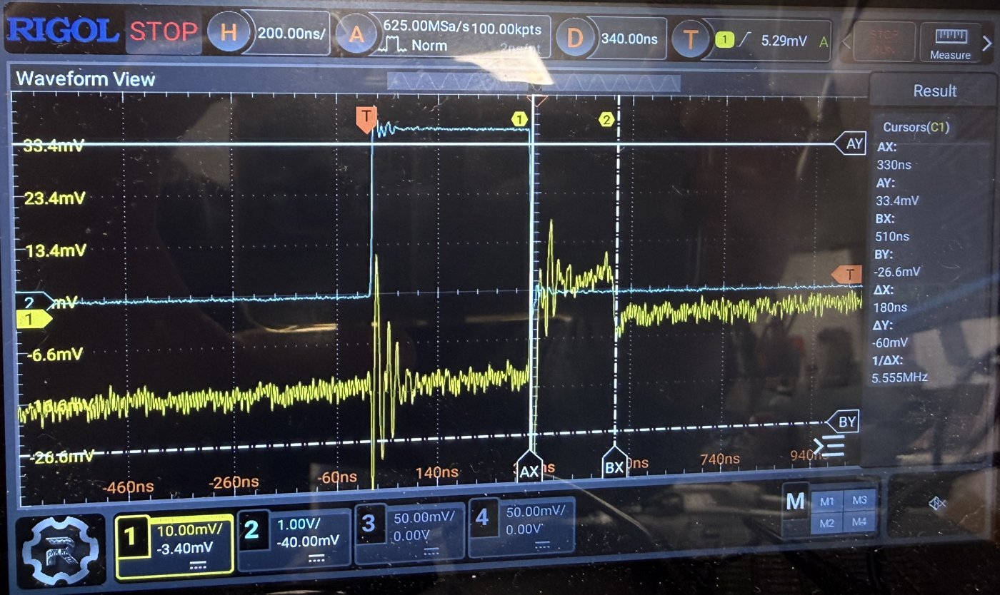

*2:5, gap 200 ns, 200 ns/div. Cyan CS, yellow buffer output. CS falls at AX = 330 ns, where the step up starts; the step down is at BX = 510 ns, 180 ns later. CS rising (near 0 ns) gives ringing only.*

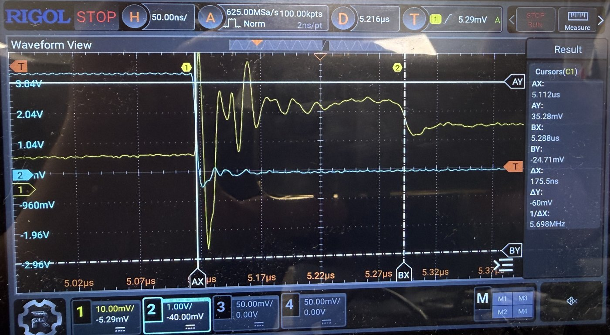

*2:5, gap 5000 ns, 50 ns/div. CS falls at AX = 5.112 us and the step up starts with it; the step down is at BX = 5.288 us, 175.5 ns later.*

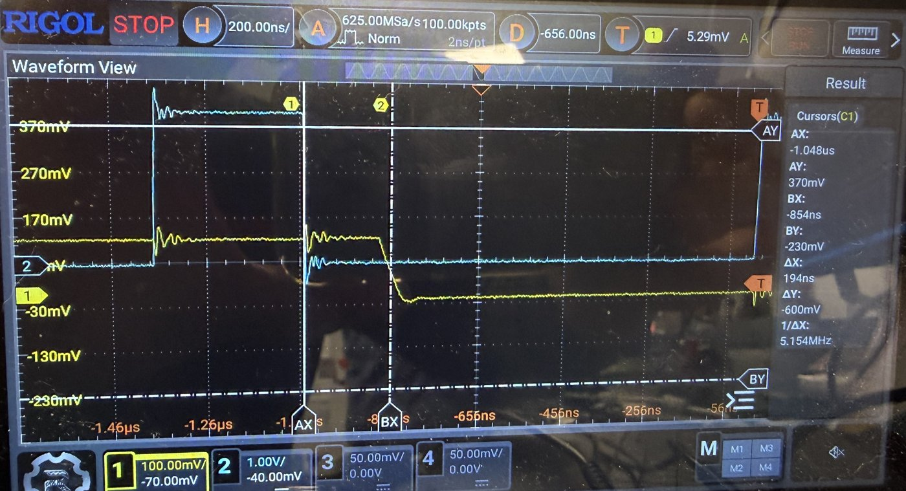

*2:5, gap 5000 ns, connection frame, 200 ns/div, CH1 really at 1 V/div (displayed as 100 mV/div). CS falls at AX = -1.048 us; the node falls to the sensor at BX = -854 ns, 194 ns later.*

### Time budget of the frame

| Interval | Time | Source |
| --- | --- | --- |
| Frame period | 1373 ns | Firmware cycle counter (824 cycles at 600 MHz) |
| CS high | 345 ns | Scope cursor, CS probe alone. The trace amplitude was distorted, so only edge times were used. |
| CS low | 1028 ns | Period minus CS high |
| 16 clocks | 800 ns | 20 MHz |
| Overhead inside CS low | About 228 ns | 1028 - 800. The split before and after the clocks is not measured. |
| CS low to first clock | About 85-100 ns at 20 MHz: a fixed part + half a clock (`PCSSCK = div/2` in the Teensy SPI library). The app assumes 25 ns. | Derived from the pulse widths at 20 and 10 MHz and the 172-180 ns CS-to-step-down time; SCLK not probed |
| Pulse width | 165 ns | Scope |
| Pulse end to mux event | 13-18 ns | Scope, from the fall at the connection |
| Acquisition | At least about 620 ns (datasheet minimum 325 ns) | Derived |

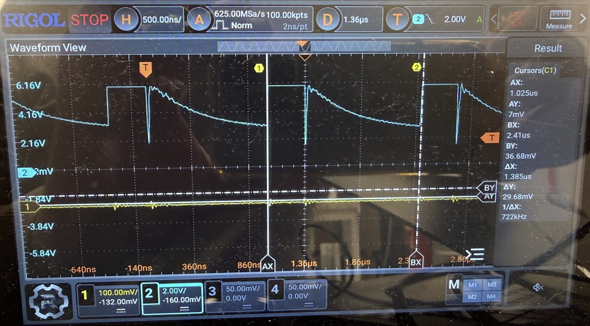

*CS alone (cyan), 20 MHz, gap 200 ns, CH1 not connected to the node. Cursor spacing gives the 1.385 us period. CS rises at 1.025 us and falls at about 1.36 us, giving about 345 ns high. The CS amplitude is distorted, so only edge times were used.*

### The same features at other settings, channel 1:0

| Clock, gap | `T` | Pulse width | Pulse rise to mux event | Net jump |
| --- | --- | --- | --- | --- |
| 20 MHz, 200 ns | 1373 ns | 165 ns | About 178 ns | About 114 mV |
| 10 MHz, 200 ns | 2213 ns | 270 ns | 283 ns | About 109 mV |
| 10 MHz, 5000 ns | 7013 ns | About 220-280 ns (photo) | 283 ns | About 114 mV |

These 1:0 jumps come from captures with the parked level off screen, which overstated the jump on 2:5, so they may be high. The pulse follows the clock and the start of the frame, not the CS-high time. Its end stays locked to the mux selection.

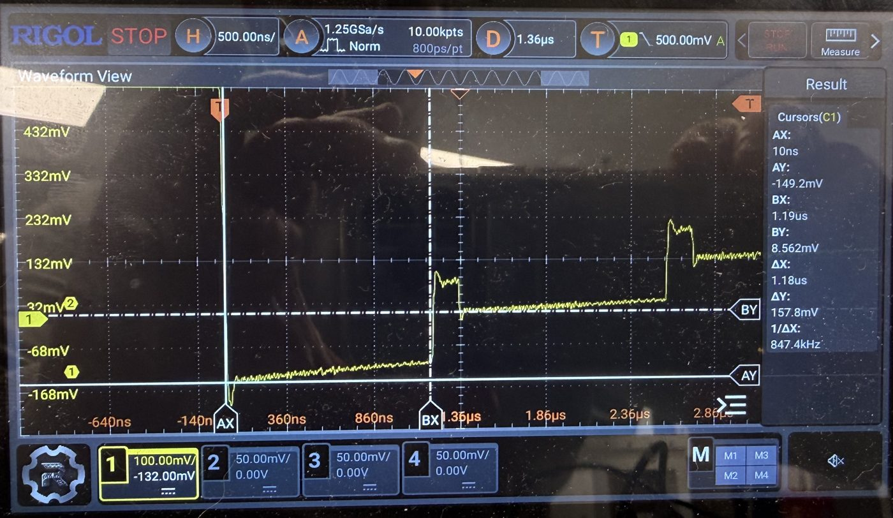

*1:0, 20 MHz, gap 200 ns. Cursors: -149 mV after the fall, first pulse at 1.19 us. Parked level off screen.*

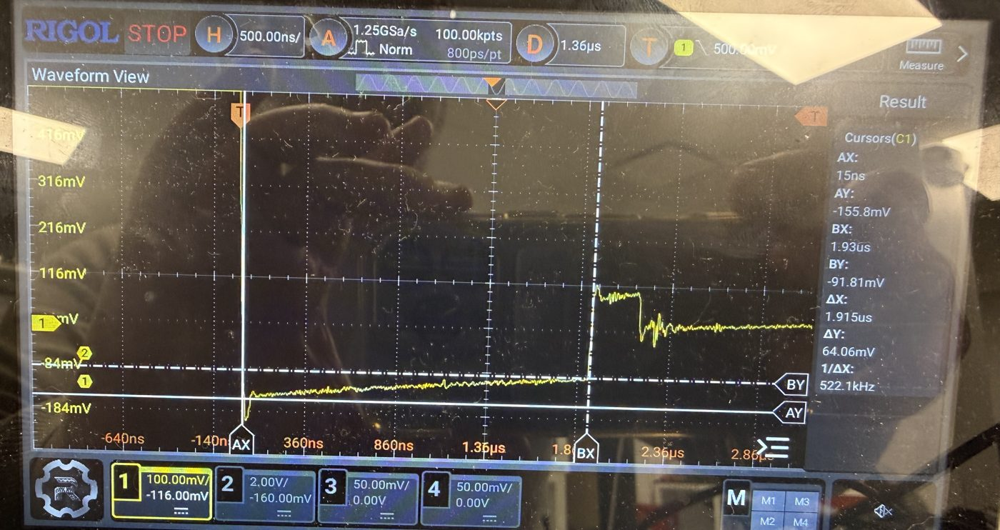

*1:0, 10 MHz, gap 200 ns. The pulse is wider. Cursors: -156 mV after the fall, pulse rise at 1.93 us. Parked level off screen.*

### Fit with the ADS7953 datasheet (SLAS605C)

| Datasheet statement | Observed | Status |
| --- | --- | --- |
| Mux selected on the 2nd SCLK falling edge, in every frame and mode | Pulse ends just before the same point at both clocks. Continue mode changes nothing. | Fits |
| Acquisition starts on the 14th SCLK rising edge | Small bump 1134 ns after the mux event at 10 MHz (predicted 1150). Weak features near 575 ns at 20 MHz. | Fits, weak signal |
| Sample taken at CS falling, 5 ns aperture | On 2:5 the ADC reads 292 mV, the pulse top is 297 mV and the level before the pulse is 134 mV. So CS must fall after the pulse rises. | Needs CH1 and CS together |
| No listed event during CS high | If CS falls inside the pulse, the pulse rise has no datasheet edge. | Unexplained |
| 15 pF input capacitance disturbs the new channel (section 9.1) | This describes a source driving the input directly. The buffer should block it, yet the pulse is on MXO. | Source of the charge unknown |

## What we did

| Date | Test | Result | Results folder |
| --- | --- | --- | --- |
| 10-30 | Gap sweep, 8 gaps | `1/tau` is a line in `1/T` | `2026-10-30_gap_sweep_8gaps` |
| 10-30 | Continue command against re-command | `C_total` within 0.42 %, `C_f` within 1.22 % | `2026-10-30_continue_mode` |
| 10-30 | 20 and 10 MHz at equal `T` | `C_f` ratio 0.999 | `2026-10-30_spi_clock` |
| 11-02 | Scope on 1:0 at the op-amp output, two clocks, two gaps; CS alone | Pulse and jump each frame, timing above | `2026-11-02_scope_test`, `_2`, `_10MHz` |
| 11-02 | Scope at MXO on 1:0 | Pulse and jump also at MXO | `2026-11-02_scope_test_10MHz`, `_4` |
| 11-02 | Scope on 1:2, rest and probe checks | Channel differs from the 10-30 record; rest and probe are not the cause | `_5`, `_6`, `_7`, `2026-11-02_channel_recheck` |
| 11-02 | Sweep of all ADC1 and ADC2 channels | Table below | `2026-11-02_gap_sweep_adc12` |
| 11-02 | Scope on 2:5 and 2:7 | Jump scales with `C_total` | `2026-11-02_scope_adc2`, `_b`, `_d` |
| 11-02 | Rest time on 2:7 | 3 s is enough | `2026-11-02_rest_time_2_7` |

Folders are under `CapTest/Results/TestBoard_7953/`, which git ignores. Selected scope photos, cropped to the screen, are in `images/testboard7953_capacitance/`. Their original file-name labels did not reach the analysis, so each photo was matched to a shot by its scope settings and the saved ADC values. A mismatch is possible, most of all on photos with no cursors.

## Results

### Channels

Fitted values, 8 gaps, 5 repeats, 2026-11-02:

| Sensor | `R_b` | Channels | `C_total` | `C_f` |
| --- | --- | --- | --- | --- |
| Large | 470 kΩ | 2:2, 2:7, 2:12 | 252-261 pF | 3.15-3.16 pF |
| Small | 1 MΩ | 1:0, 1:1, 1:4, 1:5, 1:6, 1:9 | 69-73 pF | 3.97-4.04 pF |
| Small | 470 kΩ | 2:4, 2:5 | 73-78 pF | 4.04-4.08 pF |
| Small | 470 kΩ | 2:0, 2:3, 2:6, 2:8-2:11, 2:13, 2:14 | 133-142 pF | 3.30-3.67 pF |
| Small, odd | 1 MΩ | 1:8 | 94 pF | 3.67 pF |
| Small, odd | 1 MΩ | 1:3 | 147 pF | 5.12 pF |
| Large, odd | 1 MΩ | 1:7 | 97 pF, about a third of the other large sensors | 3.83 pF |
| Poor fit, excluded | | 1:2 (misfit 10.6 %), 2:1 (7.9 %) | 483 and 176 pF | |

- **Size ratio:** large against the normal small group is 3.2-3.8, against an expected 2.94.
- **Open:** nine small ADC2 channels read about twice the others, near 2 x 70 pF. The cause is unknown.
- **Repeatability:** 1:0, 2:2, 2:7 and 2:12 match 10-30 within about 1.3 %.
- **ADC3 and ADC4** are left out. Their sensors are in poor condition, and it is not certain which sensors were attached on 10-30. For the same reason, the differences seen on 1:2, 3:2 and 4:12 against the 10-30 record may not be changes in one sensor.

### Per-frame jump

20 MHz, gap 5000 ns unless noted. Model values use fitted `C_total` and the `C_f` voltage curve.

| Channel | Net jump on scope | Model jump | Charge per frame | First ADC step | Model step |
| --- | --- | --- | --- | --- | --- |
| 2:5 | About 81 mV (nothing off screen, photo) | 72 mV | About 6 pC | 220 mV | 228 mV |
| 2:7 | 22 and 34 mV (cursors) | 28 and 26 mV | About 6-9 pC | 87 mV | 85 mV |
| 2:5, gap 200 ns | | 94 mV | | 129 mV | 136 mV |

The ADC steps agree with the model within about 7 % on these channels.

### Rest time, 2:7

| Rest | 0.5 s | 1 s | 2 s | 3 s | 5-40 s |
| --- | --- | --- | --- | --- | --- |
| First sample | 770 mV | 640 mV | 214 mV | 95 mV | 93 mV |

The curve is not a single exponential: it falls slowly, then quickly, then stops at a floor. The discharge path has not been identified. Only 2:7 was measured. Small channel 1:0 reads close to its rested first sample at 500 ms (first/V_D 0.113 against 0.092). The sweeps' 500 ms spacing therefore keeps large sensors in the upper part of their voltage range. This may explain why those fits give lower `C_f` than rested bursts, but that has not been tested.

### Scope against ADC

| Frame | 1 | 2 | 3 | 4 | 5 | 6 |
| --- | --- | --- | --- | --- | --- | --- |
| 2:7 scope below ADC, pulse tops | 113 mV | 74 mV | About 55 mV | About 30 mV | About 17 mV | About 0 |

Frames 1 and 2 use cursors, the rest a photo. With the parked level on screen, 2:5 agrees (297 against 292 mV). The 2:7 shots had the parked level about 130 mV off screen, so overdrive of the scope input is still possible. The scope also shows levels below 0 V after the fall (2:7 -239 mV by cursor, 2:5 about -100 mV by photo). The OPA365 output cannot reach these with no negative rail, and no negative voltage was seen at the sensor pads. So they are a measurement artifact or an unidentified effect. Earlier ideas of a negative rest voltage and negative charge injection have been withdrawn.

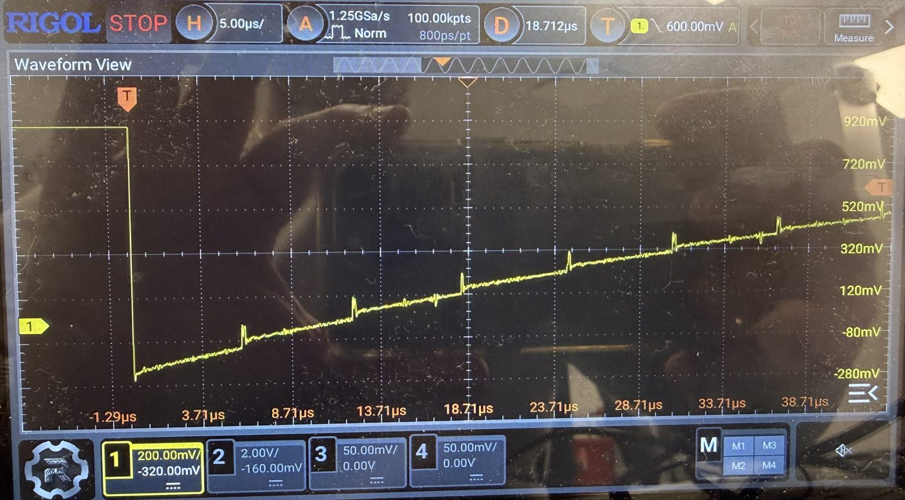

*2:7, 5 us/div, parked level about 130 mV off screen. Used for the scope-against-ADC table.*

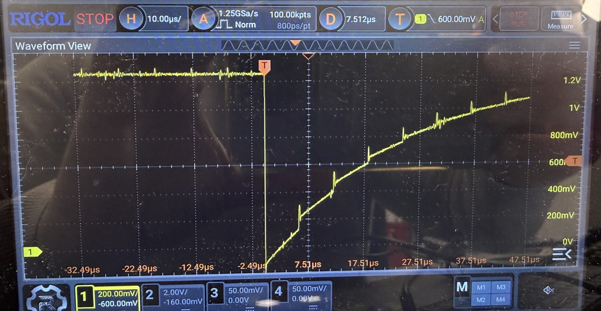

*2:5, 10 us/div, gap 5000 ns, whole fall and most of the rise on screen.*

### Switching to Vmid between samples (3 November)

CapTest firmware 1.2.0 adds `capalt`. After the park it repeats S frames on the sensor, then V frames on Vmid (input 15), as production does with Vmid between channels. Each Vmid frame resets the node to a known voltage. So the sensor's distance from Vmid shrinks by a fixed ratio each cycle: `r = (1 − C_share/C_total) · exp(−S·T/tau)`. U_k is the last sensor sample of cycle k, and the fit is `U_{k+1} = r · U_k + (1 − r) · V_inf`. ADC2, 20 MHz, scope on the buffer output. Run: `tools/scope_test_7953.py --set alternate`; data in `CapTest/Results/TestBoard_7953/2026-11-03_scope_test_alternate`.

| Shot | Sensor | S:V | T, µs | r | `C_share`, pF (tau = R_b × C_total) | Fitted `V_inf` below `V_D`, mV (extrapolated) | Last 10 readings below `V_D`, mV (measured) |
| --- | --- | --- | --- | --- | --- | --- | --- |
| Production pattern | 2:5 | 1:2 | 1.40 | 0.825 | 10.3 | 36.5 | 12.1 |
| Long gap | 2:5 | 1:2 | 6.19 | 0.717 | 10.3 | 22.9 | 6.7 |
| One Vmid frame | 2:5 | 1:1 | 1.40 | 0.824 | 10.4 | 36.2 | 12.1 |
| Three sensor frames | 2:5 | 3:2 | 1.41 | 0.678 | 17.1 | 30.4 | 11.5 |
| Large sensor | 2:7 | 1:2 | 1.40 | 0.946 | 10.8 (`C_total` assumed 252 pF) | 36.1 | 5.4 |

Repeats agreed within 0.1 pF (three on 2:5, five on 2:7). Tag errors were 0 throughout.

- **The alternating bursts measure `C_total` on their own.** With S fixed, `r(T) = A_S · exp(−S·T / (R_b · C_total))`. `A_S` lumps every switching effect of one connection, and a second gap cancels it: `C_total = S·(T2 − T1) / (R_b · ln(r1/r2))`. The S = 1 shots give tau 34.4 µs, so `C_total` = 73.2 pF with `R_b` = 470 kΩ, and the effective connection capacitance `C_total · (1 − A_1)` = 10.4 pF. This matches the 73 pF from rested bursts, and it does not need the sensor to start at 0 V. Changing how much of the late curve enters the fit moves it within about 72.5-74.0 pF (Codex review). It still rests on the circuit model and the nominal `R_b`.
- **The effective connection capacitance is about 10.5 pF on both sensors** (10.3 on 2:5, 10.8 on 2:7). The 2:7 value used the assumed `C_total` of 252 pF. The later single-burst measurement (step 5) gives 2:7 its own `C_total`, 257.5 pF, and the same 6.5-6.8 pF at `V_D` on all four channels. It is the charge taken per connection, as an equivalent capacitance reset to V_D, and it is an effective value, not a measured parasitic to subtract from `C_total`. Most of it is not an instant charge sharing. The scope shows the first drop going to about 0 V (cursor 18 mV) and rising during the connected frame. Sharing 10 pF at the instant of connection would put the drop at about 0.18 V.
- **Each extra sensor frame acts like the ordinary per-frame charge.** The factors multiply, because each operation acts on the remaining distance: `1 − C_share,3/C_total = (1 − C_share,1/C_total) · (1 − f)²`. So `f` = 0.0553, `C_total · f` = 4.05 pF, and in rate form `−C_total · ln(1 − f)` = 4.17 pF. That matches the ordinary-burst `C_f` of 4.04 pF on 2:5 (step 1). My earlier figure of 3.4 pF per frame subtracted the two values and was wrong (Codex review). A model that covers every S is `ln r = ln A_conn + (S − 1) · ln A_hold − S·T / (R_b · C_total)`. It has one factor for the connection from Vmid and one for each further sensor frame. Shots with different S cannot share one connection factor, so the tool combines only shots with equal S.
- **One Vmid frame resets the node fully.** The first Vmid sample after each connection is within ±0.6 mV of `V_D` in every shot, and 1:1 gives the same `C_share` as 1:2. At this channel and 20 MHz, the second Vmid frame of the production pattern does not change the sensor reading. Its effect on ghosting between channels was not tested here.
- **Withdrawn: "the sensor settles 23-37 mV below `V_D` from a fixed 0.47 pC per connection".** The fitted `V_inf` extrapolates the early cycles (those more than 30 mV below `V_D`). The measured curve passes it and keeps rising: the last ten readings are only 5-12 mV below `V_D` (table). The contraction factor also changes with voltage, so 0.47 pC is a parameter of that straight-line fit, not a physical charge. A physical injection charge would also need its place in the cycle. When the voltage dependence is fitted (step 5), the fixed term falls to 0.09-0.19 pC. Its source and size remain open. Pointed out in the Codex review.
- **The scope read the park at 1.252 V in these captures**, in agreement with the ADC (1.249 V). The 80 mV low reading of the earlier floor shot was not present.
- **What this means for production.** Each connection reduces the sensor's distance from `V_D` by the connection factor, about 14 % on 2:5 and 4 % on 2:7 near 0 V and less near Vmid. `R_b` sits on MXO, so it charges the sensor only while the sensor is selected. Its average effect is set by the connected fraction of the revisit period. Modelling the switching as an equivalent conductance of about `C_share / T_rev` is useful, but there is no established fixed target voltage. The earlier "about 1.21 V" came from the withdrawn extrapolated `V_inf`.

## What is established and what is open

| Established | Evidence |
| --- | --- |
| A once-per-frame charge exists | Seen on the scope and in ADC steps; `1/tau` line |
| It is independent of `R_b`, of SPI clock at equal `T`, and of the channel command | Sweeps and comparison tests |
| It appears at MXO | Direct probe |
| Jump size scales inversely with `C_total` | 2:5 against 2:7 |
| The step up starts at CS falling; the step down is 172-180 ns later, at both gaps | CS and node in one capture, 3 November |
| With Vmid between samples and S fixed, two gaps cancel the connection factor: `C_total` = 73.2 pF on 2:5 (72.5-74.0 with different fit ranges) | `capalt`, 3 November |
| Each further sensor frame in a connection takes about 4.1 pF of rate, matching the ordinary-burst `C_f` of 4.04 pF on 2:5 | `capalt` 3:2 against 1:2, factors multiplied |
| One Vmid frame returns the node to `V_D` within 0.6 mV | `capalt` 1:1 and 1:2 |
| One burst with Vmid between samples gives `C_total` to 0.1-0.2 % repeatability, within +0.5 to +2.7 % of the 8-gap sweep, without the sensor start voltage; `C_share` at `V_D` is 6.5-6.8 pF on four channels | Step 5, CapTest default from firmware 1.3.0 |

| Open | What would answer it |
| --- | --- |
| `C_par`, and so `C_s` | Sweep with a strip unplugged |
| Absolute capacitance | LCR meter on a sensor |
| Scope reads low on 2:7, and negative levels | 2:7 at 200 mV/div, offset -500 mV, nothing off screen; then probe at AIN |
| Whether the mux opens during the pulse | Zoomed shot while parked; known capacitor in place of a sensor |
| Scope reads about 80 mV low during bursts (park 1.17 V against 1.25 V idle and 2047 counts on the ADC; floor −80 mV) | CH2 at 20 mV/div on the OPA365 V- pin, ground clip at the same point as CH1's, during a burst and with the board idle |
| Physical source of the connection factor `A_conn` and of its voltage dependence; whether a fixed injected charge exists | `capalt` with a known capacitor added to a channel, more gaps on 2:5; a different voltage on input 15 |
| Source of the per-frame charge | Temporarily change the voltage on input 15, or use a known capacitor in place of a sensor |
| Extra 60 pF on nine ADC2 channels; odd 1:2, 1:3, 1:7, 1:8, 2:1 | Array routing check; strip-unplugged sweep |
| Early slope on 2:7 above `R_b` (22 against about 12 mV/µs) | The same no-clipping shot. On 2:5 it matches `R_b` within a rough reading (39 against 37 mV/µs). |

## What this means for measuring

1. Do not report `C_total = tau / R_b` from a single short frame. Use two frame periods, or a long frame where `R_b` does 90 % or more of the charging (T about 36 µs here).
2. Rest large sensors at least 3 s before a burst that needs a known start. The app's 300 ms default is too short for 2:7. Other channels still need measuring.
3. Use the ADC as the reference. On the scope, keep the parked level on screen, and do not probe MXO when measuring capacitance.
4. Check any channel against the sweep before trusting it, since same-size sensors currently differ by a factor of two.
