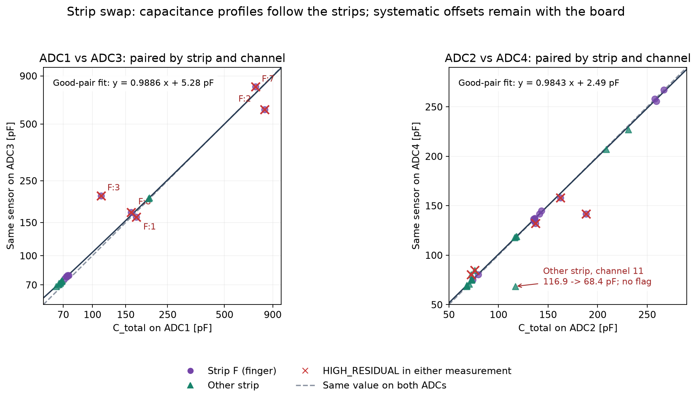
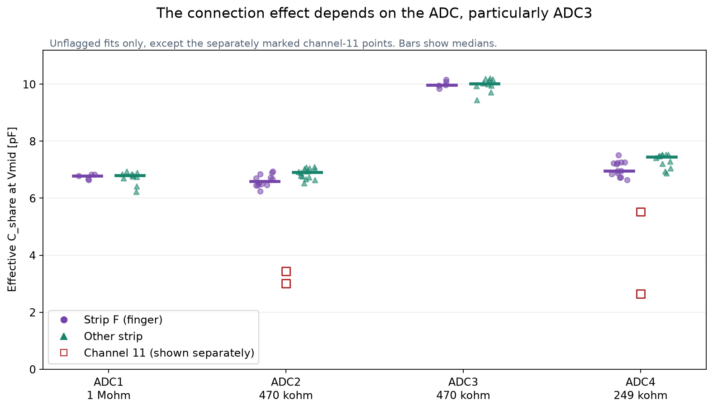
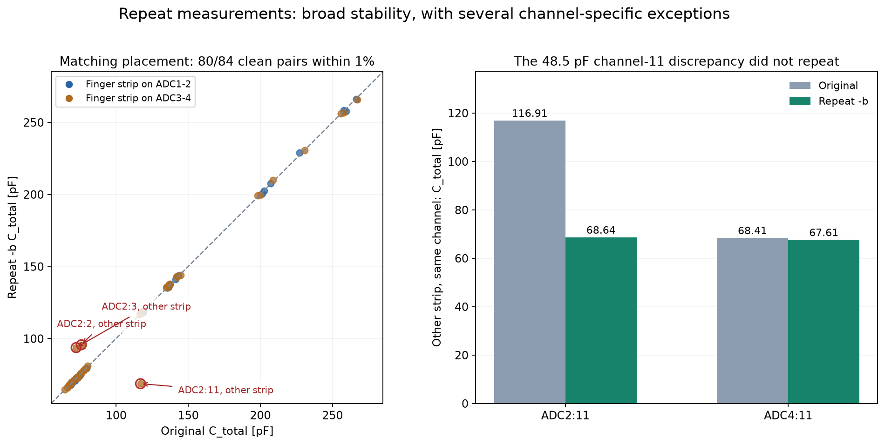
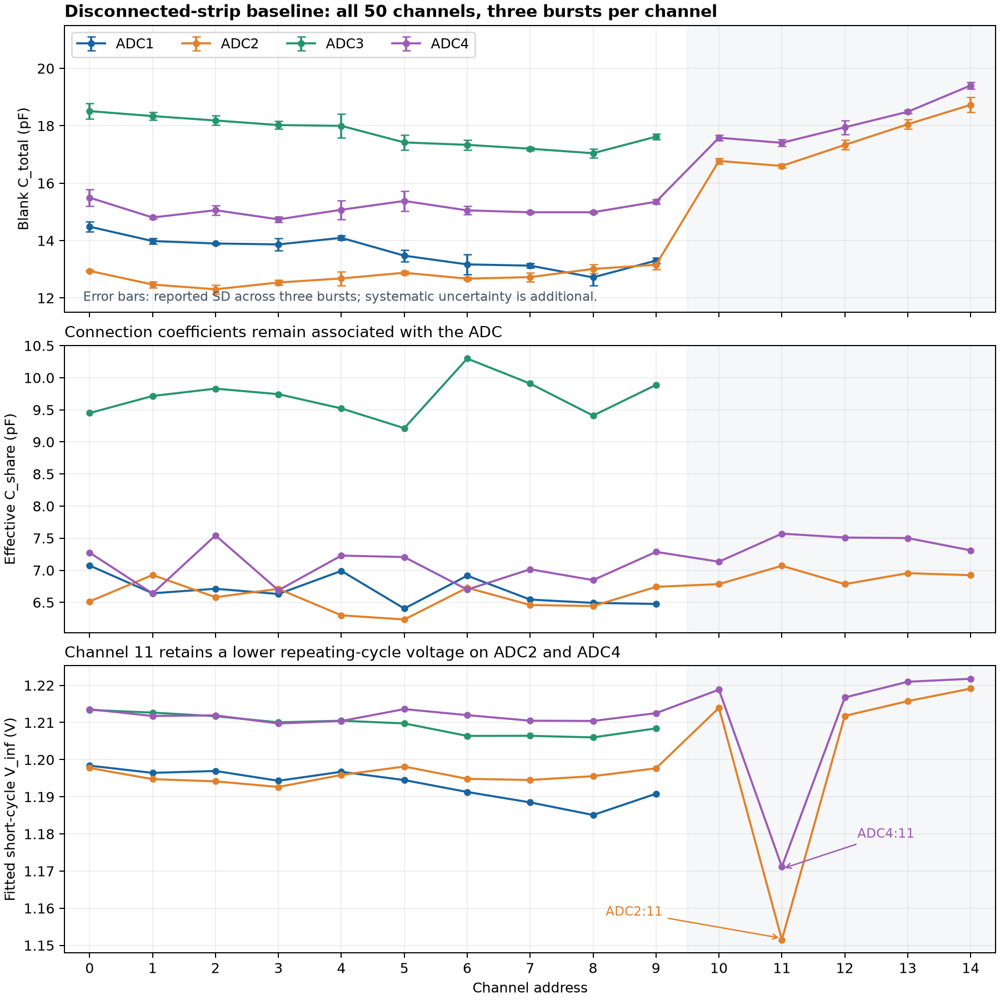
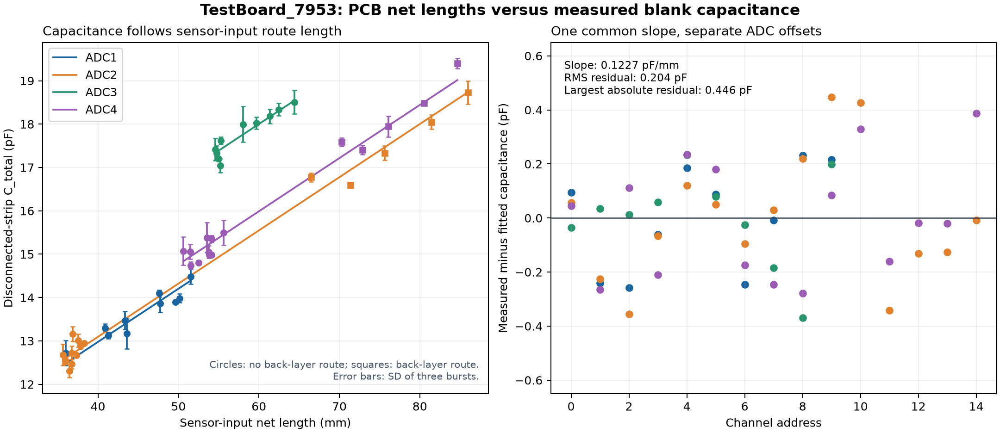
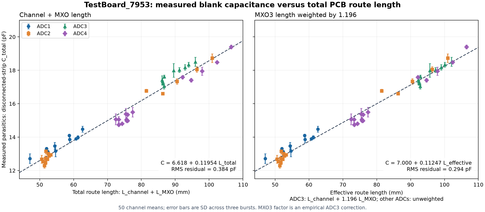

# TestBoard_7953: strip-swap comparison, 4 November 2026

The capacitance profiles and the strongest fit failures follow the strips. A smaller systematic capacitance difference and a substantial difference in effective connection capacitance remain associated with the ADC/board position. Channel 11 requires separate investigation.

**Follow-up:** the `-b` runs confirm the broad patterns, but the original large channel-11 capacitance discrepancy does not repeat. Several previously flagged channels also recover. See the repeat comparison at the end; those exceptions should not be classified as permanent sensor defects or fixed ADC offsets from the first two runs alone.

**Disconnected-strip control:** the subsequent blank run explains most of the ADC3-versus-ADC1 capacitance offset, supplies per-channel board baselines, and confirms a channel-11 repeating-cycle voltage anomaly without either strip. See the final section for subtraction limits and numerical results.

## Data and pairing

Sources: [finger on ADC1-2](../../CapTest/Results/TestBoard_7953/2026-11-04_switching_strips/finger_on_ADC1-2.json) and [finger on ADC3-4](../../CapTest/Results/TestBoard_7953/2026-11-04_switching_strips/finger_on_ADC3-4.json), plus matching CSV exports in the same directory.

Strip F denotes the strip called “finger” in the filenames; strip O denotes the other strip. The comparison assumes the swap preserves channel order: ADC1 corresponds to ADC3, and ADC2 to ADC4. Under that mapping, the sensor profiles match closely.

The two settings dictionaries are identical: alternate method, 20 MHz SPI, one Vmid frame, automatic long gap, 3 s configured wait, and automatic burst length. Every result reports `fit_model = alt` and `c_total_method = vmid_cycles`. Although the settings contain `fit_model = 1exp`, that selector does not replace the alternate-method fit. Bias values correctly remain associated with the ADC: 1 Mohm, 470 kohm, 470 kohm, and 249 kohm.

There is one burst per channel in each run. The exported zero standard deviations mean there is no repeat estimate; they are not zero measurement uncertainty. The first export has nine `HIGH_RESIDUAL` rows; the second has seven. All 100 rows nevertheless have `bursts_used = 1`. No raw packets were supplied in this directory, so this comparison cannot inspect or refit the transients.

## Strip-associated capacitance



Selected corresponding channels of strip F:

| Sensor/channel on strip F | On ADC1-2, pF | After moving to ADC3-4, pF |
| --- | ---: | ---: |
| First half, channel 0 | ADC1:0 = 73.88 | ADC3:0 = 78.63 |
| Second half, channel 5 | ADC2:5 = 74.07 | ADC4:5 = 75.34 |
| Second half, channel 10 | ADC2:10 = 135.88 | ADC4:10 = 135.05 |
| Second half, channel 2 | ADC2:2 = 266.65 | ADC4:2 = 267.19 |
| Second half, channel 7 | ADC2:7 = 257.73 | ADC4:7 = 257.91 |
| Second half, channel 12 | ADC2:12 = 259.34 | ADC4:12 = 255.77 |

The approximately 135-145 pF group on strip F remains when it moves from ADC2 to ADC4. Thus the previously unexplained roughly doubled capacitance is largely associated with the strip assembly, not solely with ADC2 or its 470 kohm resistor. The strip assembly includes the sensors, flex, contacts, routing, and mounting; the swap alone cannot distinguish those contributions.

Strip O also retains its characteristic values: its second-half channel 5 reads 118.15 pF on ADC2 and 119.02 pF on ADC4; channel 7 reads 208.61 and 206.94 pF; channel 12 reads 230.76 and 226.97 pF. The strips cannot be represented accurately by one shared small-sensor capacitance and one shared large-sensor capacitance.

For unflagged strip-F pairs on ADC2/ADC4, the median absolute difference is 0.67%. Across both strips, excluding flagged pairs and the exceptional strip-O channel 11, the ADC2/ADC4 median absolute difference is 0.82% (24 pairs). This is useful agreement across the different bias resistors; it does not establish absolute accuracy.

## Fit failures that follow strip F

Channels 1, 2, 3, 7, and 8 in the first half of strip F have `HIGH_RESIDUAL` on ADC1 and again on ADC3 after the swap. The same positions of strip O fit cleanly on both ADCs.

| Strip-F first-half channel | C_total on ADC1, pF | C_total on ADC3, pF | Interpretation |
| --- | ---: | ---: | --- |
| 1 | 170.55 | 159.90 | Both fits flagged |
| 2 | 816.44 | 596.82 | Both flagged; effective share is negative |
| 3 | 111.24 | 208.24 | Both flagged; very large disagreement |
| 7 | 730.67 | 786.73 | Both flagged; effective share is negative |
| 8 | 160.44 | 169.97 | Both fits flagged |

These values should not be interpreted as reliable physical sensor capacitances. The failed model and negative effective share coefficients are diagnostic information, not evidence of a calibrated 600-800 pF sensor. The association with strip F is strong, but does not establish that the sensor itself is broken; sensor non-ideal behavior, mounting, contacts, or strip wiring remain possible.

Strip-F second-half channel 13 is also flagged on both positions (162.25 pF on ADC2, 157.83 pF on ADC4). Second-half channel 1 is flagged only on ADC2, while channel 11 is flagged only on ADC4. Strip O has flagged second-half channels 2 and 3 only when on ADC4. Those cases allow a board/strip interaction or a condition-dependent model error, rather than a purely strip-only explanation.

## Board-associated differences

For corresponding unflagged sensors, ADC3 reads higher than ADC1 on both strips. Strip F has a median difference of +4.43 pF across five clean pairs; strip O has +4.32 pF across ten clean pairs. Across all 15 pairs:

```text
Ctotal_ADC3 approximately equals 0.98864*Ctotal_ADC1 + 5.28 pF
RMS departure from this descriptive fit: 0.32 pF
```

The median absolute percentage difference before this correction is 6.33%. An approximately additive board contribution is consistent with the observations, with a smaller scale difference possible. This is not a direct measurement of the difference in physical node capacitance: resistor tolerance, timing/model differences, run drift, and reconnection effects can also contribute. Do not apply the regression as an absolute calibration without controls.

ADC2 and ADC4 agree more closely. Excluding flagged pairs and strip-O channel 11 gives 24 pairs and the descriptive relation:

```text
Ctotal_ADC4 approximately equals 0.98429*Ctotal_ADC2 + 2.49 pF
RMS departure: 1.16 pF
```

The positive offset with a slightly lower scale describes the tendency for small values to read a little higher on ADC4 and some large values a little lower. The two swaps do not establish its cause.



Median `C_share` at Vmid, pooling both strips and excluding flagged rows and channel 11:

| ADC | Median C_share, pF | Unflagged rows used |
| --- | ---: | ---: |
| ADC1 | 6.79 | 15 |
| ADC2 | 6.75 | 26 |
| ADC3 | 10.01 | 15 |
| ADC4 | 7.23 | 25 |

The contrast between ADC1 and ADC3 is particularly clear: strip F gives 6.79 pF on ADC1 and 9.98 pF on ADC3; strip O gives 6.79 and 10.02 pF. This switching contribution largely follows the board position. The earlier 6.5-6.8 pF result covered four channels on ADC1/ADC2; it cannot be generalized to every ADC.

`C_share` remains an effective transfer coefficient, not a physical parasitic capacitance to subtract. Production force reconstruction needs the switching parameters for the actual ADC/channel/configuration, even when the same strip is moved between connectors.

## Channel 11 is an exception to the otherwise good agreement

For strip O, second-half channel 11 reads:

```text
On ADC4 before the swap: 68.41 pF, C_share 5.52 pF, RMS 1.54 LSB, no flags
On ADC2 after the swap: 116.91 pF, C_share 3.44 pF, RMS 1.32 LSB, no flags
```

This is a 48.51 pF disagreement for the corresponding sensor, despite low residuals. A good fit residual alone therefore does not establish a correct capacitance.

For strip F, the same channel gives C_share 3.01 pF on ADC2 and 2.65 pF on ADC4, substantially below the usual neighboring-channel values. The latter fit is flagged. These observations indicate a channel-specific effect, potentially interacting with the strip or fit conditions. They do not establish whether its source is the mux silicon, board routing, firmware activity, or the model.

The earlier [channel-11 investigation](firmware/TESTBOARD_7953_CHANNEL11_FIRMWARE_REVIEW.md) also found unusual ADC2/ADC4 channel-11 behavior with the strips unplugged. That independent evidence makes an electronics/address/history contribution credible; it does not identify its mechanism.

## Consequences and next controls

- Associate capacitance calibration with the physical strip/sensor and board path. Record strip identity and connector assignment explicitly.
- Keep per-ADC/channel switching calibration. An ADC1/ADC2 value of about 6.8 pF is not a universal correction for ADC3.
- Exclude the flagged strip-F channels from force-calibration scaling until their response is explained. Do not use the exported zero SD as evidence of confidence.
- Repeat the swap back to the first configuration, with at least three rested bursts per channel and saved raw packets. This tests reversibility and separates board assignment from run drift and reconnection history.
- Test known capacitors on corresponding ADC1/ADC3 channels to check the approximately 4-5 pF difference. Multiple capacitance values distinguish an additive offset from a scale error.
- Test channel 11 against channels 10/12 with the same known capacitor and saved Vmid/reset data. Inspect the complete transient on both ADC2 and ADC4 rather than relying on the summary residual.
- Inspect strip-F first-half channels 1, 2, 3, 7, and 8, plus second-half channel 13, for reproducible non-ideal impedance or connection effects.

The swap supports the capacitance method on the well-behaved channels, locates several anomalies at the strip-assembly level, and exposes a repeatable board contribution. It does not yet separate physical sensor capacitance from wiring/node parasitics or establish an absolute calibration.

## Repeat measurements: files with `-b`

Additional sources: [finger on ADC1-2, repeat b](../../CapTest/Results/TestBoard_7953/2026-11-04_switching_strips/finger_on_ADC1-2-b.json) and [finger on ADC3-4, repeat b](../../CapTest/Results/TestBoard_7953/2026-11-04_switching_strips/finger_on_ADC3-4-b.json).

All four settings dictionaries are identical. The new files again contain one burst per channel, so the comparison measures variation between matching placements/runs, including any reconnection or handling effects. It does not isolate ADC noise or provide within-run repeat standard deviations.



### Most matching results are stable

Across the two matching placements, 84 channels have no flags in either their original or repeat measurement:

- 80 of 84 change by less than 1%.
- 81 of 84 change by less than 2%.
- The median absolute percentage change is 0.38%.

The median is 0.27% for the files with finger on ADC1-2 and 0.46% for finger on ADC3-4. These summaries exclude any pair with a flagged fit and should not be generalized to the failing channels.

The approximately 135-145 pF group and the large-sensor capacitances still follow strip F. The board-associated differences also repeat:

| Quantity | Original pair of runs | Repeat-b pair |
| --- | ---: | ---: |
| Strip F, clean ADC3 minus ADC1, median | +4.43 pF | +4.48 pF |
| Strip O, clean ADC3 minus ADC1, median | +4.32 pF | +4.03 pF |
| ADC1 median C_share, clean rows excluding channel 11 | 6.79 pF | 6.79 pF |
| ADC2 median C_share, same selection | 6.75 pF | 6.77 pF |
| ADC3 median C_share, same selection | 10.01 pF | 10.07 pF |
| ADC4 median C_share, same selection | 7.23 pF | 7.20 pF |

The eligibility of individual channels changes between runs. These are descriptive medians, not a fixed calibration correction or independent accuracy estimate.

### The original channel-11 capacitance mismatch is not persistent

Strip O's corresponding channel 11 now gives:

| Board input | Original C_total | Repeat-b C_total | Flags in either run |
| --- | ---: | ---: | --- |
| ADC2:11 | 116.91 pF | 68.64 pF | None |
| ADC4:11 | 68.41 pF | 67.61 pF | None |

The discrepancy shrinks from 48.51 pF to 1.03 pF. Thus, the original 116.91 pF ADC2 result was not a reproducible fixed ADC2-versus-ADC4 capacitance difference for this sensor. Its cause could be a changed physical state, connection/history effect, or inadequacy of the fitted model; summary exports cannot distinguish these possibilities.

The abnormal **switching coefficient** at channel 11 remains:

| Strip and input | Original C_share | Repeat-b C_share |
| --- | ---: | ---: |
| F, ADC2:11 | 3.01 pF | 2.92 pF |
| F, ADC4:11 | 2.65 pF | 2.66 pF |
| O, ADC2:11 | 3.44 pF | 4.27 pF |
| O, ADC4:11 | 5.52 pF | 5.38 pF |

The finger-strip ADC4:11 fit remains flagged in both runs. The persistent channel-11 transfer behavior and the nonpersistent 48.5 pF capacitance discrepancy are separate observations.

### Other significant changes, including unflagged changes

For strip O on ADC2, the three changes exceeding 2% among the 84 clean pairs are:

| Channel | Original C_total | Repeat-b C_total | Change | Residual RMS, original / repeat |
| --- | ---: | ---: | ---: | ---: |
| 2 | 75.89 pF | 95.64 pF | +26.0% | 1.09 / 1.39 LSB |
| 3 | 72.26 pF | 93.68 pF | +29.6% | 1.03 / 0.73 LSB |
| 11 | 116.91 pF | 68.64 pF | -41.3% | 1.32 / 1.56 LSB |

All six measurements have no flags. These are not small repeat differences, and a low residual alone cannot resolve their physical interpretation. The same strip's channels 2/3 remain flagged on ADC4, so their behavior is not confined to one ADC. The starting voltage ranges on ADC2 remain large, rather than failing the documented small-range criterion.

Several originally poor fits recover:

- Strip F, ADC3:1: 159.90 pF, HIGH_RESIDUAL -> 80.06 pF, no flags, with C_share returning to 10.08 pF. The same sensor remains flagged at about 170 pF on ADC1. Its response is condition/path dependent; the first comparison did not prove a permanent sensor defect.
- Strip F, second-half channel 13: the two board positions originally gave flagged 162.25 and 157.83 pF. The repeats give unflagged 134.08 and 134.27 pF. This strongly supports an intermittent/state-dependent disturbance in the original runs.
- Strip F, ADC2:1 improves from flagged 188.13 pF to unflagged 163.32 pF, but the corresponding ADC4:1 repeat is 142.93 pF. The remaining approximately 12.5% difference deserves attention despite the cleared flag.

Strip-F first-half channels 2, 3, 7, and 8 still fail on both board positions. Their numerical C_total outputs should remain excluded from sensor-capacitance calibration.

### Revised experimental priorities

The repeat supports the stable strip profiles and ADC-associated switching coefficients. Further repetitions of already stable channels are less informative than saved raw captures of the exceptions:

1. Save complete raw bursts, not only result tables, for strip-O second-half channels 2, 3, and 11 and strip-F second-half channel 1.
2. At a fixed placement, collect multiple rested bursts without touching the assembly, then repeat after reconnecting it. This separates stationary variation from reconnection/handling effects.
3. Use the same known capacitor on channel 11 and neighboring inputs on ADC2/ADC4, and on corresponding ADC1/ADC3 inputs. This isolates the board/address contribution from the sensor/strip.
4. Retain separate calibration by physical sensor and board path. Do not average stable and state-changing results into one calibration value merely because their fit flags are empty.

## Disconnected-strip control

Source: [no strips connected](../../CapTest/Results/TestBoard_7953/2026-11-04_switching_strips/no_strips_connected.json). The acquisition settings match the strip runs except that this run uses **three bursts per channel**, rather than one. All 50 rows have no flags, use all three bursts, and report the alternate `vmid_cycles` method. Median reported capacitance SD across channels is 0.14 pF; the largest is 0.41 pF. Those are within-run burst SDs, not total uncertainty or proof of an accurate capacitance scale. The file contains aggregate results, not raw packets.



### Board baseline and the ADC1/ADC3 offset

| ADC and channels | Median blank C_total, pF | Range, pF | Median blank C_share, pF |
| --- | ---: | ---: | ---: |
| ADC1, 0-9 | 13.67 | 12.72-14.48 | 6.64 |
| ADC2, 0-9 | 12.70 | 12.30-13.16 | 6.55 |
| ADC2, 10-14 | 17.33 | 16.60-18.73 | 6.92 |
| ADC3, 0-9 | 17.81 | 17.04-18.51 | 9.73 |
| ADC4, 0-9 | 15.05 | 14.74-15.49 | 7.11 |
| ADC4, 10-14 | 17.95 | 17.41-19.40 | 7.50 |

The median corresponding-channel blank difference `ADC3 - ADC1` is **4.16 pF**, ranging from 3.90 to 4.35 pF. The connected-strip difference was about 4-5 pF. Subtracting each channel's own blank from its loaded measurement reduces the median signed ADC3-minus-ADC1 difference as follows:

| Strip and run | Loaded difference, pF | Difference after individual blank subtraction, pF | Clean pairs |
| --- | ---: | ---: | ---: |
| F, original | +4.43 | +0.40 | 5 |
| O, original | +4.32 | +0.19 | 10 |
| F, repeat b | +4.48 | +0.58 | 5 |
| O, repeat b | +4.03 | -0.04 | 10 |

Each comparison excludes a pair if either loaded result is flagged. The remaining median absolute differences in repeat b are 0.58 pF for F and 0.50 pF for O. This is strong evidence that an approximately additive board/path baseline explains most of the observed ADC1/ADC3 offset. It does not independently prove that the entire fitted blank is physical capacitance rather than including measurement-model bias.

ADC2/ADC4 also show a channel-group pattern: blank capacitance increases at channels 10-14 on both. The board routing information supplied below supports a routing contribution, especially for ADC2 channels 10-14, but the present run does not quantify it separately from mux/address or model effects. Use individual channel baselines rather than one board-wide parasitic value. Blank subtraction does not remove every loaded discrepancy: for example, strip F's repeat-b channel 7 becomes 245.43 pF on ADC2 versus 241.79 pF on ADC4.

Per-channel blank means for subsequent comparisons, all in pF:

| Channel | ADC1 | ADC2 | ADC3 | ADC4 |
| --- | ---: | ---: | ---: | ---: |
| 0 | 14.48 | 12.94 | 18.51 | 15.49 |
| 1 | 13.98 | 12.47 | 18.34 | 14.80 |
| 2 | 13.90 | 12.30 | 18.18 | 15.06 |
| 3 | 13.87 | 12.54 | 18.02 | 14.74 |
| 4 | 14.09 | 12.68 | 18.00 | 15.07 |
| 5 | 13.47 | 12.88 | 17.42 | 15.38 |
| 6 | 13.17 | 12.67 | 17.33 | 15.05 |
| 7 | 13.13 | 12.73 | 17.20 | 14.99 |
| 8 | 12.72 | 13.01 | 17.04 | 14.99 |
| 9 | 13.30 | 13.16 | 17.62 | 15.35 |
| 10 | - | 16.77 | - | 17.58 |
| 11 | - | 16.60 | - | 17.41 |
| 12 | - | 17.33 | - | 17.95 |
| 13 | - | 18.05 | - | 18.49 |
| 14 | - | 18.73 | - | 19.40 |

Use full-precision JSON values in calculations. These rounded values are for inspection.

### Interpretation using the reported board routing

The board designer supplied these layout facts after the blank comparison:

- ADC3 and ADC4 have longer sensor-connector routes than ADC1 and ADC2.
- ADC2 channels 10-14 have longer input routes through the backplane than its other channels and ADC1's channels.
- ADC3 and ADC4 have longer MXO-to-op-amp routes than ADC1 and ADC2. ADC3's MXO route passes through the backplane.

These facts distinguish two capacitance locations in the existing circuit model:

```text
Coff[a,i]   = Cs[i] + Cstrip[i] + Cboard_input[a,i]
Ctotal[a,i] = Coff[a,i] + Cn[a]
Cblank[a,i] = Cboard_input[a,i] + Cn[a]
```

`Cboard_input` includes the board's sensor-connector trace and input-side parasitics that remain attached to that input while it is deselected. `Cn` includes the shared MXO trace, mux-output parasitics, and op-amp input capacitance. The equations use the lumped-capacitance approximation and assume removing the strip preserves the relevant board capacitances.

Longer sensor-input routes are consistent with increased Cboard_input and therefore increased blank C_total. Longer MXO routes are consistent with increased Cn and affect both the blank total and the charge-sharing operation. In the ideal instantaneous-sharing limit, before resistor charging and additional switch/frame charge:

```text
DeltaU_share = Cn / (Coff + Cn) * (VD - U_before)
```

This explains why locating capacitance on the two sides of the mux matters. Sensor-input trace capacitance remains available to store sensor-generated charge between visits. Shared MXO capacitance reconnects at each visit after being reset by the Vmid selection.

The measurements are consistent with this interpretation:

- ADC3's blank is approximately 4.16 pF above ADC1 on corresponding channels, while their median blank C_share values differ by approximately 3.09 pF. Its longer shared MXO/backplane route provides a plausible explanation for much of the increased switching contribution, alongside the longer sensor routes.
- ADC4 channels 0-9 have a median blank about 2.35 pF above ADC2 channels 0-9, while their median blank C_share differs by about 0.56 pF. This is consistent with a different mixture of input-route and shared-node capacitance from ADC3's mixture.
- ADC2 channels 10-14 have a median blank 4.63 pF above its channels 0-9, while median C_share increases by only 0.38 pF. That is consistent with extra capacitance mainly on the longer input/backplane routes, which share the same MXO node as ADC2's other channels. The unequal sharing medians also show that an effective fitted C_share need not be identical across inputs of one ADC.

These are consistency checks, not a decomposition into measured Cn and input capacitance. Effective C_share also contains switching/frame effects. In particular, subtracting 3.09 pF of effective-sharing difference from 4.16 pF of total difference would not establish the difference in sensor-input trace capacitance.

The known longer routes explain the broad ADC/channel-group patterns. They do not alone explain channel 11's lower repeating-cycle voltage relative to its similarly routed neighbors, or the large changes between individual loaded runs. Additional coupling or settling associated with layout remains possible and requires raw or scope measurements to identify.

### What subtraction measures

Under an additive capacitance model with a valid measurement scale:

```text
Ctotal_loaded = Cboard_path + Cstrip_wiring + Cs
Ctotal_blank  = Cboard_path
Cadded        = Ctotal_loaded - Ctotal_blank = Cs + Cstrip_wiring
```

Here the blank is interpreted as an unplugged strip at the board connector. If the disconnection point was different, the capacitances remaining in the baseline must be described accordingly. Removing the whole strip removes its flex/traces as well as its sensors. Therefore, this run supplies a **board baseline**, not a direct separation of sensor capacitance from strip wiring capacitance. A matching sensor-free strip or an independent strip-wiring measurement is needed to identify Cs alone.

Examples from strip F, repeat b:

| Sensor/channel | Loaded ADC2 / ADC4, pF | After respective blank subtraction, pF |
| --- | ---: | ---: |
| Second half, 5 | 73.52 / 75.92 | 60.65 / 60.54 |
| Second half, 10 | 135.26 / 135.83 | 118.48 / 118.25 |
| Second half, 13 | 134.08 / 134.27 | 116.03 / 115.78 |

The roughly doubled group therefore survives board subtraction: approximately 60 pF versus 116-118 pF of added strip/sensor capacitance in these examples. The board baseline does not explain that grouping.

The blank's effective C_share values remain close to the connected values, including the larger ADC3 value. This supports a substantial electronics-associated switching contribution. However, **C_share is still not Cn**, and neither C_share nor its loaded-minus-blank difference should be substituted for a physical parasitic capacitance. The blank also does not separate shared-node Cn from board capacitance on each disconnected input.

For production force calculations, retain the **loaded** recurrence parameters and loaded C_total where that model requires them. Do not replace loaded C_total by Cadded throughout the force formula. This blank alone does not identify Coff or the charge-to-voltage gain required by the analytical force calculation in the guide.

### Channel 11 remains exceptional without the strips

| Input | Blank C_total, pF | Blank C_share, pF | Fitted short-cycle V_inf, V | Mean V_inf of channels 10/12, V |
| --- | ---: | ---: | ---: | ---: |
| ADC2:11 | 16.60 | 7.07 | 1.152 | 1.213 |
| ADC4:11 | 17.41 | 7.57 | 1.171 | 1.218 |

The blank capacitance and effective sharing values are comparable to their neighboring inputs, but the fitted repeating-cycle voltage is lower by **61.4 mV on ADC2 and 46.6 mV on ADC4**. In the current analyzer, `vinf_v` is the fitted sensor voltage after the short cycle of the repeating short/long sequence. It is not the held-channel DC voltage, not the measured Vmid reference, and not by itself a leakage measurement.

This demonstrates a channel-11 effect with neither strip attached, independently of the nonrepeating 116.91 pF loaded outlier. It does not identify a particular hardware or firmware cause. The aggregate export omits per-burst q, c1, connected timings, and reset samples, so it cannot establish which transition parameter produces the lower cycle voltage. Save raw captures of channels 10/11/12 for that comparison.

The disappearance of the strip-associated high residuals when unplugged is consistent with a strip or load-dependent problem. A bare input has very different impedance and voltage dynamics, so clean blank fits do not by themselves rule out a board fault that appears only with a load.

### Next calibration step

Measure at least two independently known capacitors at the same board connector and with the same configuration. For each channel under test, check that `Ctotal(Cknown) - Ctotal(blank)` agrees with Cknown, and that the difference between the two loaded measurements agrees with the difference between the known capacitors. Cover both channel groups and include channels 10/11/12 on ADC2/ADC4. Save raw bursts. This validates whether these fitted bare-input baselines remain additive over the production capacitance range before treating the subtraction as an absolute sensor calibration.

## Quantitative comparison with PCB net lengths

Routing source: [TestBoard_7953-NetLengthDetails.csv](../../CapTest/boards/TestBoard_7953-NetLengthDetails.csv). It contains 50 sensor-input nets keyed by ADC/channel and four shared MXO nets. All 50 inputs match the disconnected-strip result exactly once. The millimeter and mil columns agree within 0.003 mm after conversion, consistent with their displayed precision. The original CSV is preserved unchanged.

The CSV confirms the reported routing and additionally identifies **ADC4 channels 10-14 as going through the back layer**, as do ADC2 channels 10-14. The field is named `Through Back Layer`; it identifies whether a net uses that layer, not how much of its length is on each layer or its complete geometry.



### Input-route length explains most channel-to-channel blank variation

Fit all 50 blank means by ordinary, unweighted least squares, using one slope for sensor-input length and an independent intercept for each ADC:

```text
Cblank_fit[a,i] (pF) = A[a] (pF) + k (pF/mm) * Linput[a,i] (mm)

k = 0.122678 pF/mm = 1.22678 pF/cm
A[1] = 8.06937 pF
A[2] = 8.18739 pF
A[3] = 10.64114 pF
A[4] = 8.62805 pF

RMS residual across 50 channels = 0.204 pF
Largest absolute residual      = 0.446 pF
```

Independent ADC intercepts keep the input-length relationship from being inferred merely from differences between ADCs. This is a descriptive fit to one blank run. It uses the reported means without weighting by SD estimated from only three bursts. The displayed coefficient digits support reproduction, not equivalent physical accuracy. Leaving out each ADC in turn gives common slopes from 0.1204 to 0.1268 pF/mm, so the overall relationship is not carried by one ADC alone.

For comparison, separate straight-line fits within each ADC give:

| ADC | Sensor-input length range, mm | Individual slope, pF/mm | Pearson r | Individual-fit RMS, pF |
| --- | ---: | ---: | ---: | ---: |
| ADC1 | 36.004-51.512 | 0.1035 | 0.950 | 0.161 |
| ADC2 | 35.639-85.989 | 0.1208 | 0.995 | 0.227 |
| ADC3 | 54.608-64.433 | 0.1304 | 0.940 | 0.165 |
| ADC4 | 50.620-84.665 | 0.1292 | 0.991 | 0.199 |

These relationships provide quantitative support for input-route capacitance as the main source of the smooth channel-to-channel baseline pattern. Approximately 10 mm of additional route corresponds to 1.23 pF in the common-slope model. Actual capacitance also depends on layer stack, trace width, reference conductors, pads, vias, connectors, and neighboring nets; length alone is an approximation. The slope is an empirical capacitance-per-length estimate for these nets, not a universal PCB constant.

Length and back-layer use are correlated in this layout. Adding one binary back-layer term changes the common slope to 0.1134 pF/mm and adds 0.344 pF for flagged input nets, but only reduces RMS from 0.204 to 0.198 pF. The current data do not establish that this term represents a distinct physical back-layer capacitance. Per-layer lengths and geometry would be required for that interpretation.

### Shared MXO routing and the effective switching coefficient

| ADC | MXO net length, mm | MXO through back layer | Median blank C_share, pF, all routed channels |
| --- | ---: | --- | ---: |
| ADC1 | 11.115 | No | 6.64 |
| ADC2 | 14.944 | No | 6.73 |
| ADC3 | 31.487 | Yes | 9.73 |
| ADC4 | 21.833 | No | 7.23 |

These medians include every routed channel; earlier group tables use their stated channel subsets. The longer MXO routes accompany larger effective C_share, especially ADC3's route through the back layer. This is consistent with additional shared-node capacitance participating in each Vmid-to-sensor reconnection. There are only four MXO nets, one per ADC, and the back-layer route is unique to ADC3. Shared-route length, ADC identity, geometry, and fixed circuit differences therefore remain confounded. Do not infer a precise physical Cn from a four-point length correlation or from C_share itself.

The fitted A values likewise combine shared-node capacitance, fixed input-side contributions, and any measurement-model offset. They are extrapolated zero-input-length intercepts, not independent Cn measurements. In particular, `Coff = Ctotal - A` is not justified by this regression.

### Consequences for capacitance and force calibration

- Retain the measured per-channel blank for subtraction when available. The length fit explains and checks those measurements; its residuals do not justify replacing them with rounded length-based estimates.
- The sensor-input trace capacitance is part of Coff and stores sensor-generated charge between visits. The shared MXO capacitance belongs to Cn and participates when the mux reconnects. The length information supports this distinction but does not identify the absolute capacitance on each side.
- Channel 11 has no exceptional route-length increase relative to channels 10/12: ADC2 lengths are 66.513 / 71.352 / 75.608 mm, and ADC4 lengths are 70.300 / 72.858 / 76.103 mm. Its blank-capacitance residual from the common model is only -0.341 pF on ADC2 and -0.160 pF on ADC4. The 61/47 mV repeating-cycle voltage depression is therefore not explained by an exceptional total trace length. Coupling, local geometry, switching, or settling remain possible contributors.
- Known-capacitor scale checks and raw channel-10/11/12 captures remain the next useful controls. Routing evidence strengthens the interpretation of the blank capacitance but does not explain the intermittent loaded outliers or complete the charge-response calibration.

## Measured parasitics versus total channel-plus-MXO route length

Use the same 50 blank means and routing CSV, now counting both the selected input net and its ADC's shared MXO net:

```text
Ltotal[a,i] = Linput[a,i] + LMXO[a]
```



The left panel uses the unmodified lengths. A common straight-line fit across all ADCs gives:

```text
Cblank (pF) = 6.61844 + 0.119543 * Ltotal (mm)
RMS residual = 0.38377 pF
```

To test an additional MXO3/backplane contribution, fit one extra constant for ADC3. This is ordinary unweighted least squares across the same 50 channel means, with all three coefficients refitted together:

```text
Cblank (pF) = 6.99995 + 0.112469 * Ltotal (mm) + 0.692775 * I_ADC3

I_ADC3 = 1 for ADC3, otherwise 0
RMS residual = 0.29362 pF
```

The additional term is equivalent to counting the full 31.487 mm MXO3 net with an effective length factor:

```text
f_MXO3 = 1 + 0.692775 / (0.112469 * 31.487)
       = 1.19563

Leffective = Linput + f_MXO3 * LMXO3     for ADC3
Leffective = Linput + LMXO              for other ADCs

Cblank (pF) = 6.99995 + 0.112469 * Leffective (mm)
```

The right panel shows this weighted length. The correction corresponds to an extra 6.16 mm of effective route, or 0.69 pF, on ADC3. It reduces in-sample RMS mismatch by 23.5%. It does not collapse all board differences: mean residuals remain approximately +0.28 pF for ADC1 and -0.20 pF for ADC4. The earlier model with four independent ADC intercepts has a lower RMS of 0.204 pF, at the cost of additional fitted parameters.

The factor is an empirical correction for this board and acquisition setup. The CSV provides only one MXO3 route and a binary back-layer indicator, so the correction cannot be uniquely attributed to the backplane. It also absorbs any other fixed ADC3 contribution. Because the actual MXO3 length on each layer is unspecified, 1.196 is a factor for the **whole MXO3 net**, not a measured ratio of back-layer to front-layer capacitance per millimeter. It does not change the separately calibrated mux-switching coefficients or establish absolute Cn. An independent layout/impedance comparison or controlled route change would be needed to identify the physical backplane contribution.
