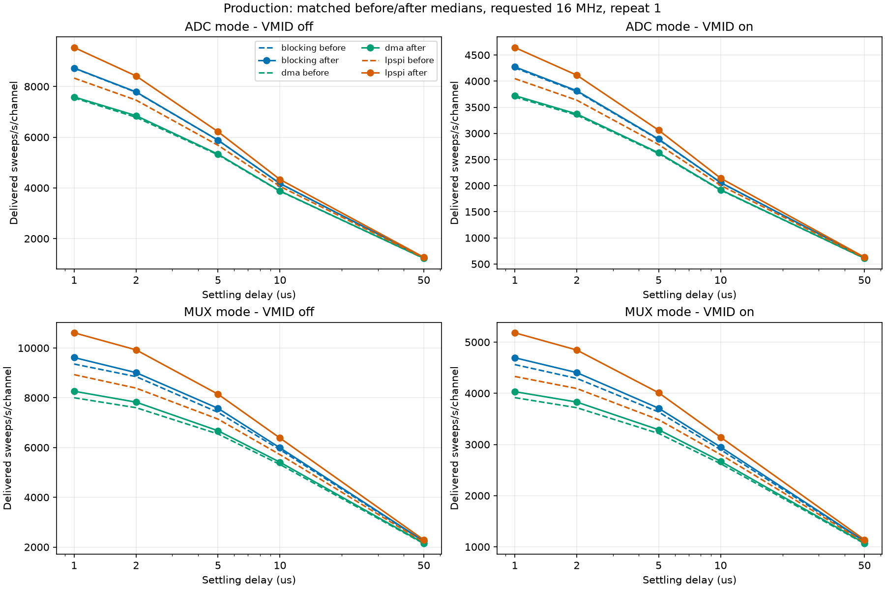
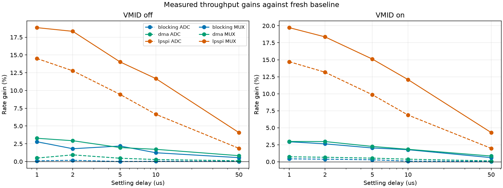
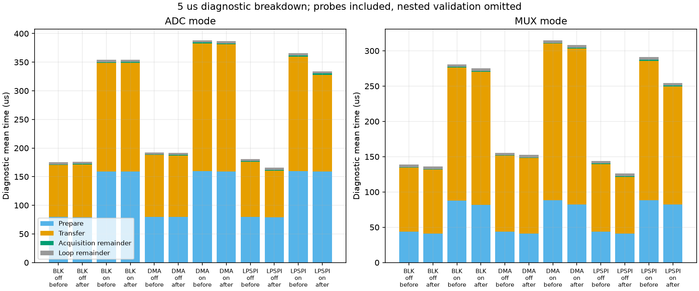
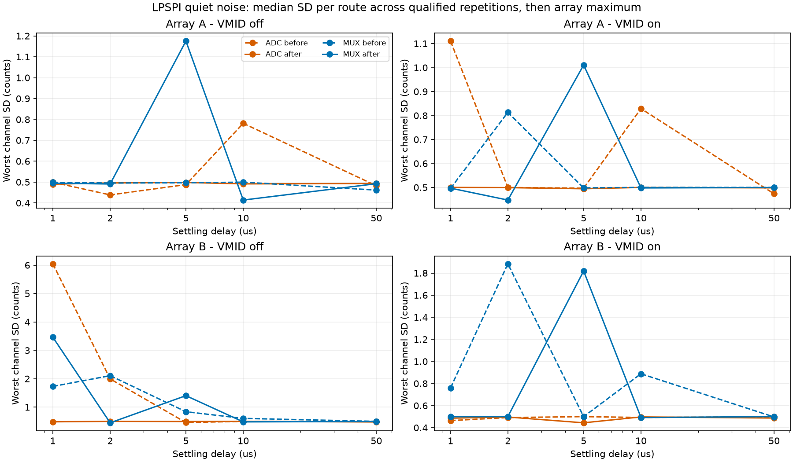

# ADC124 FIFO batching and coordinated GPIO switching

2026-10-14 | COM4 | connectors disconnected | charger connected

The validated scan-mode firmware was merged into `main` through [PR #51](https://github.com/sheramir/arduino_adc_streamer/pull/51) after the required `pytest` check passed. This report covers the subsequent FIFO/GPIO optimizations.

## Implementation and compatibility

LPSPI now queues prepared 16-bit commands under one GPIO CS and drains responses in order. PARAM supplies TX/RX depths; actual TXCOUNT includes command entries; outstanding responses never exceed RX capacity. FIFO error flags and an unsigned cycle deadline bound the operation. All responses, empty TX, TCF and idle are required before CS release. Cancellation flushes hardware and releases CS. Pipeline primes, repeats and payload labels are unchanged. [NXP RT1060 reference manual, chapter 48](https://www.pjrc.com/teensy/IMXRT1060RM_rev3.pdf).

Address changes use precomputed SET/CLEAR register sequences, including different cached addresses on the two banks. GPIO6 carries A0; GPIO9 carries A1/A2/B0; GPIO8 carries B1/B2. Only changed bits are written, with no read/modify/write of unrelated output bits. Single-bank phases use a direct cached path. Shared phases disable all changing banks, wait 200 ns after the last disable, update addresses, enable with A-high/B-low polarity, then wait 200 ns after the last enable. One full analog settling wait follows. VMID phases use the same coordination. Unchanged banks remain untouched; startup/stop/failure parking remains.

Protocol remains 3: `adc` finishes A then B, and `mux` shares switching/settling before sequential A/B transfers. Wire layout, ACKs, routes and historical decoding are unchanged. New status reports revision `adc124-fifo-grouped-gpio-v2`, FIFO batching, grouped ports and coordinated guards. There is no ADC124 desktop profile to migrate.

The cached transition tables use 48,096 bytes on ARM. The production build reports 59,744 bytes of RAM1 variables and 431,776 bytes free for local variables. This spends memory to remove mask assembly from acquisition.

## Validation and benchmark method

Both production/diagnostic builds passed. 80 focused tests passed, including 708 acquisition cases per build, 512 paired address histories per build, asymmetric 1/4/16-word FIFOs, 13-word repeated batches, final-clock completion, FIFO faults, wrapped timeouts, pipeline mapping, sparse routes, guard timing, EN polarity and USB behavior. Native digital tests and ARM USB emulation supplement hardware captures; they do not prove PCB analog routing or electrical edge timing.

Fresh before/after production matrices each contain 60 settings x 3 repetitions. Diagnostic matrices each contain 60 settings x 1 repetition. Every standard run uses 1 s warm-up + 2 s measurement, both arrays, requested 16 MHz, manual acquisition, repeat 1, bursts, ADC/MUX modes, blocking/DMA/LPSPI, 1/2/5/10/50 us settling and VMID off/on. The same configuration rotation is used for both versions. Before and after are sequential sessions, so thermal/background drift is not eliminated.

486 analyzed captures: **7,135,178 received frames**, 7,135,527 acquired, 349 accounted discards (0.00489%). Sent frames: 7,135,178; received equals sent: True. Error totals: {'transfer_errors': 0, 'data_errors': 0, 'usb_write_errors': 0}. Raw SHA-256 checks, independent parsers, valid 12-bit codes, exact payload routes and nonoverlapping monotonic sweep intervals passed. Exploratory smoke captures are excluded from these comparisons.

## Measured production performance

Tables use medians of three device timestamp measurements. Rates count delivered complete sweeps; useful per-channel sample rate equals sweeps/s. Counter-derived whole-run sampling rates are separately labeled estimates in the CSV. Accounted discards can lower delivered rate. Actual SCLK and individual conversion/CS edges were not measured.

| Engine | Mode | VMID | Before sweeps/s | After sweeps/s | Gain | Saved us/sweep |
| --- | --- | --- | --- | --- | --- | --- |
| blocking | adc | off | 5882.4 | 5882.4 | 0.0% | 0.000 |
| blocking | mux | off | 7413.5 | 7575.3 | 2.2% | 2.880 |
| blocking | adc | on | 2881.8 | 2890.2 | 0.3% | 1.000 |
| blocking | mux | on | 3634.6 | 3708.3 | 2.0% | 5.466 |
| dma | adc | off | 5306.5 | 5331.1 | 0.5% | 0.870 |
| dma | mux | off | 6545.6 | 6674.2 | 2.0% | 2.944 |
| dma | adc | on | 2614.4 | 2628.3 | 0.5% | 2.022 |
| dma | mux | on | 3215.4 | 3287.8 | 2.3% | 6.848 |
| lpspi | adc | off | 5681.8 | 6218.8 | 9.5% | 15.196 |
| lpspi | mux | off | 7142.9 | 8144.6 | 14.0% | 17.219 |
| lpspi | adc | on | 2786.3 | 3061.0 | 9.9% | 32.202 |
| lpspi | mux | on | 3484.5 | 4010.7 | 15.1% | 37.654 |

Full 60-setting comparison:

| Settle us | VMID | Blocking ADC gain | Blocking MUX gain | DMA ADC gain | DMA MUX gain | LPSPI ADC gain | LPSPI MUX gain |
| --- | --- | --- | --- | --- | --- | --- | --- |
| 1 | off | 0.1% | 2.8% | 0.5% | 3.3% | 14.5% | 18.8% |
| 1 | on | 0.4% | 2.9% | 0.7% | 3.0% | 14.7% | 19.7% |
| 2 | off | 0.2% | 1.8% | 0.9% | 2.9% | 12.8% | 18.3% |
| 2 | on | 0.4% | 2.6% | 0.7% | 3.0% | 13.2% | 18.4% |
| 5 | off | 0.0% | 2.2% | 0.5% | 2.0% | 9.5% | 14.0% |
| 5 | on | 0.3% | 2.0% | 0.5% | 2.3% | 9.9% | 15.1% |
| 10 | off | 0.0% | 1.2% | 0.3% | 1.7% | 6.7% | 11.7% |
| 10 | on | 0.1% | 1.8% | 0.4% | 1.8% | 6.9% | 12.1% |
| 50 | off | 0.0% | 0.5% | 0.1% | 0.8% | 1.9% | 4.1% |
| 50 | on | 0.0% | 0.6% | 0.1% | 0.8% | 2.0% | 4.3% |

## Measured diagnostic phases

Profiling includes probes, interrupts and warm-up. Prepare includes sensor/VMID switching, guards and analog settling in both versions. Validation is nested in transfer; acquisition overlaps these phases. Do not sum nested scopes or use diagnostic throughput as production performance.

| Engine | Mode | VMID | Before prepare us | After prepare us | Before transfer us | After transfer us | Before encode/enqueue us | After encode/enqueue us |
| --- | --- | --- | --- | --- | --- | --- | --- | --- |
| blocking | adc | off | 79.550 | 79.390 | 90.984 | 91.931 | 0.660 | 0.662 |
| blocking | adc | on | 159.308 | 158.976 | 189.322 | 189.855 | 0.658 | 0.662 |
| blocking | mux | off | 43.974 | 41.094 | 90.567 | 90.805 | 0.658 | 0.660 |
| blocking | mux | on | 87.999 | 81.895 | 188.324 | 188.594 | 0.659 | 0.660 |
| dma | adc | off | 80.041 | 79.576 | 107.848 | 107.523 | 0.666 | 0.667 |
| dma | adc | on | 160.002 | 159.231 | 222.809 | 221.886 | 0.668 | 0.668 |
| dma | mux | off | 44.007 | 41.094 | 107.316 | 107.284 | 0.668 | 0.668 |
| dma | mux | on | 88.242 | 82.144 | 221.994 | 221.404 | 0.666 | 0.669 |
| lpspi | adc | off | 79.749 | 79.315 | 96.000 | 81.330 | 0.660 | 0.662 |
| lpspi | adc | on | 159.595 | 159.151 | 200.137 | 168.920 | 0.658 | 0.662 |
| lpspi | mux | off | 44.004 | 41.094 | 95.456 | 80.408 | 0.660 | 0.659 |
| lpspi | mux | on | 88.147 | 82.141 | 197.819 | 167.290 | 0.660 | 0.662 |

## Calculations distinguished from measurements

SPI words, batches and CS allowances are unchanged by this optimization: 64 words / 14 batches / 2.8 us configured CS allowance with VMID off; 134 / 28 / 5.6 us with VMID on. This round does not claim new CS-edge allowance savings. FIFO gains arise from CPU/queue scheduling rather than reducing analog settling.

Full two-array bank transitions stay 14/28 (VMID off/on). ADC mode retains nominal 5.6/11.2 us of switching guards. Coordinated MUX phases reduce the configured guard budget from 5.6 to 2.8 us off and 11.2 to 5.6 us on. These are firmware allowance calculations, not measured propagation times. Analog waits remain 14/28 in ADC and 7/14 in MUX. Steady VMID-off address writes fall from 24 individual-bit writes to 22 cached register writes in ADC and 21 in MUX; EN writes are unchanged. Prepare-phase differences include these effects and CPU overhead, not an isolated GPIO measurement.

## Quiet-period acquisition quality

50 ms bins; eight array/MUX median channel SD envelopes; threshold max(0.6, P20+0.15, lower40% median+4*1.4826*MAD); reject any flagged bin and its neighbors for all 50 channels; no individual sample clipping/filtering/detrending.

363/366 analyzed quiet records qualified with >=1 s and >=100 retained frames. Unqualified short records: 3. A failed quiet criterion never becomes a noise PASS. ADC/blocking/2 us/VMID-off receives matched 15 s supplementary captures, with the same 1 s warm-up and common-window method. Extended qualified records take precedence over short records for that setting.

Charger switching/rails were not independently recorded. This method detects relative group-envelope bursts; it does not establish their electrical cause or remove sustained/isolated channel variation. No individual sample is clipped, filtered or detrended. SD uses ddof=1; median SD per route across qualified repetitions is then compared. Peak-to-peak is saved but not treated as duration-independent. Counts convert at 3.3/4096 V/count. Biases A: 470k/1M/470k/1M; B: 1M/470k/1M/470k.

| Engine | Mode | VMID | Before worst SD counts | After worst SD counts | Largest route SD increase | Largest baseline shift counts |
| --- | --- | --- | --- | --- | --- | --- |
| blocking | adc | off | 0.499 | 0.497 | 0.482 | 1.0 |
| blocking | mux | off | 0.499 | 0.832 | 0.481 | 3.0 |
| blocking | adc | on | 0.500 | 0.500 | 0.319 | 1.0 |
| blocking | mux | on | 0.497 | 0.499 | 0.497 | 1.0 |
| dma | adc | off | 0.500 | 0.500 | 0.483 | 1.0 |
| dma | mux | off | 0.697 | 0.581 | 0.420 | 3.0 |
| dma | adc | on | 0.499 | 0.499 | 0.285 | 1.0 |
| dma | mux | on | 0.500 | 0.498 | 0.497 | 1.0 |
| lpspi | adc | off | 0.488 | 0.498 | 0.486 | 15.0 |
| lpspi | mux | off | 0.838 | 1.404 | 1.392 | 16.0 |
| lpspi | adc | on | 0.500 | 0.494 | 0.444 | 7.0 |
| lpspi | mux | on | 0.500 | 1.819 | 1.632 | 9.0 |

The following settings retain >1 count worst channel SD or a >0.5 count route SD increase. These are descriptive screening thresholds, not sensor acceptance limits:

| Engine | Mode | Settle us | VMID | Before worst SD | After worst SD | Largest SD increase |
| --- | --- | --- | --- | --- | --- | --- |
| blocking | adc | 1 | off | 0.500 | 1.378 | 0.889 |
| blocking | mux | 1 | off | 0.556 | 2.232 | 1.676 |
| blocking | adc | 2 | off | 3.537 | 4.275 | 0.945 |
| blocking | mux | 2 | off | 0.824 | 1.026 | 0.458 |
| dma | mux | 1 | off | 0.490 | 1.267 | 1.172 |
| dma | mux | 1 | on | 0.499 | 1.949 | 1.576 |
| dma | adc | 2 | off | 3.162 | 2.991 | 0.371 |
| lpspi | mux | 1 | off | 1.729 | 3.463 | 3.052 |
| lpspi | mux | 5 | off | 0.838 | 1.404 | 1.392 |
| lpspi | mux | 5 | on | 0.500 | 1.819 | 1.632 |

Faster SPI scheduling changes the analog read history, especially at short settling delays. A throughput gain cannot establish equal acquisition quality. Channel-specific SD, baseline shifts and qualification gaps remain visible in `channel_comparisons.csv`; verify attached sensors and known input voltages before analog acceptance.

## Identity, final state and remaining work

Raw root: `docs\testing\datasets\testboard-adc124\fifo_gpio_20261014T142000Z`. Frozen before/after production and diagnostic HEX files, source/image hashes, Git base identity, run/status logs and raw bytes are retained there. Production was restored with acquisition stopped; final status is in `after_lifecycle.json`. The earlier scan report is [here](../scan_modes_2026-10-13/README.md).

Remaining checks: verify final SCLK/CS/EN edges with a logic analyzer, stimulate known sensor inputs, and compare analog settling with sensors attached. FIFO polling can be tuned further only with measured benefit; cached transition tables could trade some memory back for arithmetic if needed. Encoding/enqueue is unchanged and the counters account for sparse USB pressure.

Reproduction: build and load the corresponding production revision, then run `scripts/benchmark_adc124_fifo_gpio.py before|after RAW_ROOT`, `scripts/analyze_adc124_fifo_gpio.py RAW_ROOT RESULT_ROOT`, and `scripts/report_adc124_fifo_gpio.py RESULT_ROOT`. Run the benchmark with `--extended-quiet` after each completed main matrix for the matched 15 s quiet captures. Raw folders must be new; captures are not overwritten. Supplementary long records retain their duration in channel comparisons. `capture_metrics.csv`, `summary.csv`, `comparisons.csv`, `channel_noise_baselines.csv`, `channel_comparisons.csv`, quiet-bin CSVs and thresholds contain detailed evidence.
