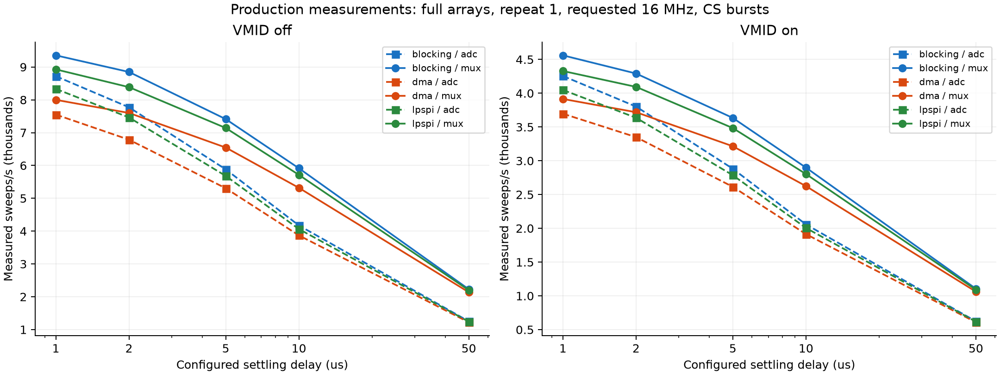
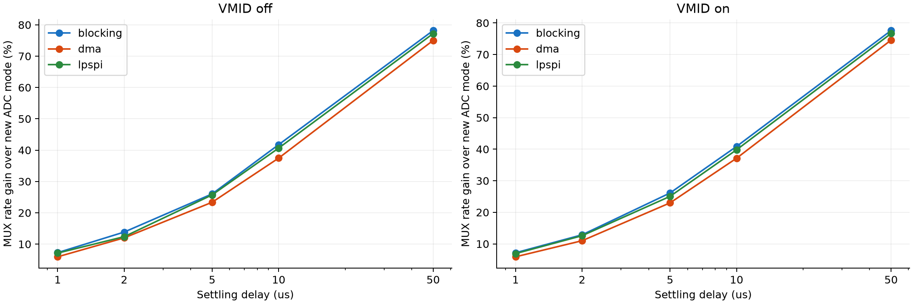
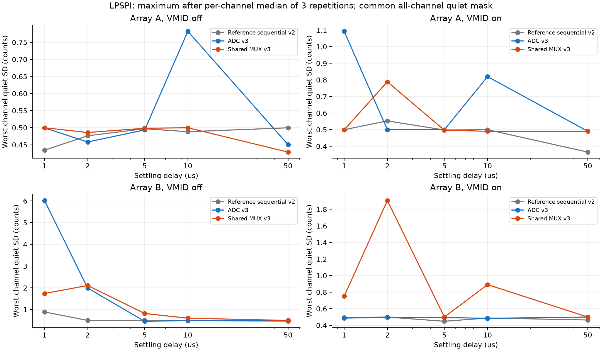
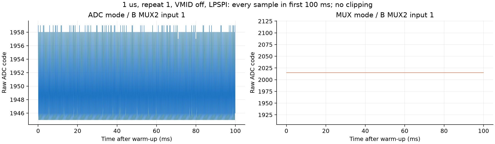

# TestBoard ADC124: sequential ADC and shared MUX scans

2026-10-13 | COM4 | protocol 3 | connectors disconnected | charger connected

Implemented ADC mode (array A address groups, then B) and MUX mode (switch both participating banks, one shared settling wait, then ADC A/B). Continuous-CS batches are supported by all three engines. Production firmware was restored and acquisition left stopped.

**Evidence:** 106 focused tests passed; 708 digital cases per production/diagnostic build; both ARM builds passed. Hardware matrix: 180 production captures (60 settings x 3 repetitions), 12 single-word controls and 60 diagnostic captures. 3,248,510 complete frames received; 3,248,558 acquired; 48 explicitly discarded (0.00148%). Every sent frame was received. Transfer/data/USB-write errors were zero. Raw hashes and independent parser checks passed.

## Scope and exact semantics

Protocol 1/2 `scanorder mux` was array-sequential address grouping; it is now `scanorder adc`. Protocol 3 `scanorder mux` means shared switching/waiting. Old `channel`/`interleaved` aliases are rejected, and historical captures are decoded using their stored version and physical payload routes. Wire width remains 50 uint16 values per sweep with the same trailer. No individual conversion timestamps are exported.

ADC mode sorts (array,address,MUX); MUX mode sorts (address,array,MUX). Full routes read four inputs per ADC at addresses 0-5, IN4 only at address 6. Partial and single-array plans switch/read only needed banks and populated inputs. Cached state skips repeated addresses and EN transitions. Shared waits start after both banks' turn-on allowances. VMID phases coordinate participating banks at address 7, then discard a selector prime plus four ADC inputs per bank.

Ownership parking was inherited from ADS7953 and is not required for SPI isolation here: CS deassertion tri-states ADC DOUT, and analog inputs have their own unity buffers. There is no extra parking on ADC-input/CS changes or sweep end. Startup, run preparation, stop and failure still park both banks safely. Unselected banks are disabled during runs. ADC/MUX analog histories differ; speed and baseline comparisons must not assume electrical equivalence.

The desktop registry explicitly lists ADC124 as unsupported: no ADC124 GUI controls or persisted desktop scan setting exist to migrate. The ADS7953 GUI/profile retains its own names. CLI/session metadata now records protocol version, scan semantics, SPI frame mode, physical payload labels and settings. Saved old captures remain unchanged.

## Datasheet and implementation

TI SNAS283D pp.16-17/19 specifies serial frames containing multiples of 16 clocks and continuous conversions while CS remains low. Commands select the next conversion. A fixed-address batch contains a discarded prime plus prepared channel/repeat commands; only the final repeat is stored. CS rises only after the complete batch and is high before another ADC can drive MISO. [Primary TI datasheet](https://www.ti.com/lit/ds/symlink/adc124s101.pdf?ts=1781720494475).

Blocking uses one transaction/CS per batch; DMA one persistent aligned 2N-byte launch; LPSPI one sweep transaction and per-word bounded start/receive/TCF checks under continuous CS. Timeout/error cleanup releases CS, restores SPI and parks. EN polarities remain A active-high / B active-low, with 200 ns off and on guards. GPIO set/clear masks are cached and unchanged address bits skipped. Analog settling was not reduced to offset CPU overhead.

## Production rate measurements

All new production repetitions: 1 s warm-up + 2 s measurement, requested 16 MHz, manual prepared acquisition, repeat 1, both arrays, CS bursts. Rates below are medians of three repetitions, from device sweep-start intervals. Sweeps/s equals useful samples/s/channel. Sampling rate inferred from counters/endpoints is separately labeled an estimate. Actual pin SCLK was not measured.

| Settle us | VMID | Blocking ADC | Blocking MUX | DMA ADC | DMA MUX | LPSPI ADC | LPSPI MUX |
| --- | --- | --- | --- | --- | --- | --- | --- |
| 1 | off | 8720.9 | 9355.9 | 7550.4 | 8000.0 | 8333.3 | 8928.4 |
| 1 | on | 4255.3 | 4561.0 | 3697.0 | 3915.3 | 4048.7 | 4329.0 |
| 2 | off | 7772.7 | 8849.4 | 6785.6 | 7600.1 | 7462.7 | 8386.8 |
| 2 | on | 3802.4 | 4291.8 | 3350.2 | 3718.7 | 3636.4 | 4094.2 |
| 5 | off | 5882.4 | 7413.5 | 5306.5 | 6546.6 | 5681.8 | 7142.9 |
| 5 | on | 2881.8 | 3634.6 | 2614.4 | 3215.4 | 2786.4 | 3484.5 |
| 10 | off | 4172.6 | 5914.9 | 3869.4 | 5319.1 | 4062.5 | 5714.3 |
| 10 | on | 2057.6 | 2898.6 | 1913.9 | 2624.7 | 2005.2 | 2803.5 |
| 50 | off | 1250.5 | 2228.3 | 1221.8 | 2138.6 | 1241.5 | 2200.0 |
| 50 | on | 622.7 | 1105.9 | 608.8 | 1062.8 | 618.1 | 1091.8 |

Compared with the supplied sequential-mode reference, the optimized ADC mode includes burst/driver changes and removes unnecessary parking. MUX mode adds shared waits. The reference has three 5 s production repetitions; the new matrix has three 2 s repetitions, so session conditions/window lengths are a comparison limitation. Reference data use old `mux` names and remain unchanged.

| Mode | Settle us | VMID | Reference period us | New period us | Rate gain vs reference | Rate gain vs new ADC |
| --- | --- | --- | --- | --- | --- | --- |
| adc | 1 | off | 133.012 | 120.000 | 10.8% | 0.0% |
| adc | 5 | off | 196.304 | 176.000 | 11.5% | 0.0% |
| adc | 50 | off | 916.295 | 805.507 | 13.8% | 0.0% |
| adc | 1 | on | 266.000 | 246.992 | 7.7% | 0.0% |
| adc | 5 | on | 377.178 | 358.890 | 5.1% | 0.0% |
| adc | 50 | on | 1637.208 | 1617.983 | 1.2% | 0.0% |
| mux | 1 | off | 133.012 | 112.003 | 18.8% | 7.1% |
| mux | 5 | off | 196.304 | 140.000 | 40.2% | 25.7% |
| mux | 50 | off | 916.295 | 454.536 | 101.6% | 77.2% |
| mux | 1 | on | 266.000 | 231.000 | 15.2% | 6.9% |
| mux | 5 | on | 377.178 | 286.987 | 31.4% | 25.1% |
| mux | 50 | on | 1637.208 | 915.958 | 78.7% | 76.6% |

## Burst-only control

The following compares the same new plan/GPIO/parking behavior with per-word CS versus bursts at 5 us. Controls used one 2 s measurement; optimized rows are medians of three. These are measured gains; they are not pure CS-delay arithmetic. Blocking bursts were fastest in this matrix, despite LPSPI's sweep transaction.

| Engine | Mode | VMID | Single period us | Burst period us | Measured rate gain |
| --- | --- | --- | --- | --- | --- |
| blocking | adc | off | 188.299 | 170.000 | 10.8% |
| blocking | adc | on | 386.878 | 347.000 | 11.5% |
| blocking | mux | off | 152.884 | 134.889 | 13.3% |
| blocking | mux | on | 315.182 | 275.132 | 14.6% |
| dma | adc | off | 303.810 | 188.448 | 61.2% |
| dma | adc | on | 627.779 | 382.498 | 64.1% |
| dma | mux | off | 269.000 | 152.751 | 76.1% |
| dma | mux | on | 556.982 | 311.000 | 79.1% |
| lpspi | adc | off | 183.444 | 176.000 | 4.2% |
| lpspi | adc | on | 376.785 | 358.890 | 5.0% |
| lpspi | mux | off | 148.686 | 140.000 | 6.2% |
| lpspi | mux | on | 305.000 | 286.987 | 6.3% |

## Measured diagnostic breakdown

Diagnostic: one repetition per setting, 1 s warm-up + 2 s measurement, profiling on. Values below are whole-run mean cycle-counter phases at 5 us. Probes/storage and interrupts are included. Validation is nested inside transfer and acquisition includes session/prepare/transfer; do not sum overlapping phases. New prepare includes VMID settling, whereas the old reference included it in transfer. Only production determines rate gains.

| Engine | Mode | VMID | Prepare us | Session us | Transfer us | Validate us (nested) | Encode us | Enqueue us | Acquisition us | Bookkeeping us |
| --- | --- | --- | --- | --- | --- | --- | --- | --- | --- | --- |
| blocking | adc | off | 79.550 | 0.027 | 90.974 | 1.733 | 0.250 | 0.410 | 171.520 | 1.813 |
| blocking | adc | on | 159.308 | 0.027 | 189.323 | 3.739 | 0.250 | 0.408 | 350.403 | 1.901 |
| blocking | mux | off | 43.974 | 0.027 | 90.568 | 1.713 | 0.250 | 0.408 | 135.152 | 1.800 |
| blocking | mux | on | 87.999 | 0.027 | 188.325 | 3.510 | 0.250 | 0.409 | 277.314 | 1.968 |
| dma | adc | off | 80.039 | 0.027 | 107.847 | 2.013 | 0.250 | 0.416 | 188.934 | 1.830 |
| dma | adc | on | 160.003 | 0.027 | 222.808 | 3.904 | 0.250 | 0.418 | 384.583 | 1.868 |
| dma | mux | off | 44.007 | 0.027 | 107.314 | 1.978 | 0.250 | 0.417 | 151.949 | 1.846 |
| dma | mux | on | 88.242 | 0.027 | 221.993 | 3.868 | 0.250 | 0.416 | 311.225 | 1.962 |
| lpspi | adc | off | 79.750 | 0.455 | 96.000 | 2.013 | 0.250 | 0.410 | 177.226 | 1.892 |
| lpspi | adc | on | 159.595 | 0.453 | 200.138 | 3.904 | 0.250 | 0.408 | 361.931 | 1.941 |
| lpspi | mux | off | 44.004 | 0.454 | 95.455 | 1.840 | 0.250 | 0.410 | 140.515 | 1.768 |
| lpspi | mux | on | 88.147 | 0.454 | 197.819 | 3.567 | 0.250 | 0.410 | 287.384 | 1.901 |

## Calculations, separate from measurements

Both modes use 64 words / 14 sensor batches with VMID off; 134 words / 28 sensor+VMID batches with VMID on. At configured 0.1 us setup + 0.1 us high per frame, burst CS allowance is 2.8 us off / 5.6 us on. Removing per-word allowances saves `(64-14)*0.2 = 10.0 us` off and `(134-28)*0.2 = 21.2 us` on. The earlier 50 us estimate was for a different channel-by-channel plan and does not apply. These values are firmware arithmetic, not measured CS edge durations.

Steady full-array ADC mode has 14/28 settling waits and MUX mode 7/14 (off/on). Both have 14/28 actual bank address changes. Guard budget is 5.6/11.2 us at 0.4 us/change. Shared-wait savings are `7*D` off or `14*D` on; sparse/repeated addresses may skip waits. Nominal word-clock budget is 64/134 us at the requested 16 MHz, not a measured SCLK or an additive track-plus-conversion-plus-shift budget (these overlap). Prepare-minus-requested-waits is a residual model estimate containing guards, GPIO, control and probes, not isolated GPIO propagation.

## Quiet-period acquisition quality

50 ms bins; eight ADC/MUX group median channel sample SDs; threshold max(0.6, P20+0.15, lower40% median+4*1.4826*MAD); any-group rejection plus neighboring bins; one common time mask for all 50 channels; no sample clipping/filtering/detrending. Rejection applies one mask to every channel in a capture and excludes one neighboring 50 ms bin each side of a flagged burst. Quantization-aware floor is 0.6 counts. At least 1 s and 100 frames must remain. All 192 production/control captures met this requirement. No bins crossed the method's group-envelope thresholds, so all post-warm-up windows were retained. Charger switching/rails were not independently recorded; this does not establish absence of sub-LSB interference or isolated channel events.

SD is sample SD (ddof=1) around each channel's own mean. The plot takes median across repetitions per physical route, then the maximum across the array; it matches the reference statistic. Reference records are 15 s and new records 2 s. Peak-to-peak/sample counts are saved but not treated as duration-independent noise measures. Codes converted using 3.3/4096 V per count. Biases A: 470k/1M/470k/1M; B: 1M/470k/1M/470k.

**Quality limitation:** ADC/LPSPI at 1 us, VMID off, showed persistent B MUX2 input 1 variation near 6 counts SD across all repetitions. It was retained because it is not a rejected common burst window. A speed improvement alone cannot qualify this setting. Shared MUX mode, VMID and longer delays change connection/read history; noise and baseline must be assessed with actual sensors before acceptance. Electrical cause is unproven.

| Settle us | VMID | Array | Reference worst SD counts | ADC worst SD counts | MUX worst SD counts |
| --- | --- | --- | --- | --- | --- |
| 1 | off | A | 0.434 | 0.499 | 0.500 |
| 1 | off | B | 0.891 | 6.019 | 1.740 |
| 1 | on | A | 0.500 | 1.092 | 0.499 |
| 1 | on | B | 0.493 | 0.487 | 0.751 |
| 2 | off | A | 0.476 | 0.458 | 0.486 |
| 2 | off | B | 0.500 | 1.988 | 2.109 |
| 2 | on | A | 0.553 | 0.500 | 0.789 |
| 2 | on | B | 0.499 | 0.496 | 1.906 |
| 5 | off | A | 0.497 | 0.493 | 0.498 |
| 5 | off | B | 0.497 | 0.461 | 0.820 |
| 5 | on | A | 0.498 | 0.500 | 0.497 |
| 5 | on | B | 0.448 | 0.494 | 0.500 |
| 10 | off | A | 0.488 | 0.782 | 0.500 |
| 10 | off | B | 0.494 | 0.492 | 0.602 |
| 10 | on | A | 0.500 | 0.820 | 0.490 |
| 10 | on | B | 0.488 | 0.484 | 0.891 |
| 50 | off | A | 0.500 | 0.450 | 0.429 |
| 50 | off | B | 0.467 | 0.500 | 0.500 |
| 50 | on | A | 0.365 | 0.490 | 0.490 |
| 50 | on | B | 0.464 | 0.499 | 0.500 |

## Remaining optimization and validation

1. Benchmark with attached sensors and known input stimulation. Short ADC-mode delays show a reproducible channel-specific quality issue; no electrical diagnosis or ghosting acceptance is claimed.
2. LPSPI bursts still start/poll/drain each word and require fresh completion. A bounded FIFO-queued implementation could reduce this overhead, but needs dedicated FIFO/error/clock-end tests and on-board comparison. DMA has reduced launch count but remains launch/completion limited. Blocking burst is the measured best engine in this matrix.
3. Cached GPIO masks and changed-bit writes are implemented. Grouped port writes are a possible further experiment when pins share a hardware port; preserve EN guards and analog settling. Measure an isolated GPIO/delay-call control before attributing residual prepare cost to it.
4. Encoding/enqueue remain around sub-microsecond scopes. USB discards were sparse and fully accounted, so no transport rewrite was prioritized. Verify logic-analyzer CS/SCLK edges and ADC input identity; these were not individually measured here.

## Evidence and reproduction

Raw sessions: `docs\testing\datasets\testboard-adc124\scan_modes_20261013T214607Z`. Each capture keeps full raw bytes, command/status logs, exact payload routes, hashes and profile evidence. `firmware_lifecycle.json` records pre-test production images, new image/source hashes, diagnostic loading, and final production revision/configuration. Final flags: profile unavailable, running false, both arrays, ADC mode, blocking, 16 MHz, repeat 1, 5 us, VMID off, CS bursts. Original protocol-2 `mux` preference was explicitly migrated to protocol-3 ADC semantics.

References: [sequential timing/engine PDF](../../../../reports/exports/TestBoard_ADC124_MUX_Timing_Engines_2026-10-13.pdf) and [sequential settling/VMID PDF](../../../../reports/exports/TestBoard_ADC124_MUX_Settling_VMID_2026-10-13.pdf). Their raw reports/datasets remain intact. The new script uses the associated timing JSON and common-window method.

Reproduce: `scripts/benchmark_adc124_scan_modes.py` (hardware with production/diagnostic restoration), `scripts/analyze_adc124_scan_modes.py` (raw hash/frame/timing/noise evidence), `scripts/report_adc124_scan_modes.py` (this report/plots). `summary.csv`, `capture_metrics.csv`, `comparisons.csv`, `channel_noise_baselines.csv`, per-capture quiet-bin/threshold files and `analysis.json` supply all numeric values. No commit or push was performed.
