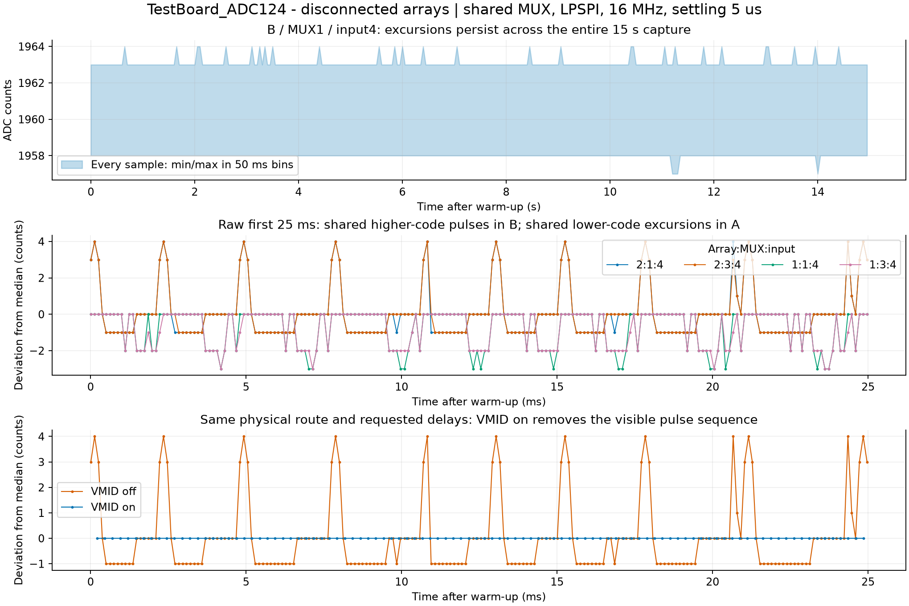
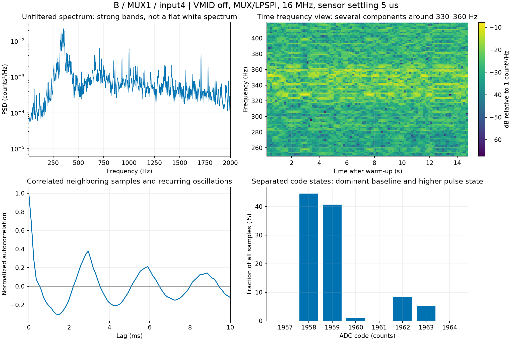
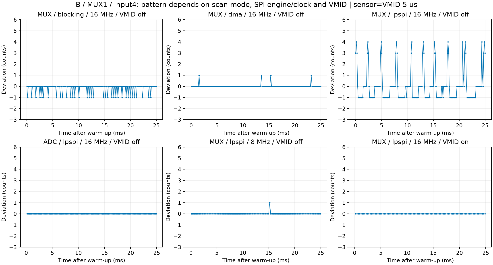
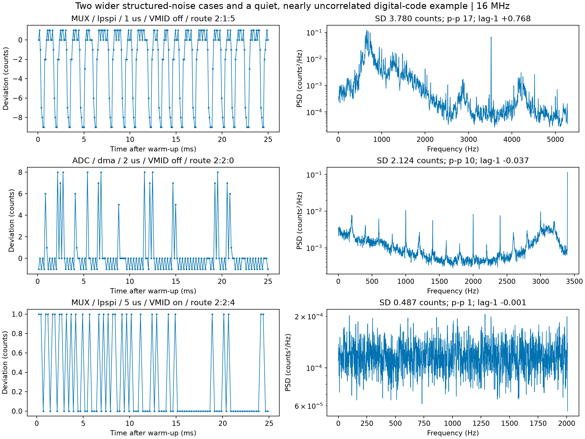

# Unfiltered disconnected TestBoard_ADC124 noise - 14 October 2026

There are recurrent short pulses and structured noise in some acquisition settings. The data is not uniformly white noise. Other routes/settings have a quiet, approximately uncorrelated one-code background. These conclusions use all measured samples, including excursions, rather than the report's conditional quiet-period mask.

All 252 current production captures (84 settings, three repetitions, 15 s after 1 s warm-up) were rechecked against raw hashes and both decoders. Both array connectors are disconnected. The charger is connected. Nominal conversion: 3.3/4096 V/count = 0.805664 mV/count. The user confirmed LDO TPS7A2033PDBVR after acquisition; the original capture setup record has been preserved.

## Repeatable pulse case

Shared MUX mode, LPSPI, requested 16 MHz, sensor settling 5 us, VMID off. B/MUX1/external address 4 and B/MUX3/external address 4 rise together. Both have 1 MOhm bias resistors. A/MUX1/address 4 and A/MUX3/address 4 also show paired lower-code excursions, but are not strongly correlated with the B pair. Route strings use array:MUX:external address, addresses 0-6. Address 4 is the fifth MUX input, not ADC channel 4.

| Measurement on B/MUX1/address 4 | Result |
|---|---:|
| Unfiltered SD, reps 1/2/3 | 1.4336 / 1.4334 / 1.4305 counts |
| Unfiltered p-p, each repeat | 7 counts = 5.6396 mV |
| Typical rise above dominant low state | about 4-5 counts = 3.22-4.03 mV |
| Samples in higher state (code >=1961) | 13.62-13.67% |
| Higher-state events in each 15 s | 6519 / 6526 / 6447 |
| Median event duration | 3 sweeps, approximately 369 us |
| Single-sweep events | 1366 / 1379 / 1280 |
| Median interval between event starts | 2.582 ms |
| B/MUX1 versus B/MUX3 correlation | 0.9946 / 0.9951 / 0.9948 |
| Lag-1 temporal correlation | 0.686 / 0.690 / 0.692 |

The spectrum has multiple strong components around 330-360 Hz, higher-frequency structure and a component near 1 kHz. Autocorrelation recurs at roughly 3 ms. This is incompatible with an independent white-noise-only interpretation. The pulses persist across the 15 s windows; they are not just a few rare large spikes. Some events occupy only one sweep, so spikes are present too. Pulse duration estimates use sampled sweep periods, not an oscilloscope measurement of analog pulse edges.

VMID on at matched 5 us settings removes this visible pulse sequence on the B/MUX1 route. Its three unfiltered SDs are about 0.0081/0.0071/0.0058 counts, with p-p 1 count in each repeat. Other channels still have measurable noise: the worst channel SD in this setting is about 0.49 counts. A fixed digital code does not prove zero analog noise.

## Acquisition dependence and wider cases

The same B/MUX1/address 4 route is much quieter at ADC/LPSPI/16 MHz, shared MUX/DMA/16 MHz, or shared MUX/LPSPI/8 MHz with 5 us settling and VMID off. Shared MUX/blocking has adjacent-code toggling. This setting dependence points to acquisition-related effects as a hypothesis, but changing settings also changes the sampling rate, baseline, analog history and possible aliasing; it is not a controlled proof of electrical cause.

At 1 us settling, shared MUX/LPSPI/VMID off has wider structured variation on B/MUX1/address 5: SD approximately 3.78 counts, p-p 17 counts (13.696 mV), and lag-1 correlation about 0.77. This special sensor-7 route corresponds to external address 5. ADC/DMA at 2 us has another wider, spectrally structured case; its amplitude and spectrum vary between repeats.

Across the entire current matrix, the largest observed route p-p was 17 counts, and the largest absolute deviation from that route's median was 11 counts (8.862 mV). The recordings do not exclude faster spikes between conversion apertures.

In contrast, B/MUX2/address 4 at shared MUX/LPSPI/16 MHz/5 us/VMID on has a relatively flat PSD, lag-1 correlation -0.0006 and maximum absolute autocorrelation 0.0112 over lags 1-64 in the first repeat. It toggles between two adjacent codes, SD 0.487 counts, p-p 1 count. This example is consistent with a white-like quantized background; it does not establish exact analog whiteness or classify every route as white.

## Complete requested route audit: MUX/LPSPI/VMID off, 1 and 5 us

All 50 routes were checked at each delay, at requested 16 MHz, using all three existing production repetitions: 100 route/delay cases and 300 channel/repetition records. The threshold uses unfiltered 15 s sample SD after warm-up, with median SD strictly above 0.5 counts. Reproducible structure is screened by maximum absolute autocorrelation over lags 1-64 of at least 0.05 in at least two repeats. All selected cases pass both amplitude and correlation criteria in all three repeats. This descriptive screen does not establish whiteness for excluded routes or identify electrical cause.

| Settling us | Array | MUX / ADC input | External address | Connector sensor / channel | Median SD counts |
|---:|---|---|---:|---|---:|
| 1 | B (2) | MUX1 / IN1 | 5 | PZT7 / 1 | 3.7820 |
| 1 | B (2) | MUX2 / IN2 | 5 | PZT7 / 2 | 2.7689 |
| 1 | B (2) | MUX3 / IN3 | 5 | PZT7 / 3 | 3.6700 |
| 1 | B (2) | MUX4 / IN4 | 5 | PZT7 / 4 | 2.0079 |
| 5 | A (1) | MUX1 / IN1 | 4 | PZT1 / 5 | 1.1050 |
| 5 | A (1) | MUX2 / IN2 | 4 | PZT3 / 5 | 0.5353 |
| 5 | A (1) | MUX3 / IN3 | 4 | PZT5 / 5 | 0.9712 |
| 5 | B (2) | MUX1 / IN1 | 3 | PZT1 / 4 | 0.5234 |
| 5 | B (2) | MUX1 / IN1 | 4 | PZT1 / 5 | 1.4334 |
| 5 | B (2) | MUX2 / IN2 | 4 | PZT3 / 5 | 0.9558 |
| 5 | B (2) | MUX3 / IN3 | 3 | PZT5 / 4 | 0.5064 |
| 5 | B (2) | MUX3 / IN3 | 4 | PZT5 / 5 | 1.4222 |
| 5 | B (2) | MUX4 / IN4 | 4 | PZT6 / 5 | 0.8491 |

The revised PDF contains a raw time plot and full-window PSD for every listed route, overlaid for all three repetitions. External addresses are zero-based; ADC IN labels use the firmware's MUX-to-ADC mapping. Connector labels identify positions despite sensors being disconnected. Non-white patterns below 0.5 counts, such as A/MUX4/address4 at 5 us, are excluded by the requested amplitude threshold.

Reproduce with `Arduino_Sketches/TestBoard_ADC124/benchmarks/analyze_adc124_selected_noise.py`. Full audit and selection rule: `selected_noise_1us_5us.json`, `selected_noise_channel_audit.csv`, `selected_noise_route_summary.csv`. Numerical spectra and time zooms: `selected_noise_psd.csv`, `selected_noise_time_zoom.csv`. This analysis uses the frozen captured firmware revision `adc124-vmid-settle-v1`; it does not test later source changes or perform new hardware acquisition.

## Long bursts versus short excursions

The existing eight-group median-SD detector, operating in complete 50 ms bins, retained all measurement bins in all 252 current captures. It detected no long envelope bursts under its specified rule. It can miss channel-specific or submillisecond disturbances. The finer detector identifies coherent separated-state excursions in seven captures. Threshold sensitivity means this is not a complete classification of every structured-noise case.

At shared MUX/LPSPI/5 us/VMID off, the fine mask rejects about 67.8% of sweeps including adjacent guards; approximately 13.7% of samples on the illustrated B1 route are actually in its higher state. These percentages measure different things. Neither is a measured charger duty cycle. The report's quiet-only SD near 0.50 counts therefore must not be mistaken for the unfiltered SD near 1.43 counts on this affected route.

## What the LDO establishes

TI specifies typical TPS7A20 PSRR of 95 dB at 1 kHz for a 20 mA load and input 1 V above output, and output noise of 7 uV RMS at 2.8 V/300 mA over 10 Hz-100 kHz. Rejection depends on operating conditions, frequency and implementation. These are datasheet conditions, not a measurement of this board's 3.3 V rail. See the [TI TPS7A20 datasheet](https://www.ti.com/lit/ds/symlink/tps7a20.pdf), electrical characteristics and layout sections.

The LDO should substantially attenuate input-supply ripple when implemented and operated appropriately, but it does not provide complete isolation. Reference/VMID disturbances, ground coupling, analog acquisition/settling, digital switching and external interference remain hypotheses. A sampled-domain 1 kHz component alone cannot identify USB or charger coupling. A charger-on/off repeat plus synchronized measurements of LDO input/output, VMID, ADC inputs and SPI/MUX activity would separate possible sources. No causal USB-power conclusion is supported by these recordings alone.

## Reproducibility and limits

- `Arduino_Sketches/TestBoard_ADC124/benchmarks/analyze_adc124_noise_patterns.py` generates these results from preserved raw production captures, without running or changing firmware.
- `unfiltered_noise_channels.csv`: 12,600 per-channel/repetition records, full-window SD, p-p, code histogram modal fraction, deviations from median and lag-1 correlation. Deviations >=3/5/10 counts are descriptive thresholds, not automatically classified bursts or statistical outliers.
- `unfiltered_noise_captures.csv` and `noise_patterns.json`: every capture's worst route and spectral diagnostics. Listed peaks are interior local maxima above 10 Hz; DC and Nyquist endpoints are excluded from the list but remain visible in spectra.
- `noise_pulse_case.json`: event timing and correlation for all three repeats of the 5 us pulse case.
- `noise_wide_quiet_cases.json`: illustrative wider and quiet cases.
- PSD: Hann-window Welch, 4096 samples, 50% overlap, mean removed, approximate per-section mean sampling clock. Split at timestamp gaps >1.5 times the median sweep interval; sections shorter than 4096 are excluded from PSD averaging. Small normal timing jitter remains. Time traces and reported SD/p-p are unfiltered and undetrended.
- Spectrogram and autocorrelation use sweep-index timing with the approximate rate; sparse missing frames are not inserted. Per-channel ADC aperture times and rail waveforms were not recorded. Frequencies can include aliases. No unique interference source can be assigned from these plots.

Production firmware is restored; acquisition is stopped. The disconnected data remains the reference for the later sensor-connected experiment.
