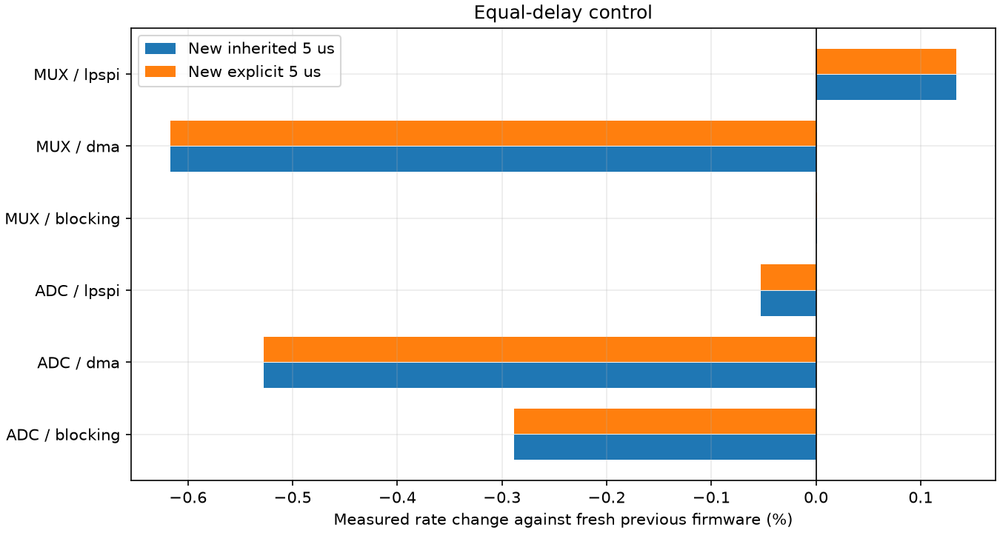
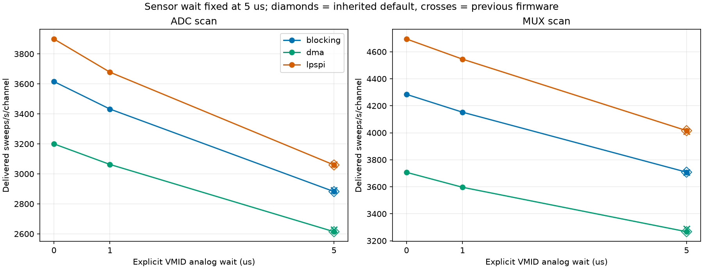
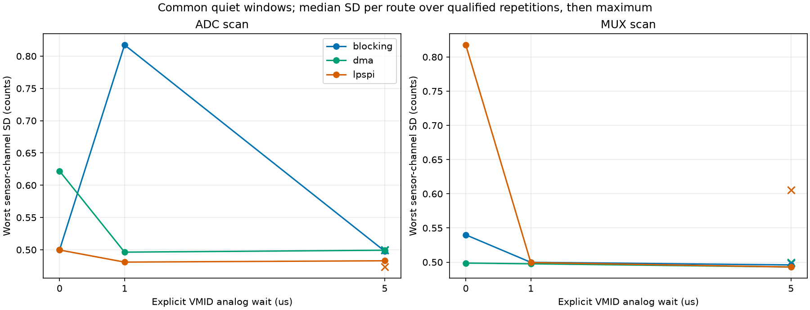

# ADC124 independent VMID settling

2026-10-14 | COM4 | connectors disconnected | charger connected

## Firmware and command behavior

Added `vmidsettle default|0..1000*`. Boot defaults to `default`: changing `muxsettle` also updates VMID delay. Explicit values remain fixed when the sensor delay changes; `vmidsettle default*` restores following. Status reports the effective `vmid_settle_us` and `vmid_settle_mode=follow_sensor|explicit`. Revision is `adc124-vmid-settle-v1`, protocol remains 3. Payload layout, routes, primes and conversions are unchanged.

The override applies to VMID conversions during acquisition and configured VMID parking at run preparation/stop/failure. Both scan modes use it; MUX phases retain one shared VMID wait after both banks finish switching. Zero skips only the extra analog wait: the 200 ns off/on guards, ADC priming and all VMID conversions remain. VMID off suppresses optional VMID conversions as before. Startup begins with the normal inherited 5 us default.

Examples: `muxsettle 5*` then `vmidsettle 0*` gives sensor 5 us / VMID 0 us. `vmidsettle 1*` chooses 1 us. `vmidsettle 5*` explicitly matches 5 us; `vmidsettle default*` follows future sensor changes. The standalone runner adds `--vmid-settle-us default 5 0 1`, distinct test IDs/comparison keys, actual setting metadata and restoration of explicit overrides including zero. Older firmware supports the inherited mode only; explicit requests are rejected before configuration. ADC124 still has no desktop GUI profile.

## Verification

Both production/diagnostic builds passed. 100 focused tests passed: existing 708 digital acquisition cases per build plus 216 full/single-array override cases, 90 sparse override cases, default/explicit-5 parity in both modes/all engines, inheritance/reset/invalid commands, GPIO guards, ADC primes/repeats, feature detection, CLI identity, delay budgets and ARM USB checks. In the tagged digital model, explicit/inherited 5 us produced identical sample ordering, delay sequences and sweep duration.

Fresh previous-firmware baseline: 6 settings x 3 repetitions. New production: ADC/MUX x blocking/DMA/LPSPI x inherited/explicit 5/0/1 us x 3 repetitions = 72 captures. Each production record has 1 s warm-up + 5 s measurement. Diagnostic: 24 settings x 1 repetition, 1 s warm-up + 2 s measurement. All use sensor wait 5 us, VMID on, both full arrays, requested 16 MHz, repeat 1, burst/manual acquisition. Sessions are sequential; environmental drift is not eliminated. The baseline includes the preceding FIFO/GPIO optimizations.

114 captures; 2,131,652 complete frames received; 2,131,663 acquired; 11 accounted USB discards (0.00052%). Error totals: {'transfer_errors': 0, 'data_errors': 0, 'usb_write_errors': 0}. Every sent frame was received. Raw hashes, independent parsers, 12-bit code ranges, physical payload labels and nonoverlapping timestamps were checked. Timing is measured using device sweep-start intervals; actual SCLK/individual edge times were not probed.

## Equal-delay control: sensor = VMID = 5 us

The effective wait remains 5 us for both default and explicit settings. The largest measured throughput change versus previous firmware is 0.617%. Default and explicit controls use the same acquisition path; small build/layout/timing changes and sequential-session effects remain visible rather than being called bit-for-bit analog equivalence.

| Engine | Mode | Previous sweeps/s | New default | New explicit 5 | Default change | Explicit change |
| --- | --- | --- | --- | --- | --- | --- |
| blocking | adc | 2890.2 | 2881.8 | 2881.8 | -0.288% | -0.288% |
| dma | adc | 2628.3 | 2614.4 | 2614.4 | -0.528% | -0.528% |
| lpspi | adc | 3061.0 | 3059.4 | 3059.4 | -0.053% | -0.053% |
| blocking | mux | 3708.3 | 3708.3 | 3708.3 | 0.001% | 0.001% |
| dma | mux | 3287.8 | 3267.6 | 3267.5 | -0.617% | -0.617% |
| lpspi | mux | 4010.7 | 4016.1 | 4016.1 | 0.134% | 0.134% |

## Measured effects of shorter VMID waits

| Engine | Mode | VMID us | Sweeps/s | Gain vs explicit 5 | Measured saved us/sweep | Calculated saved us/sweep |
| --- | --- | --- | --- | --- | --- | --- |
| blocking | adc | 5 | 2881.8 | 0.00% | 0.000 | 0.0 |
| blocking | adc | 0 | 3615.7 | 25.46% | 70.429 | 70.0 |
| blocking | adc | 1 | 3432.2 | 19.10% | 55.642 | 56.0 |
| dma | adc | 5 | 2614.4 | 0.00% | 0.000 | 0.0 |
| dma | adc | 0 | 3200.0 | 22.40% | 69.994 | 70.0 |
| dma | adc | 1 | 3062.8 | 17.15% | 55.999 | 56.0 |
| lpspi | adc | 5 | 3059.4 | 0.00% | 0.000 | 0.0 |
| lpspi | adc | 0 | 3899.5 | 27.46% | 70.419 | 70.0 |
| lpspi | adc | 1 | 3678.1 | 20.22% | 54.985 | 56.0 |
| blocking | mux | 5 | 3708.3 | 0.00% | 0.000 | 0.0 |
| blocking | mux | 0 | 4284.7 | 15.54% | 36.275 | 35.0 |
| blocking | mux | 1 | 4152.5 | 11.98% | 28.845 | 28.0 |
| dma | mux | 5 | 3267.5 | 0.00% | 0.000 | 0.0 |
| dma | mux | 0 | 3707.2 | 13.45% | 36.294 | 35.0 |
| dma | mux | 1 | 3596.5 | 10.07% | 27.990 | 28.0 |
| lpspi | mux | 5 | 4016.1 | 0.00% | 0.000 | 0.0 |
| lpspi | mux | 0 | 4694.8 | 16.90% | 36.000 | 35.0 |
| lpspi | mux | 1 | 4545.5 | 13.18% | 29.000 | 28.0 |

Calculated delay savings are 14*(5-D) us per ADC sweep and 7*(5-D) us per MUX sweep: 70/35 us at D=0, or 56/28 us at D=1. These are configured-delay arithmetic, not measured speed gains. Measurements also include skipped delay-call overhead, loop/profiling/interrupt effects and sparse USB pressure. SPI word count, CS batch count and switching guards do not decrease. All 134 conversion words and 28 batches still run at repeat 1. Diagnostic prepare-phase means for all settings are saved in summary.csv; validation is nested and profiling overhead is excluded from production gains.

## Quiet sensor-channel acquisition quality

50 ms bins; eight array/MUX median channel sample-SD envelopes; threshold max(0.6 counts, P20+0.15, lower40% median+4*1.4826*MAD). Any flagged bin and its neighboring bins are rejected for every channel together. No individual sample clipping/filtering/detrending. Each qualified record retains >=1 s and >=100 frames. Charger switching/rails were not separately recorded, so this method identifies relative envelope bursts rather than proving their electrical cause.

90/90 production quiet records qualified. Unqualified records remain explicit in capture_metrics.csv. SD is ddof=1 around each route's own mean; repetitions are combined by per-route median, then the worst sensor channel is shown. The discarded VMID responses are validated digitally but are not exported, so their analog values/noise are not directly measured. Counts convert at 3.3/4096 V/count; biases A=470k/1M/470k/1M, B=1M/470k/1M/470k.

| Engine | Mode | VMID setting | Previous worst SD | New worst SD | Largest route SD increase vs explicit 5 | Largest baseline shift vs previous |
| --- | --- | --- | --- | --- | --- | --- |
| blocking | adc | default | 0.500 | 0.498 | 0.009 | 1.0 |
| blocking | adc | 5 | 0.500 | 0.498 | 0.000 | 1.0 |
| blocking | adc | 0 | 0.500 | 0.500 | 0.361 | 2.0 |
| blocking | adc | 1 | 0.500 | 0.817 | 0.792 | 1.0 |
| dma | adc | default | 0.499 | 0.497 | 0.011 | 1.0 |
| dma | adc | 5 | 0.499 | 0.499 | 0.000 | 1.0 |
| dma | adc | 0 | 0.499 | 0.622 | 0.443 | 1.0 |
| dma | adc | 1 | 0.499 | 0.496 | 0.329 | 1.0 |
| lpspi | adc | default | 0.473 | 0.486 | 0.011 | 0.0 |
| lpspi | adc | 5 | 0.473 | 0.483 | 0.000 | 0.0 |
| lpspi | adc | 0 | 0.473 | 0.500 | 0.495 | 2.0 |
| lpspi | adc | 1 | 0.473 | 0.481 | 0.467 | 1.0 |
| blocking | mux | default | 0.498 | 0.495 | 0.008 | 0.0 |
| blocking | mux | 5 | 0.498 | 0.496 | 0.000 | 0.0 |
| blocking | mux | 0 | 0.498 | 0.540 | 0.533 | 1.0 |
| blocking | mux | 1 | 0.498 | 0.500 | 0.302 | 1.0 |
| dma | mux | default | 0.500 | 0.495 | 0.011 | 1.0 |
| dma | mux | 5 | 0.500 | 0.493 | 0.000 | 1.0 |
| dma | mux | 0 | 0.500 | 0.499 | 0.339 | 1.0 |
| dma | mux | 1 | 0.500 | 0.498 | 0.298 | 1.0 |
| lpspi | mux | default | 0.606 | 0.491 | 0.008 | 1.0 |
| lpspi | mux | 5 | 0.606 | 0.493 | 0.000 | 1.0 |
| lpspi | mux | 0 | 0.606 | 0.818 | 0.755 | 2.0 |
| lpspi | mux | 1 | 0.606 | 0.499 | 0.325 | 1.0 |

Reducing the VMID dwell changes analog history. Functional streaming/parity checks do not qualify analog accuracy with attached sensors. Review channel_comparisons.csv for individual routes, baseline shifts, repeated noise changes and qualification coverage; sustained or isolated variation is retained by this method.

## Identity and final state

Raw root: `docs\testing\datasets\testboard-adc124\vmid_settle_20261014T152435Z`. Frozen before/after sources, both HEX files, source/image hashes, run/status/profile logs and raw bytes are retained. Final lifecycle: `complete_production_restored_verified`; production revision `adc124-vmid-settle-v1`, acquisition stopped, VMID setting inherited. Original both-array ADC/blocking/16 MHz/repeat 1/sensor 5 us/VMID-off configuration was restored.

No commit or push was performed. Previous reports and raw captures remain intact. Reproduce with scripts/benchmark_adc124_vmid_settle.py, scripts/analyze_adc124_vmid_settle.py and scripts/report_adc124_vmid_settle.py. CSVs/analysis.json contain all measured settings, counters, profile phases, estimated budgets and channel metrics.
